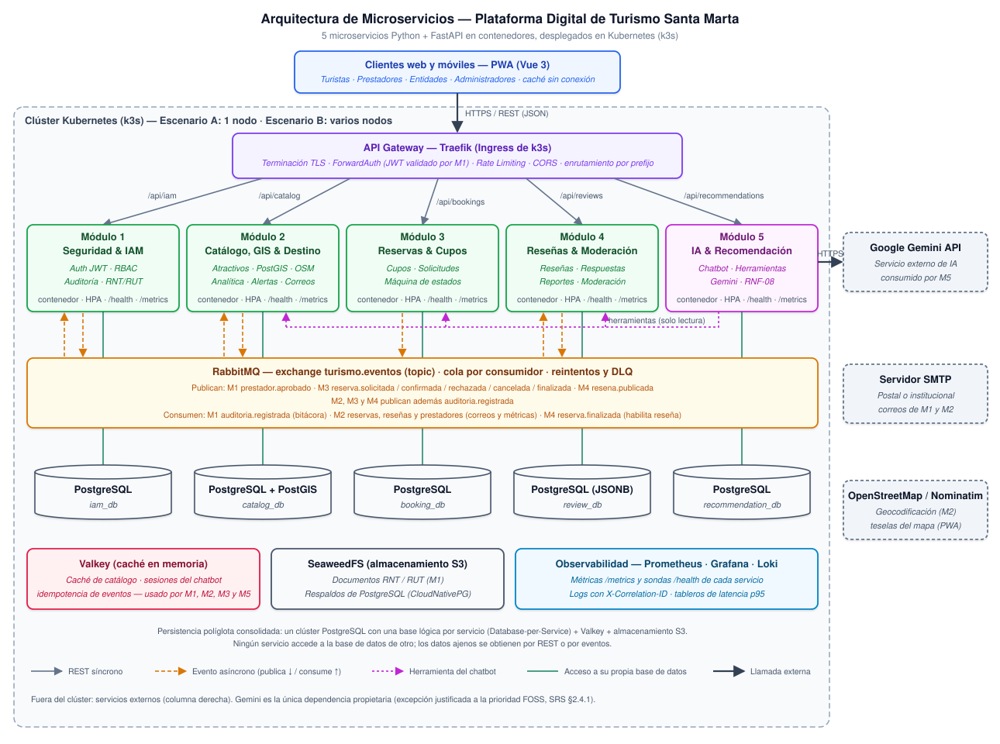
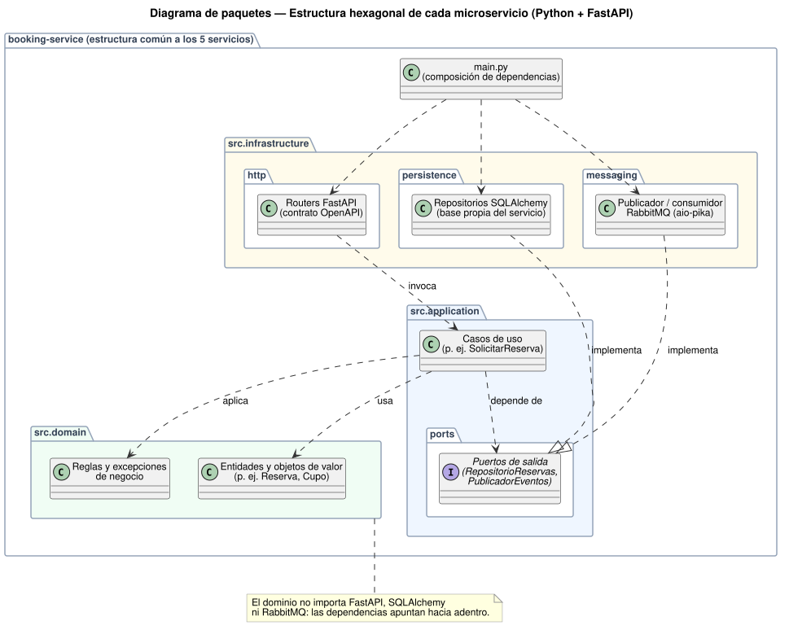
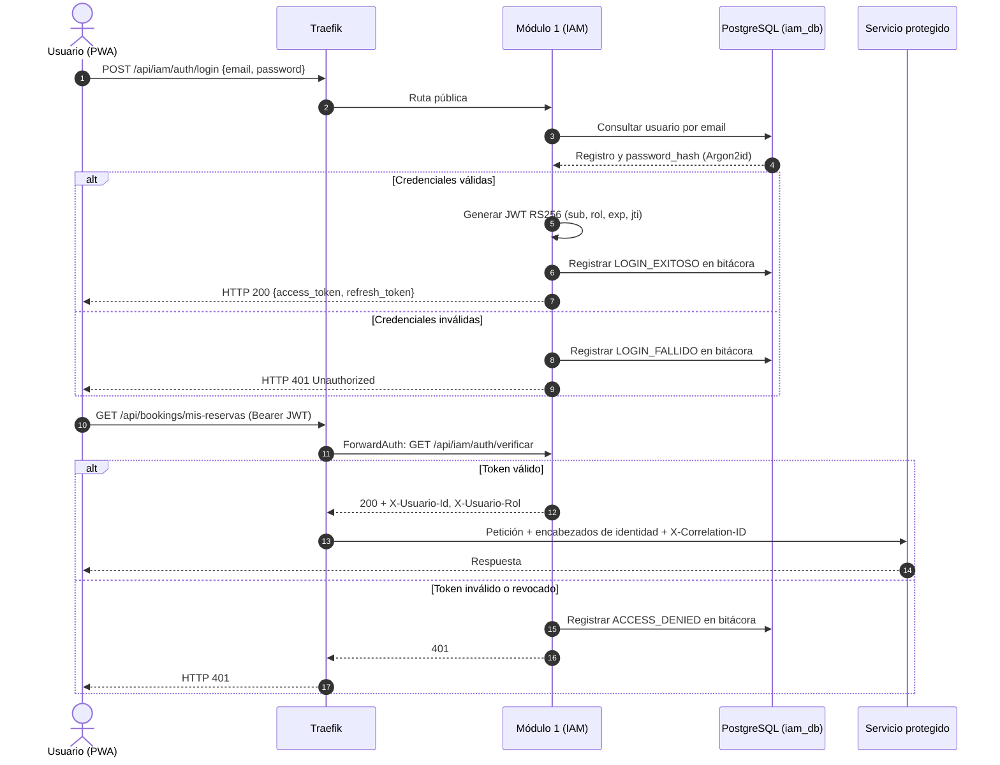
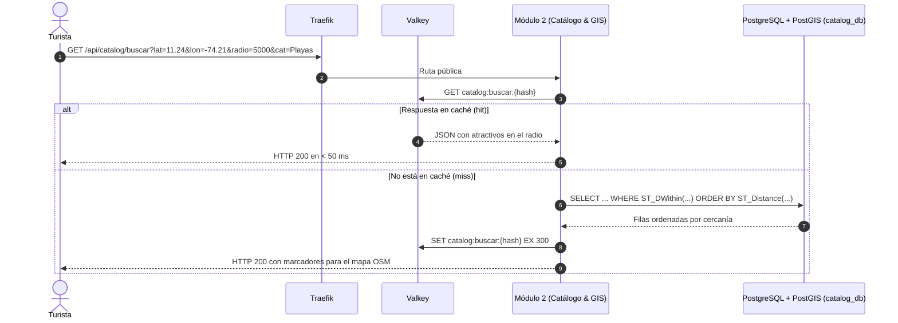
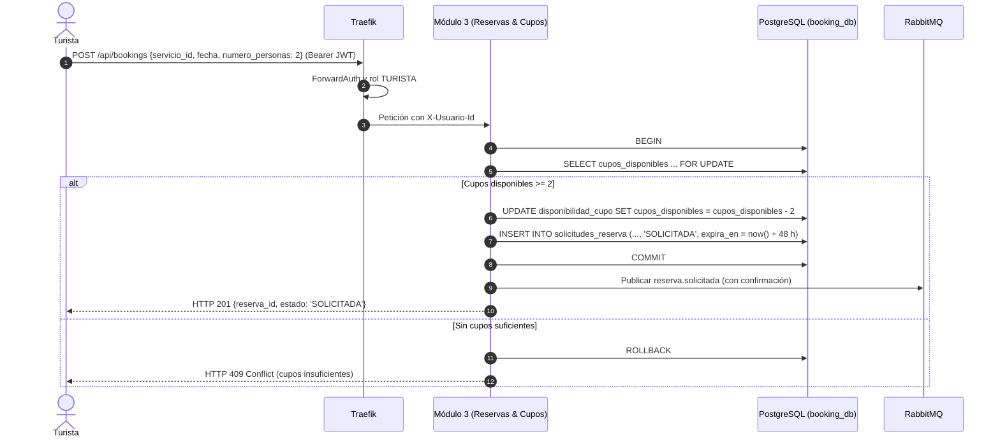
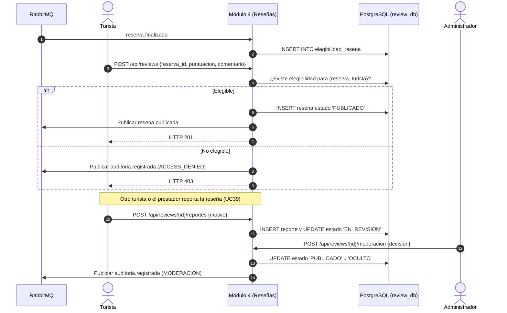
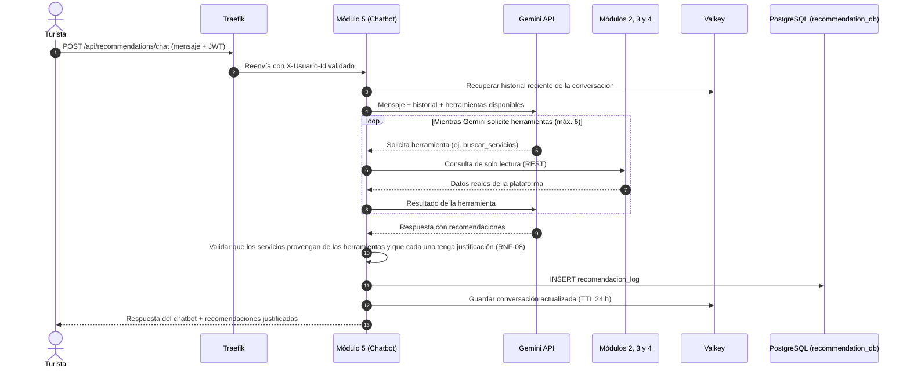
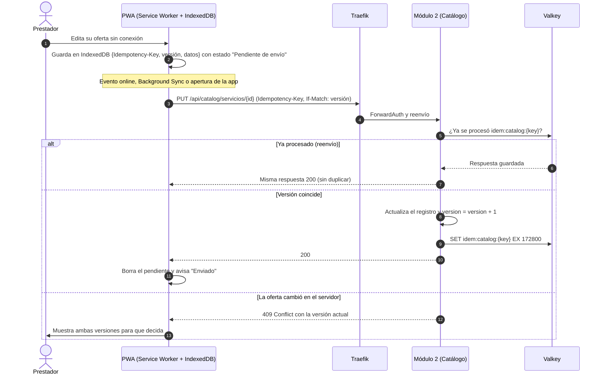
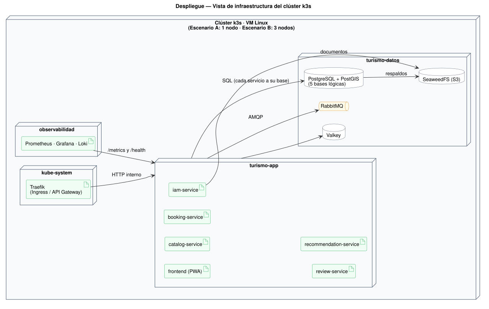

# Plan de Implementación y Funcionamiento Interno
## Plataforma Digital para la Gestión Integrada y Sostenible del Turismo en Santa Marta

**Curso:** Arquitectura de Software — Experiencia Final de Diseño  
**Programa:** Ingeniería de Sistemas — Universidad del Magdalena  
**Versión:** 1.1 (Especificación Técnica Interna)  
**Fecha:** Octubre 2026  
**Documento Complementario de Alto Nivel:** [Especificación de Requerimientos de Software (SRS IEEE 29148)](./Requirements_docIEEE.md)  
**Decisiones de diseño:** [Registro de Decisiones Arquitectónicas](./Registro_Decisiones_Arquitectonicas.md)  

---

## Tabla de Contenido

* [1. Introducción y Enfoque de Implementación](#1-introducción-y-enfoque-de-implementación)
  * [1.1 Propósito del documento](#11-propósito-del-documento)
  * [1.2 Consolidación Arquitectónica: Unificación del Módulo 2 y Módulo 6](#12-consolidación-arquitectónica-unificación-del-módulo-2-y-módulo-6)
  * [1.3 Plataforma y Lenguaje](#13-plataforma-y-lenguaje)
* [2. Arquitectura Interna y Descomposición de Microservicios](#2-arquitectura-interna-y-descomposición-de-microservicios)
  * [2.1 Topología General de Servicios (5 Microservicios + Perímetro)](#21-topología-general-de-servicios-5-microservicios--perímetro)
  * [2.2 Estructura Interna por Microservicio (Arquitectura Hexagonal)](#22-estructura-interna-por-microservicio-arquitectura-hexagonal)
  * [2.3 Especificación Interna de cada Componente](#23-especificación-interna-de-cada-componente)
* [3. Stack Tecnológico Detallado y Decisiones FOSS](#3-stack-tecnológico-detallado-y-decisiones-foss)
  * [3.1 Matriz de Tecnologías y Versiones](#31-matriz-de-tecnologías-y-versiones)
  * [3.2 Justificación Técnica de Decisiones Abiertas](#32-justificación-técnica-de-decisiones-abiertas)
* [4. Mecanismos de Comunicación y Protocolos Internos](#4-mecanismos-de-comunicación-y-protocolos-internos)
  * [4.1 Comunicación Síncrona REST / HTTPS](#41-comunicación-síncrona-rest--https)
  * [4.2 Comunicación Asíncrona Orientada a Eventos (RabbitMQ)](#42-comunicación-asíncrona-orientada-a-eventos-rabbitmq)
  * [4.3 Idempotencia, Reintentos y DLQ](#43-idempotencia-reintentos-y-dlq)
  * [4.4 Auditoría Asíncrona](#44-auditoría-asíncrona)
* [5. Modelo de Persistencia (Database-per-Service)](#5-modelo-de-persistencia-database-per-service)
  * [5.1 Bases de Datos por Servicio](#51-bases-de-datos-por-servicio)
  * [5.2 Reglas de Diseño de Datos](#52-reglas-de-diseño-de-datos)
  * [5.3 Datos en Memoria y Objetos](#53-datos-en-memoria-y-objetos)
* [6. Flujos de Ejecución y Secuencias Internas Clave](#6-flujos-de-ejecución-y-secuencias-internas-clave)
  * [6.1 Flujo 1: Autenticación, ForwardAuth y Propagación de Identidad](#61-flujo-1-autenticación-forwardauth-y-propagación-de-identidad)
  * [6.2 Flujo 2: Búsqueda Geoespacial Indexada con PostGIS y Caché](#62-flujo-2-búsqueda-geoespacial-indexada-con-postgis-y-caché)
  * [6.3 Flujo 3: Transacción Atómica de Reserva y Bloqueo de Cupos](#63-flujo-3-transacción-atómica-de-reserva-y-bloqueo-de-cupos)
  * [6.4 Flujo 4: Máquina de Estados, Expiración y Finalización de Reservas](#64-flujo-4-máquina-de-estados-expiración-y-finalización-de-reservas)
  * [6.5 Flujo 5: Publicación, Reporte y Moderación de Reseñas](#65-flujo-5-publicación-reporte-y-moderación-de-reseñas)
  * [6.6 Flujo 6: Consulta al Chatbot de Recomendaciones con Gemini y Herramientas](#66-flujo-6-consulta-al-chatbot-de-recomendaciones-con-gemini-y-herramientas)
  * [6.7 Flujo 7: Analítica de Demanda por Eventos y Alertas Institucionales](#67-flujo-7-analítica-de-demanda-por-eventos-y-alertas-institucionales)
  * [6.8 Flujo 8: Sincronización de Formularios de la PWA sin Conexión](#68-flujo-8-sincronización-de-formularios-de-la-pwa-sin-conexión)
* [7. Entorno de Ejecución, Despliegue y Observabilidad](#7-entorno-de-ejecución-despliegue-y-observabilidad)
  * [7.1 Entorno de Desarrollo Local con Docker Compose](#71-entorno-de-desarrollo-local-con-docker-compose)
  * [7.2 Despliegue en Kubernetes (k3s)](#72-despliegue-en-kubernetes-k3s)
  * [7.3 Recursos por Microservicio](#73-recursos-por-microservicio)
  * [7.4 Red, Secretos y Seguridad](#74-red-secretos-y-seguridad)
  * [7.5 Telemetría y Monitoreo](#75-telemetría-y-monitoreo)
  * [7.6 Respaldos y Recuperación](#76-respaldos-y-recuperación)
* [8. Estrategia de Pruebas Internas y Validación de Carga](#8-estrategia-de-pruebas-internas-y-validación-de-carga)

---

## 1. Introducción y Enfoque de Implementación

### 1.1 Propósito del documento

El propósito del presente documento es detallar la **arquitectura técnica interna, los modelos de ejecución, los contratos de comunicación y los mecanismos de persistencia** que sustentan el desarrollo de la Plataforma Digital para la Gestión Integrada y Sostenible del Turismo en Santa Marta.

A diferencia de la [Especificación de Requerimientos de Software (SRS)](./Requirements_docIEEE.md), que se enfoca en la perspectiva de alto nivel (el *qué* del sistema, acuerdos de alcance, requerimientos funcionales, atributos de calidad y cronograma general), este Plan de Implementación define el **funcionamiento interno** (el *cómo* técnico, decisiones de bajo nivel, diseño de componentes, esquemas de bases de datos, manejo de concurrencia y despliegue físico). Las convenciones de este documento (nombres de eventos, rutas, bases de datos y puertos) son las mismas del monorepo (`contracts/`, `services/`, `infra/`).

---

### 1.2 Consolidación Arquitectónica: Unificación del Módulo 2 y Módulo 6

En la concepción original de la arquitectura se contemplaban 6 microservicios. No obstante, tras el análisis de cohesión funcional, acoplamiento de datos y viabilidad operativa para un equipo de 5 ingenieros en 13 semanas, **el Módulo 6 (Analítica & Destino) ha sido absorbido íntegramente por el Módulo 2 (Catálogo & GIS)**, pasando a denominarse:

> **Módulo 2: Catálogo, GIS & Inteligencia de Destino (Catalog, GIS & Destination Analytics Service)**

#### Justificación Técnica de la Fusión:
1. **Cohesión de Dominio y Co-localización de Datos:** Los indicadores analíticos (demanda por zonas, cálculo de presión sobre atractivos, capacidad de carga ambiental y generación de mapas de calor) operan sobre las mismas entidades geoespaciales y tablas de servicios que administra el catálogo. Separarlos en dos microservicios obligaba a duplicar esquemas espaciales o a realizar costosas consultas distribuidas a través de la red.
2. **Eficiencia en la Persistencia Espacial:** La extensión espacial **PostGIS** de PostgreSQL permite ejecutar funciones de agregación analítica espacial directa (`ST_DWithin`, `ST_ClusterKMeans`, densidades kernel) en la misma base de datos donde residen los puntos de interés turístico, optimizando drásticamente los tiempos de respuesta.
3. **Reducción de Sobrecarga Operativa:** Se reduce la cantidad de servicios a construir, desplegar y monitorear de 6 a **5 microservicios core**, disminuyendo el riesgo técnico **R-01** (curva de aprendizaje en microservicios) y simplificando la operación del clúster.

---

### 1.3 Plataforma y Lenguaje

* **Lenguaje y framework:** Los 5 microservicios se escriben en **Python 3.12 con FastAPI**, bajo orientación a objetos y arquitectura hexagonal (ADR-006). Cada servicio es una aplicación HTTP estándar (ASGI) que se ejecuta con Uvicorn dentro de un contenedor; no depende de una plataforma de ejecución concreta, por lo que el mismo código podría ejecutarse en otra plataforma de contenedores o *serverless* sin reescribirse.
* **Plataforma:** Todos los componentes se despliegan como contenedores en **Kubernetes (k3s)** (ADR-005). Docker Compose se usa solo como entorno de desarrollo local (Sección 7.1).
* **Frontend:** **PWA** en Vue.js 3 con Workbox para la operación sin conexión (ADR-004, Sección 6.8).

---

## 2. Arquitectura Interna y Descomposición de Microservicios

### 2.1 Topología General de Servicios (5 Microservicios + Perímetro)

La plataforma se organiza en **cinco microservicios desacoplados**, un **API Gateway perimetral (Traefik)** y una **infraestructura transversal de mensajería (RabbitMQ) y observabilidad (Prometheus, Grafana y Loki)**:



| Servicio | Módulo | Puerto interno | Prefijo en el Gateway | Base de datos | Responsable |
|---|---|---|---|---|---|
| `iam-service` | 1: Seguridad & IAM | `8001` | `/api/iam` | `iam_db` (PostgreSQL) + SeaweedFS | Valentina Nieves |
| `catalog-service` | 2: Catálogo, GIS & Destino | `8002` | `/api/catalog` | `catalog_db` (PostgreSQL + PostGIS) | Luis Barraza |
| `booking-service` | 3: Reservas & Cupos | `8003` | `/api/bookings` | `booking_db` (PostgreSQL) | Andres Gamero |
| `review-service` | 4: Reseñas & Moderación | `8004` | `/api/reviews` | `review_db` (PostgreSQL JSONB) | Luis Barraza |
| `recommendation-service` | 5: IA & Recomendación | `8005` | `/api/recommendations` | `recommendation_db` (PostgreSQL) + Valkey | Alvaro Ospino |

---

### 2.2 Estructura Interna por Microservicio (Arquitectura Hexagonal)

Cada microservicio del backend se organiza bajo los principios de **Arquitectura Hexagonal (Ports & Adapters)** para desacoplar las reglas de negocio de los detalles de infraestructura, frameworks y bases de datos. El dominio se modela con clases (entidades, objetos de valor y servicios de dominio) y no importa FastAPI, SQLAlchemy ni RabbitMQ:



```text
services/<servicio>/
├── Dockerfile
├── requirements.txt
├── src/
│   ├── main.py                    # Composición: crea la app FastAPI e inyecta los adaptadores
│   ├── domain/                    # Entidades, objetos de valor y reglas de negocio puras
│   ├── application/               # Casos de uso (una clase por caso de uso)
│   │   └── ports/                 # Interfaces (clases abstractas) de repositorios y publicadores
│   └── infrastructure/            # Adaptadores que implementan los puertos
│       ├── http/                  # Routers FastAPI y esquemas Pydantic (contrato OpenAPI)
│       ├── persistence/           # Repositorios SQLAlchemy sobre la base propia del servicio
│       └── messaging/             # Publicador y consumidores RabbitMQ (aio-pika)
├── k8s/                           # Deployment, Service y HPA del servicio
└── tests/
    ├── unit/
    └── integration/
```

---

### 2.3 Especificación Interna de cada Componente

#### 1. Módulo 1: Seguridad & IAM Service
* **Responsabilidad Interna:** Gestión centralizada del ciclo de vida de usuarios, autenticación basada en credenciales robustas, autorización por roles (RBAC), control documental de prestadores y bitácora de auditoría inmutable.
* **Mecanismos Internos:**
  * **Cifrado de Contraseñas:** Algoritmo **Argon2id** (configuración recomendada RFC 9106: memoria 64 MB, 3 iteraciones, 4 hilos de paralelismo) que previene ataques por fuerza bruta basados en GPU/ASIC.
  * **Emisión de Tokens:** JWT firmados con **RS256** (clave privada solo en el Módulo 1), con tiempo de vida corto (15 a 60 minutos para el Access Token). El Refresh Token dura 7 días, se rota en cada renovación y se revoca al cerrar sesión o al cambiar el rol del usuario (UC27); su `jti` revocado se guarda en Valkey hasta su expiración.
  * **Protección contra fuerza bruta:** No hay bloqueo de cuenta por intentos fallidos; la protección es el *rate limiting* por IP de Traefik (ADR-007) y cada `LOGIN_FALLIDO` queda en la bitácora.
  * **Verificación para el Gateway:** Endpoint `GET /api/iam/auth/verificar` usado por el middleware ForwardAuth de Traefik: valida firma, expiración y revocación, y responde con los encabezados `X-Usuario-Id` y `X-Usuario-Rol`. Un token inválido produce HTTP 401 y un registro en la bitácora.
  * **Verificación de Prestadores:** Los documentos RNT y RUT se guardan en SeaweedFS; al aprobar un prestador (UC28) se publica `prestador.aprobado`.
  * **Bitácora de Auditoría:** Sus propios eventos (`LOGIN_FALLIDO`, `ROL_MODIFICADO`, `PRESTADOR_VALIDADO`) se insertan en la misma transacción de la acción; los de los demás módulos llegan por el evento `auditoria.registrada` (Sección 4.4).

#### 2. Módulo 2: Catálogo, GIS & Inteligencia de Destino (Módulo Unificado)
* **Responsabilidad Interna:** Administración del catálogo turístico y de los perfiles de prestador, consultas espaciales con mapas libres, analítica agregada de demanda, estimación de capacidad de carga, alertas institucionales y correos transaccionales.
* **Mecanismos Internos:**
  * **Capa Geoespacial PostGIS:** Almacenamiento de puntos georreferenciados mediante el tipo nativo `GEOMETRY(Point, 4326)`. Búsquedas por radio y proximidad ejecutadas mediante la función `ST_DWithin` optimizada con índices espaciales `GIST`.
  * **Caché de Segundo Nivel:** Consultas de alto tráfico (catálogo general y listados de categorías) cacheadas en **Valkey** con un tiempo de expiración (TTL) de 300 segundos, invalidándose ante mutaciones del catálogo.
  * **Perfiles de Prestador:** Se crean al consumir `prestador.aprobado`; solo un prestador con perfil activo puede publicar ofertas (UC17).
  * **Analítica de Demanda por Eventos:** El módulo consume los eventos `reserva.*` y mantiene su propia proyección `reserva_proyeccion` (Sección 6.7). No consulta `booking_db`.
  * **Índice de Saturación:**
    $$\text{Índice de Saturación} = \frac{\sum \text{Personas con reserva activa}}{\text{Capacidad de Carga Oficial}}$$
    Si el índice supera el 85%, el atractivo se marca con bandera de advertencia y se habilita al rol Entidad para emitir alertas oficiales (UC26).
  * **Notificaciones Transaccionales (SMTP):** Consumidor que escucha los eventos de reservas y envía correos HTML con plantillas embebidas mediante conexión SMTP segura (TLS).

#### 3. Módulo 3: Reservas & Cupos (Bookings & Availability Service)
* **Responsabilidad Interna:** Motor transaccional de alta consistencia para consulta, bloqueo y gestión del ciclo de vida de las reservas.
* **Mecanismos Internos:**
  * **Control de Concurrencia y Bloqueo Atómico:** Para evitar condiciones de carrera (*race conditions*) y sobreventa (*overbooking*), las operaciones de reserva ejecutan una consulta de actualización con bloqueo pesimista a nivel de fila en PostgreSQL:
    ```sql
    SELECT cupos_disponibles FROM disponibilidad_cupo 
    WHERE servicio_id = $1 AND fecha = $2 
    FOR UPDATE;
    ```
    Si `cupos_disponibles >= personas_solicitadas`, se descuentan los cupos atómicamente y se inserta la solicitud de reserva en estado `SOLICITADA` dentro de la misma transacción.
  * **Máquina de Estados:** La clase de dominio `Reserva` solo permite las transiciones de la Sección 6.4; cualquier otra devuelve HTTP 409.
  * **Tareas Programadas:** Un `CronJob` de Kubernetes ejecuta cada 15 minutos la expiración de solicitudes vencidas y la finalización de reservas cuya fecha ya pasó.
  * **Publicador de Eventos de Dominio:** Cada transición publica su evento (`reserva.solicitada`, `reserva.confirmada`, `reserva.rechazada`, `reserva.cancelada`, `reserva.finalizada`) después de confirmar la transacción.

#### 4. Módulo 4: Reseñas & Moderación (Reviews & Moderation Service)
* **Responsabilidad Interna:** Captura de opiniones y calificaciones de turistas con reservas finalizadas, réplicas de prestadores, reportes de contenido y moderación manual.
* **Mecanismos Internos:**
  * **Elegibilidad:** El módulo consume `reserva.finalizada` y guarda en `elegibilidad_resena` qué turista puede reseñar qué servicio. Sin ese registro, la reseña se rechaza con HTTP 403.
  * **Moderación posterior:** Las reseñas se publican de inmediato con estado `PUBLICADO`. Un turista o prestador puede reportarlas (UC39); al recibir un reporte pasan a `EN_REVISION` y quedan ocultas hasta que el Administrador las publica de nuevo u oculta definitivamente (UC29).
  * **Almacenamiento Documental:** Tabla con columnas `JSONB` en PostgreSQL para las calificaciones multidimensionales (limpieza, guianza, relación calidad-precio) y la respuesta anidada del prestador.

#### 5. Módulo 5: IA & Recomendación (AI Recommendation Chatbot)
* **Responsabilidad Interna:** Chatbot turístico que atiende consultas en lenguaje natural (español e inglés) y entrega recomendaciones personalizadas y justificadas (RNF-08). Usa la API de Gemini como modelo de lenguaje; el equipo no entrena ni aloja ningún modelo.
* **Mecanismos Internos:**
  * **Herramientas de consulta (*tools*):** Funciones de solo lectura que el servicio declara a Gemini y ejecuta cuando el modelo las solicita. Consultan catálogo, disponibilidad, historial del turista, reseñas, capacidad de carga y alertas oficiales a través de los contratos REST de los Módulos 2, 3 y 4.
  * **Respuestas ancladas en datos:** Lo que el chatbot afirma sobre servicios, precios, disponibilidad o reseñas proviene de las herramientas, no de la memoria del modelo; se descartan los servicios recomendados que no hayan sido consultados.
  * **Identidad controlada por el servidor:** El identificador del turista llega en el encabezado `X-Usuario-Id` que agrega el gateway; el modelo nunca lo decide ni lo recibe como parámetro.
  * **Memoria de sesión:** La conversación reciente (últimos 10 mensajes) se conserva en Valkey con expiración de 24 horas.
  * **Explicabilidad y registro (RNF-08):** Cada recomendación incluye su justificación y se registra en la tabla `recomendacion_log` de `recommendation_db`.
  * **Aislamiento ante fallos:** Si Gemini no está disponible, solo falla el chatbot; el catálogo y las reservas siguen operando (ESC-01). El Deployment mantiene al menos una réplica activa (RNF-12).
* **Alcance:** No crea, modifica ni cancela reservas desde el chat; orienta al turista hacia las pantallas de la plataforma. Detalle técnico en la [Guía Técnica del Módulo 5](./Guia_Tecnica_Modulo_IA.md).

---

## 3. Stack Tecnológico Detallado y Decisiones FOSS

### 3.1 Matriz de Tecnologías y Versiones

| Capa / Componente | Tecnología Seleccionada | Versión | Licencia | Rol en la Arquitectura |
|---|---|---|---|---|
| **API Gateway & Ingress** | **Traefik** | v3 | MIT | Terminación TLS, enrutamiento por prefijo, ForwardAuth, Rate Limiting y CORS. Incluido por defecto en k3s. |
| **Backend (Módulos 1 a 5)** | **Python + FastAPI**, Uvicorn, Pydantic v2, SQLAlchemy 2, aio-pika | Python 3.12 | PSF / MIT / BSD / Apache 2.0 | Microservicios REST orientados a objetos con arquitectura hexagonal. |
| **Integración de IA (Módulo 5)** | **API de Google Gemini** (SDK `google-genai`) | Modelo configurable por variable de entorno | Términos comerciales de Google (servicio externo, no FOSS) | Modelo de lenguaje con llamada a funciones para el chatbot. |
| **Base de Datos Relacional / GIS / Documental** | **PostgreSQL + PostGIS** (JSONB) con **CloudNativePG** | PG 16 / PostGIS 3.4 | PostgreSQL / GPL-2.0 / Apache 2.0 | Persistencia ACID de los 5 servicios, consultas geoespaciales y documentos de reseñas. |
| **Caché en Memoria** | **Valkey** | 8 | BSD-3-Clause | Caché de catálogo, sesiones del chatbot, tokens revocados e idempotencia. |
| **Almacenamiento de Objetos** | **SeaweedFS** (API S3) | 3.x | Apache 2.0 | Documentos RNT/RUT y respaldos de PostgreSQL. |
| **Message Broker (Event Bus)** | **RabbitMQ** | 4 | MPL 2.0 | Bus de mensajería AMQP 0-9-1 para eventos desacoplados. |
| **Cartografía y Mapas Web** | **OpenStreetMap + Leaflet.js** | Leaflet 1.9+ | ODbL / BSD-2-Clause | Mapas interactivos sin costos comerciales por consulta. |
| **Frontend Web** | **Vue.js 3 + Vite + Workbox** (PWA) | Vue 3 | MIT | Interfaz responsiva, accesible (WCAG 2.1 AA), bilingüe y con operación sin conexión. |
| **Contenedores y Orquestación** | **Docker** (construcción de imágenes) y **k3s** (Kubernetes) | k3s estable | Apache 2.0 | Despliegue declarativo, HPA, *rolling updates* y autorreparación. Docker Compose solo en desarrollo. |
| **Observabilidad** | **Prometheus + Grafana + Loki** | Prometheus 3 / Grafana 12 / Loki 3 | Apache 2.0 / AGPL-3.0 | Métricas, tableros de salud y registros centralizados. |
| **Pruebas de carga** | **k6** | 1.x | AGPL-3.0 | Validación de ESC-02 y ESC-08. |

---

### 3.2 Justificación Técnica de Decisiones Abiertas

1. **Adopción de Valkey frente a Redis:** En 2024, Redis cambió su modelo de licenciamiento a licencias no aprobadas por la OSI (RSALv2 / SSPL). Para preservar el compromiso con el software libre y la compatibilidad de protocolo (`redis-cli`, librerías cliente), se adopta **Valkey**, bifurcación comunitaria bajo licencia BSD-3-Clause respaldada por la Linux Foundation.
2. **PostGIS como núcleo analítico y de catálogo:** Al unificar el Módulo 6 dentro del Módulo 2, PostGIS se convierte en el motor analítico central. Permite cálculos espaciales de proximidad y clusters de saturación directamente en el motor de base de datos sin requerir herramientas analíticas de terceros.
3. **Reseñas en PostgreSQL JSONB en lugar de MongoDB:** MongoDB Community se distribuye bajo SSPL, licencia que la OSI no reconoce como de código abierto, lo que contradice la prioridad FOSS del proyecto. JSONB ofrece el modelo documental que necesitan las reseñas (calificaciones variables y respuestas anidadas, con índices `GIN`) sin agregar un motor más que operar, respaldar y monitorear (ADR-003). Si el volumen de reseñas lo exigiera, FerretDB (Apache 2.0) permite exponer una API compatible con MongoDB sobre PostgreSQL.
4. **Traefik como API Gateway:** Viene incluido en k3s como controlador de Ingress, configura rutas y middlewares (ForwardAuth, RateLimit, CORS) con recursos de Kubernetes y evita operar un proxy adicional (ADR-007).
5. **Python en los 5 servicios:** Un solo lenguaje reduce la curva de aprendizaje (R-01), permite compartir la plantilla base y las prácticas de pruebas, y es el lenguaje natural del chatbot (ADR-006).

---

## 4. Mecanismos de Comunicación y Protocolos Internos

### 4.1 Comunicación Síncrona REST / HTTPS

Las peticiones de la PWA interactúan exclusivamente con el **API Gateway (Traefik)** a través de HTTPS. Traefik termina TLS, aplica los middlewares y enruta por prefijo al Service de Kubernetes de cada microservicio:

| Prefijo | Servicio destino | Autenticación |
|---|---|---|
| `/api/iam/auth/login`, `/api/iam/auth/registro`, `/api/iam/auth/recuperar` | `iam-service:8001` | Pública |
| `POST /api/iam/auth/refresh` *(propuesta, contrato en Fase 4)* | `iam-service:8001` | Pública (requiere refresh token) |
| `POST /api/iam/auth/logout` *(propuesta, contrato en Fase 4)* | `iam-service:8001` | ForwardAuth |
| `/api/iam/...` (resto) | `iam-service:8001` | ForwardAuth |
| `/api/catalog/servicios`, `/api/catalog/buscar`, `/api/catalog/alertas` (GET) | `catalog-service:8002` | Pública (RF-01) |
| `GET /api/catalog/analitica/capacidad?zona=` *(propuesta, contrato en Fase 4)* | `catalog-service:8002` | ForwardAuth (la usa la tool `presion_capacidad_carga` del Módulo 5) |
| `/api/catalog/...` (resto, incluye `/api/catalog/analitica`) | `catalog-service:8002` | ForwardAuth |
| `/api/bookings/disponibilidad` (GET) | `booking-service:8003` | Pública |
| `/api/bookings/...` (resto) | `booking-service:8003` | ForwardAuth |
| `GET /api/reviews/servicios/{id}` *(propuesta, contrato en Fase 4)* | `review-service:8004` | Pública (la usa la tool `resenas_servicio`) |
| `/api/reviews/...` (GET públicos, escritura protegida) | `review-service:8004` | Mixta |
| `/api/recommendations/chat` | `recommendation-service:8005` | ForwardAuth |

Convenciones:
* **Identidad:** En las rutas protegidas, Traefik consulta `GET /api/iam/auth/verificar` (ForwardAuth). Si la respuesta es 200, reenvía la petición agregando `X-Usuario-Id` y `X-Usuario-Rol`; los servicios confían en esos encabezados porque las políticas de red solo permiten tráfico desde Traefik y desde el Módulo 5 (Sección 7.4). Cada servicio verifica el rol requerido por su endpoint (RBAC) y responde 403 si no corresponde.
* **Llamadas entre servicios:** Solo el Módulo 5 llama a otros servicios (sus herramientas), con el `X-Usuario-Id` original de la petición. **Única excepción:** el worker del Módulo 2 consulta a iam los datos de contacto de un usuario (`GET /internal/usuarios/{id}/contacto`, `contracts/openapi/iam-interno.yaml`) para enviar los correos de reservas (UC36), porque los eventos solo llevan identificadores y los datos personales no viajan por el bus (Sección 4.2). Es una ruta interna, sin gateway, y si iam no responde el correo se reintenta sin afectar a los usuarios.
* **Errores:** Formato común `{ "error": "<CODIGO>", "message": "<texto>", "correlation_id": "<id>" }`.
* **Trazabilidad y Correlación:** Cada petición entrante en el gateway recibe un identificador en la cabecera `X-Correlation-ID`, que se propaga a las llamadas internas y a los eventos y se registra en los logs de todos los servicios.
* **Idempotencia de formularios:** Los `POST`/`PUT` que la PWA puede reintentar aceptan el encabezado `Idempotency-Key` (Sección 6.8).

---

### 4.2 Comunicación Asíncrona Orientada a Eventos (RabbitMQ)

Para que las tareas secundarias (correos, métricas, habilitación de reseñas, auditoría) no bloqueen las peticiones de los usuarios, se usa **RabbitMQ**:

* **Exchange:** `turismo.eventos` (tipo `topic`, durable). La clave de enrutamiento es el `event_type` (por ejemplo `reserva.confirmada`).
* **Colas:** Cada consumidor declara su propia cola durable (`<servicio>.<propósito>`) y la enlaza a las claves que le interesan; un consumidor caído no afecta a los demás.
* **Contratos:** Sobre común `envelope.v1.json` y un esquema JSON por evento en `contracts/events/` del monorepo.

| Evento (routing key) | Productor | Cola consumidora | Consumidor | Acción ejecutada |
|---|---|---|---|---|
| `reserva.solicitada` | booking-service | `catalog.notificaciones`, `catalog.demanda` | catalog-service | Avisa al prestador por correo; suma a la demanda del día. |
| `reserva.confirmada` | booking-service | `catalog.notificaciones`, `catalog.demanda` | catalog-service | Correo de confirmación al turista (UC36); actualiza métricas. |
| `reserva.rechazada` | booking-service | `catalog.notificaciones`, `catalog.demanda` | catalog-service | Correo al turista; resta de la demanda. |
| `reserva.cancelada` | booking-service | `catalog.notificaciones`, `catalog.demanda` | catalog-service | Correo a la otra parte; resta de la demanda. |
| `reserva.finalizada` | booking-service | `review.elegibilidad`, `catalog.demanda` | review-service, catalog-service | Habilita la reseña del turista; registra ocupación efectiva. |
| `disponibilidad.actualizada` | booking-service | `catalog.disponibilidad` | catalog-service | Guarda los cupos del servicio ese día para filtrar la búsqueda y el mapa por fecha y personas sin llamar a booking. Booking lo publica al cambiar el calendario (UC19) o los cupos por una reserva. |
| `resena.publicada` | review-service | `catalog.calificaciones` | catalog-service | Actualiza calificación promedio y métricas del prestador (UC22). |
| `resena.ocultada` | review-service | `catalog.calificaciones` | catalog-service | Quita del promedio la reseña que el Administrador ocultó al moderarla (UC29); si se vuelve a publicar, vuelve a contar. |
| `prestador.aprobado` | iam-service | `catalog.prestadores` | catalog-service | Crea el perfil del prestador y habilita UC17. |
| `auditoria.registrada` | catalog, booking y review | `iam.auditoria` | iam-service | Inserta el evento en la bitácora (Sección 4.4). |

> El Módulo 5 no participa en el bus de eventos: obtiene los datos que necesita bajo demanda mediante sus herramientas de consulta.

#### Esquema Estándar de Mensaje JSON:
```json
{
  "event_id": "a7b3c94d-5821-4bfe-98e3-0d2938174201",
  "event_type": "reserva.confirmada",
  "version": 1,
  "occurred_at": "2026-10-12T16:20:00Z",
  "producer": "booking-service",
  "correlation_id": "corr-88de-5c16-1e3d-4a4f",
  "payload": {
    "reserva_id": "c4d8e219-9f7a-4b02-861d-910283746192",
    "servicio_id": "0b6f1a52-3c1e-4c8e-9f0a-7d2a91c4e5b3",
    "turista_id": "5e2d7c10-8a4b-4f61-b3d2-1c9e0f7a6b54",
    "prestador_id": "9a1c3e5f-2b4d-4c6e-8f0a-1b3d5f7a9c2e",
    "fecha_reserva": "2026-11-05",
    "numero_personas": 2
  }
}
```

Los eventos solo llevan identificadores; el consumidor que necesita datos de contacto (por ejemplo, el correo del turista para UC36) los obtiene por REST del servicio dueño, de modo que los datos personales no viajan por el bus.

---

### 4.3 Idempotencia, Reintentos y DLQ

Para prevenir efectos secundarios no deseados causados por la entrega repetida de mensajes en el bus:

1. **Confirmación de publicación (patrón outbox):** El evento se guarda en la tabla `outbox` del servicio en la misma transacción que el cambio. Un *worker* aparte lo publica con *publisher confirms* y mensajes persistentes y solo lo marca como publicado cuando el broker confirma; si no confirma, el evento sigue en la tabla y se reintenta con espera creciente (ADR-008).
2. **Identificador de Idempotencia:** Cada consumidor guarda el `event_id` procesado en la tabla `evento_procesado` de su propia base, en la misma transacción que aplica el efecto. Si llega un mensaje con un `event_id` ya existente, se reconoce (`ACK`) y se descarta su reejecución. *Al programar el Módulo 2 nos dimos cuenta de que era más sencillo y más seguro guardarlo en la tabla que en Valkey con TTL de 24 h: efecto y registro se confirman juntos y no vencen.*
3. **Dead Letter Queue (DLQ):** Los mensajes que fallan tras 3 intentos con retroceso exponencial (1s, 5s, 25s) se enrutan al exchange `turismo.dlx` y quedan en la cola `turismo.dead-letter` para análisis del equipo.

---

### 4.4 Auditoría Asíncrona

* **Dueño único:** El Módulo 1 es el único que escribe en `bitacora_auditoria` (`iam_db`).
* **Eventos propios:** El Módulo 1 inserta sus eventos en la misma transacción que la acción (por ejemplo, el cambio de rol y su registro se confirman juntos).
* **Eventos de otros módulos:** catalog, booking y review publican `auditoria.registrada` (accesos denegados por rol, exportaciones, cambios de estado de reservas, decisiones de moderación). La cola `iam.auditoria` los inserta en la bitácora.
* **Sin duplicados:** La tabla tiene una restricción `UNIQUE` sobre `event_id`, de modo que un evento reentregado (la entrega es "al menos una vez", Sección 4.3) no se inserta dos veces: el consumidor lo reconoce (`ACK`) y lo descarta.
* **Accesos con token inválido (ESC-04):** Los detecta el endpoint de verificación de ForwardAuth, que pertenece al Módulo 1 y los registra directamente.
* **Inmutabilidad:** El usuario de base de datos del servicio solo tiene permisos de inserción y consulta sobre la tabla (Sección 5.2).
* **Garantía de entrega:** Los productores usan el patrón *outbox* (Sección 4.3): el evento se guarda en una tabla de su propia base en la misma transacción y un *worker* lo publica después. catalog-service lo adoptó al implementarse, porque un fallo entre el commit y la publicación perdía el evento; se recomienda lo mismo a booking y review (ADR-008).

---

## 5. Modelo de Persistencia (Database-per-Service)

La decisión de persistencia (políglota consolidada) y sus alternativas están en el ADR-003; el modelo conceptual de entidades, en el [SRS §3.7](./Requirements_docIEEE.md#37-modelo-de-datos-preliminar). Esta sección define cómo se reparten los datos entre servicios; el esquema físico detallado (DDL) se construye en la Fase 4 a partir de este modelo.

### 5.1 Bases de Datos por Servicio

Las cinco bases son bases lógicas dentro de un mismo clúster PostgreSQL (CloudNativePG), cada una con un usuario propio que solo tiene permisos sobre ella.

| Base | Dueño | Modelo | Entidades principales |
|---|---|---|---|
| `iam_db` | iam-service | Relacional | `USUARIO`, `DOCUMENTO_VERIFICACION`, `BITACORA_AUDITORIA` |
| `catalog_db` | catalog-service | Relacional + geoespacial (PostGIS) | `PRESTADOR_PERFIL`, `ATRACTIVO_SERVICIO`, `ALERTA_OFICIAL`, proyección `reserva_proyeccion` |
| `booking_db` | booking-service | Relacional (ACID) | `DISPONIBILIDAD_CUPO`, `SOLICITUD_RESERVA` |
| `review_db` | review-service | Documental (JSONB) | `RESENA_OPINION`, `REPORTE_RESENA`, proyección `elegibilidad_resena` |
| `recommendation_db` | recommendation-service | Relacional | `RECOMENDACION_LOG` |

### 5.2 Reglas de Diseño de Datos

* **Sin acceso cruzado:** Ningún servicio lee la base de otro. Las referencias a entidades ajenas (por ejemplo, `servicio_id` en `booking_db`) son identificadores sin llave foránea; los datos que se necesitan de otro servicio se obtienen por REST o se mantienen como **proyecciones locales** alimentadas por eventos (`reserva_proyeccion` desde `reserva.*`; `elegibilidad_resena` desde `reserva.finalizada`; `PRESTADOR_PERFIL` desde `prestador.aprobado`).
* **Bitácora inmutable (RNF-10):** El usuario de aplicación de `iam_db` solo tiene permisos de inserción y consulta sobre la bitácora.
* **Consistencia de cupos:** Las operaciones de reserva bloquean la fila de disponibilidad dentro de una transacción (Sección 2.3, Módulo 3).
* **Concurrencia optimista:** Las entidades que la PWA puede editar sin conexión (oferta y cupos) llevan un número de versión para detectar conflictos (Sección 6.8).
* **Privacidad:** `recommendation_db` guarda la justificación y las herramientas usadas, no el texto de las conversaciones (Ley 1581).

### 5.3 Datos en Memoria y Objetos

* **Valkey:** caché del catálogo, sesiones del chatbot (TTL de 24 h), tokens revocados, idempotencia de eventos y de formularios reenviados por la PWA. El *rate limiting* lo aplica Traefik.
* **SeaweedFS (API S3):** documentos RNT/RUT (acceso solo mediante URLs firmadas para el Administrador), imágenes del catálogo y respaldos de PostgreSQL.

---

## 6. Flujos de Ejecución y Secuencias Internas Clave

### 6.1 Flujo 1: Autenticación, ForwardAuth y Propagación de Identidad



---

### 6.2 Flujo 2: Búsqueda Geoespacial Indexada con PostGIS y Caché



---

### 6.3 Flujo 3: Transacción Atómica de Reserva y Bloqueo de Cupos



---

### 6.4 Flujo 4: Máquina de Estados, Expiración y Finalización de Reservas



| Transición | Quién la ejecuta | Endpoint o proceso | Cupos | Evento |
|---|---|---|---|---|
| (inicio) → `SOLICITADA` | Turista (UC11) | `POST /api/bookings` | Descuenta | `reserva.solicitada` |
| `SOLICITADA` → `CONFIRMADA` | Prestador (UC20) | `POST /api/bookings/{id}/confirmar` | — | `reserva.confirmada` |
| `SOLICITADA` → `RECHAZADA` | Prestador (UC20) | `POST /api/bookings/{id}/rechazar` | Libera | `reserva.rechazada` |
| `SOLICITADA` → `RECHAZADA` | Sistema (plazo de 48 h vencido) | CronJob `expirar-solicitudes` | Libera | `reserva.rechazada` (motivo: plazo vencido) |
| `SOLICITADA` → `CANCELADA` | Turista (UC12) | `POST /api/bookings/{id}/cancelar` | Libera | `reserva.cancelada` |
| `CONFIRMADA` → `CANCELADA` | Turista o prestador, según la política publicada | `POST /api/bookings/{id}/cancelar` | Libera | `reserva.cancelada` |
| `CONFIRMADA` → `FINALIZADA` | Sistema (fecha de la reserva superada) | CronJob `finalizar-reservas` | — | `reserva.finalizada` |

El CronJob se ejecuta cada 15 minutos con `UPDATE ... WHERE estado = 'SOLICITADA' AND expira_en < now() RETURNING *`, libera los cupos de cada fila devuelta en la misma transacción y luego publica los eventos. La modificación de una reserva (UC12) solo se permite en `SOLICITADA` y ajusta los cupos dentro de una transacción con bloqueo.

---

### 6.5 Flujo 5: Publicación, Reporte y Moderación de Reseñas



---

### 6.6 Flujo 6: Consulta al Chatbot de Recomendaciones con Gemini y Herramientas



---

### 6.7 Flujo 7: Analítica de Demanda por Eventos y Alertas Institucionales

Al estar unificado en el **Módulo 2 (Catálogo, GIS & Inteligencia de Destino)**:

1. **Proyección de demanda:** El consumidor `catalog.demanda` guarda en `reserva_proyeccion` el **estado actual de cada reserva** (servicio, fecha, personas, estado y momento del último evento aplicado) con cada evento `reserva.*`; un evento solo se aplica si ocurrió después del último aplicado. La demanda de un día es la suma de personas de las reservas activas (Solicitada y Confirmada) de esa fecha, con el índice `(fecha_reserva, servicio_id)`. La idempotencia por `event_id` (tabla `evento_procesado`) evita aplicar dos veces el mismo evento. El Módulo 2 nunca consulta `booking_db`.
   *Al programar el Módulo 2 nos dimos cuenta de que era más seguro guardar el estado de cada reserva que llevar contadores en una tabla `demanda_diaria` (sumar al solicitar, restar al cancelar…): con contadores, un evento repetido o que llega desordenado por un reintento suma o resta de más y el número queda mal para siempre; con el estado por reserva, el resultado siempre es correcto.*
2. **Cálculo de aforos:** Al consultar (`/analitica/capacidad`, mapa de calor) se compara la demanda activa por fecha y zona con `capacidad_aforo_diario` y se calcula el índice de saturación, con caché de 5 minutos en Valkey (`calculado_en` indica de cuándo es el dato).
   *Al programar el Módulo 2 nos dimos cuenta de que era más sencillo y más fresco calcularlo al consultar que con un CronJob cada 30 minutos: la suma por día usa el índice de `reserva_proyeccion`, se consulta poco (la Entidad y el chatbot) y no hace falta una tabla de resultados. Las tareas de mantenimiento del módulo (limpieza del outbox y de la disponibilidad de días pasados) corren en su worker.*
3. **Mapa de calor:** El backend transforma coordenadas y porcentajes de saturación a **GeoJSON** para su visualización en Leaflet.js por parte de la Entidad de Gestión.
4. **Alertas:** Cuando la Entidad emite una alerta (UC26), se inserta en `alertas_oficiales`; la PWA la muestra en el mapa y el chatbot la consulta con la herramienta `alertas_oficiales` antes de recomendar una zona.

---

### 6.8 Flujo 8: Sincronización de Formularios de la PWA sin Conexión

Formularios con envío diferido: perfil (UC4), reseña (UC15), registro y edición de oferta (UC17, UC18) y cupos y tarifas (UC19). Solicitar y confirmar reservas (UC11, UC20) requieren conexión.



**Estrategias de caché del Service Worker (Workbox):**

| Recurso | Estrategia | Detalle |
|---|---|---|
| Aplicación (HTML, JS, CSS, traducciones) | *Precache* + *cache first* | Se actualiza con cada versión publicada. |
| `GET /api/catalog/servicios`, `/buscar`, `/alertas` | *Stale-while-revalidate* | Máximo 7 días; la interfaz muestra la fecha de la última actualización. |
| Teselas del mapa de OSM | *Cache first* solo para teselas visualizadas | Sin descarga masiva, según la política de uso de OSM. |
| Rutas autenticadas | *Network only* | Los datos personales no se cachean; los borradores en IndexedDB se eliminan al cerrar sesión. |

---

## 7. Entorno de Ejecución, Despliegue y Observabilidad

### 7.1 Entorno de Desarrollo Local con Docker Compose

Para el desarrollo, el archivo `infra/docker-compose.yml` del monorepo levanta la infraestructura compartida (PostgreSQL con PostGIS y las cinco bases, Valkey, RabbitMQ, Traefik, Prometheus y Grafana), y cada servicio se agrega con su `Dockerfile` cuando está listo:

```bash
cd infra
cp .env.example .env
docker compose up -d
```

Docker Compose **no** es el entorno de despliegue del prototipo: no ofrece escalado automático ni *rolling updates*, que son necesarios para ESC-05 y ESC-08. Para probar esos escenarios en local se usa un clúster k3d (k3s en contenedores).

---

### 7.2 Despliegue en Kubernetes (k3s)



Las vistas de despliegue por actor (Turista, Prestador, Entidad y Administrador) están en el [SRS §3.6.5](./Requirements_docIEEE.md#365-despliegue-y-operación).

* **Clúster:** k3s sobre máquinas virtuales Linux de bajo costo. Escenario A (prototipo): 1 nodo de 4 vCPU y 8 GB de RAM. Escenario B (piloto): 3 nodos para alta disponibilidad.
* **Espacios de nombres:**

| Namespace | Contenido |
|---|---|
| `kube-system` | Traefik (Ingress de k3s), cert-manager para certificados TLS. |
| `turismo-app` | `frontend`, los 5 microservicios, los CronJobs del Módulo 3 y el worker del Módulo 2. |
| `turismo-datos` | Clúster PostgreSQL (CloudNativePG), Valkey, RabbitMQ y SeaweedFS. |
| `observabilidad` | Prometheus, Grafana, Loki y Blackbox exporter. |

* **Manifiestos:** Cada servicio tiene su carpeta `k8s/` (Deployment, Service, HPA) basada en `templates/service-template/k8s/`; la infraestructura compartida está en `infra/k8s/`. Se aplican con `kubectl apply -k` (Kustomize).
* **Imágenes:** GitHub Actions construye la imagen de cada servicio y la publica en GitHub Container Registry con la etiqueta del commit.
* **Actualizaciones:** Estrategia `RollingUpdate` con `maxUnavailable: 0` y `maxSurge: 1`, de modo que siempre hay réplicas atendiendo (ESC-05, RNF-12).

---

### 7.3 Recursos por Microservicio

| Servicio | Réplicas mínimas | HPA (máx., objetivo de CPU) | Sondas | Notas |
|---|---|---|---|---|
| `iam-service` | 2 | 4, 70% | `/health` (readiness y liveness) | Atiende ForwardAuth en cada petición protegida. |
| `catalog-service` | 2 | 6, 70% | `/health` | Servicio más presionado en temporada alta (ESC-02, ESC-08). |
| `booking-service` | 2 | 6, 70% | `/health` | Bloqueo por fila; escala sin perder consistencia. |
| `review-service` | 1 | 3, 75% | `/health` | Su caída no afecta catálogo ni reservas (ESC-01). |
| `recommendation-service` | 1 | 3, 75% | `/health` | Siempre al menos una réplica activa (RNF-12). |
| `frontend` | 2 | — | `/` | Archivos estáticos de la PWA. |

Las sondas de *readiness* se consultan cada 2 segundos con umbral de 2 fallos, de modo que una réplica con problemas sale del enrutamiento en menos de 5 segundos (ESC-01).

---

### 7.4 Red, Secretos y Seguridad

* **Políticas de red (NetworkPolicy):** Por defecto se niega todo el tráfico entrante en `turismo-app` y `turismo-datos`; se permiten explícitamente: Traefik → servicios y frontend; cada servicio → su base de datos, Valkey y RabbitMQ; `recommendation-service` → catalog, booking y review; Prometheus → `/metrics` de todos.
* **Secretos:** Credenciales de bases de datos, clave privada JWT, `GEMINI_API_KEY` y credenciales SMTP se guardan como `Secret` de Kubernetes; nunca en el repositorio ni en las imágenes.
* **Contenedores:** Imágenes `python:3.12-slim`, usuario sin privilegios y sistema de archivos de solo lectura cuando el servicio lo permite.

---

### 7.5 Telemetría y Monitoreo

1. **Exposición de Métricas:** Cada microservicio expone `/metrics` en formato Prometheus (instrumentación de FastAPI) con métricas críticas:
   * `http_requests_total{method, route, status}`
   * `http_request_duration_seconds{route}` (para verificar el percentil 95: $p95 < 2.0$s)
   * conexiones activas a la base de datos y mensajes pendientes por cola de RabbitMQ.
2. **Sondas de disponibilidad (RNF-01):** El Blackbox exporter consulta cada 15 segundos el `/health` de cada servicio a través del gateway y calcula la disponibilidad mensual.
3. **Registros:** Los logs en formato JSON (con `X-Correlation-ID`) se recolectan con Loki para seguir una petición entre servicios.
4. **Dashboards de Grafana:** Estado de salud de los 5 microservicios, réplicas activas del HPA, consumo de CPU y memoria, tiempos de respuesta por ruta crítica y uso de la API de Gemini.

---

### 7.6 Respaldos y Recuperación

* **Respaldo:** CloudNativePG realiza un respaldo base diario y archiva el WAL de forma continua en el bucket `respaldos-postgres` de SeaweedFS (RPO real menor a 24 h).
* **Restauración (ESC-06):** Se crea un clúster PostgreSQL nuevo desde el respaldo (*recovery*) y se apunta `booking-service` a él; el procedimiento se documenta y se ensaya al menos una vez (RNF-09).

---

## 8. Estrategia de Pruebas Internas y Validación de Carga

1. **Pruebas Unitarias:** `pytest` sobre el dominio y los casos de uso, con los puertos simulados; cobertura mínima del 70%.
2. **Pruebas de Integración:** `pytest` con **Testcontainers** (PostgreSQL + PostGIS, Valkey y RabbitMQ reales y efímeros) para validar consultas espaciales, bloqueos transaccionales, consumidores de eventos e idempotencia.
3. **Pruebas de Contrato:** Validación de los eventos contra los esquemas de `contracts/events/` y de las respuestas REST contra el OpenAPI de cada servicio.
   *Al programar el Módulo 2 se hizo en tres capas: toda respuesta de cualquier prueba se valida contra el OpenAPI (sin escribir casos nuevos), Schemathesis genera peticiones válidas e inválidas desde el contrato contra la app con la base real, y cada evento publicado o consumido en las pruebas se valida con su esquema. Encontró errores que las pruebas escritas a mano no veían (un campo de evento con otro tipo que el del contrato, un 500 con una página enorme, errores fuera del formato común), además de un contrato que no era OpenAPI 3.0 válido. Se recomienda a cada servicio; la base está en `services/catalog-service/tests/conftest.py`.*
4. **Pruebas de Rendimiento y Carga (k6):**
   * **ESC-02:** 500 solicitudes por segundo sobre `GET /api/catalog/buscar` durante 10 minutos; criterio $p95 < 2.0$s y 0 errores 5xx.
   * **ESC-08:** Rampa hasta 1.000 solicitudes por segundo sobre catálogo y reservas durante 30 minutos; se registran las réplicas creadas por el HPA y el tiempo en que quedan listas.
5. **Pruebas de Disponibilidad (ESC-01):** Se eliminan los pods de `review-service` (`kubectl delete pod` y luego `kubectl scale --replicas=0`) mientras k6 consulta catálogo y reservas; se mide el tiempo de aislamiento y la ausencia de errores en las rutas no afectadas.
6. **Pruebas de Despliegue (ESC-05, RNF-12):** Actualización de la imagen de `recommendation-service` durante una prueba de carga del núcleo; criterio: 0 errores 5xx en catálogo y reservas.
7. **Pruebas de Recuperación (ESC-06):** Simulacro de restauración de `booking_db` desde el respaldo, midiendo el RTO.
8. **Pruebas sin Conexión (ESC-09):** Playwright con el navegador en modo sin conexión: se editan oferta y cupos, se restablece la red y se verifica la sincronización en menos de 60 segundos sin duplicados, y que el catálogo previamente consultado se muestra sin red.
9. **Pruebas del Chatbot:** Conjunto de conversaciones tipo, validación de salida, seguridad (inyección de instrucciones) y equidad, según la [Guía Técnica del Módulo 5](./Guia_Tecnica_Modulo_IA.md).
