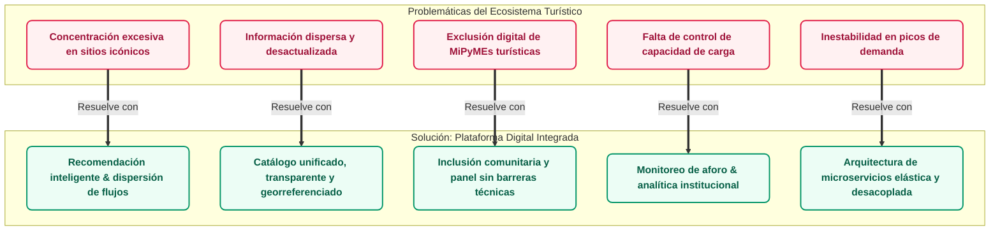
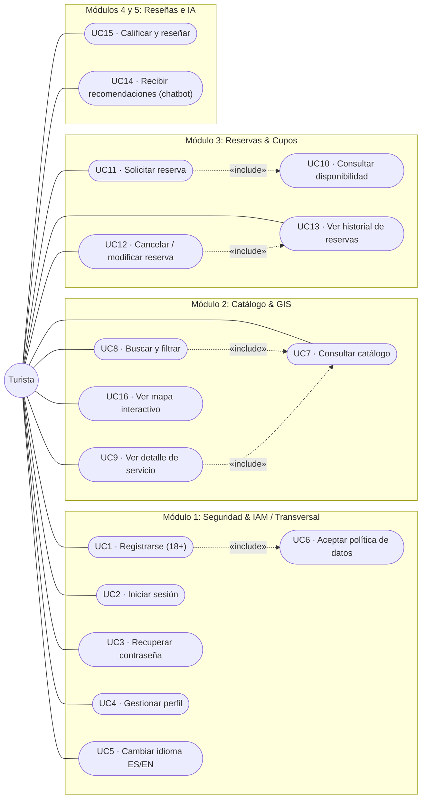
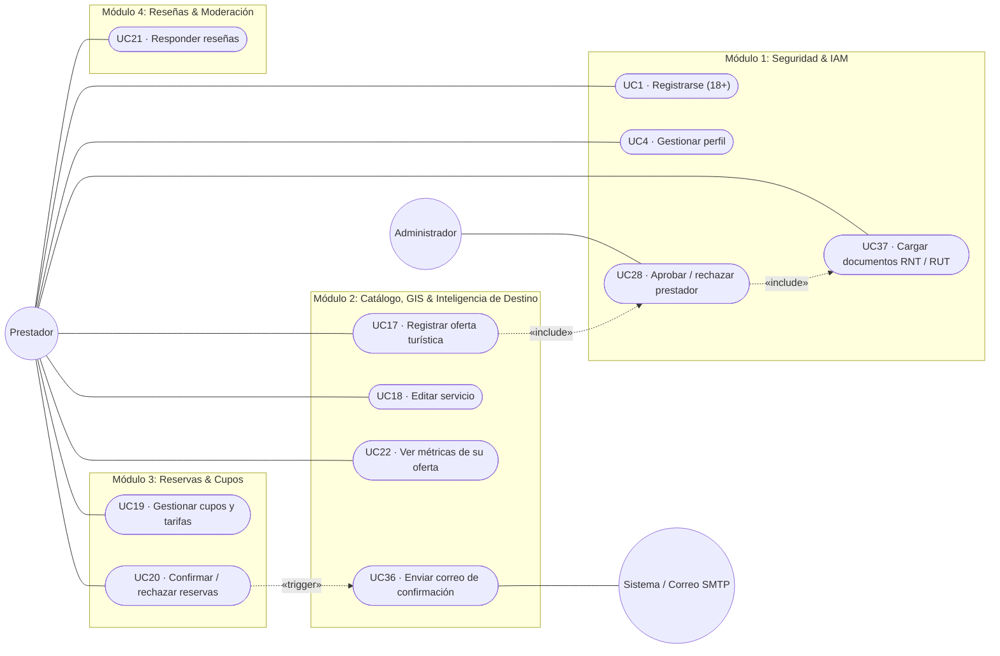
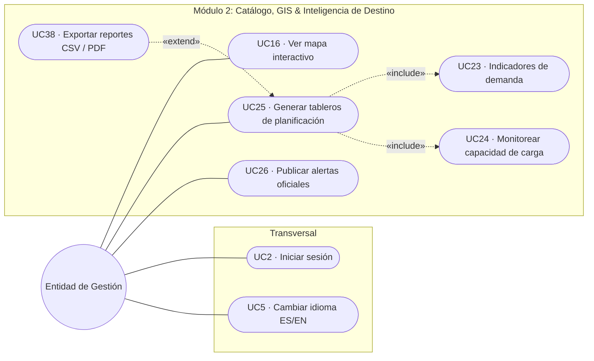
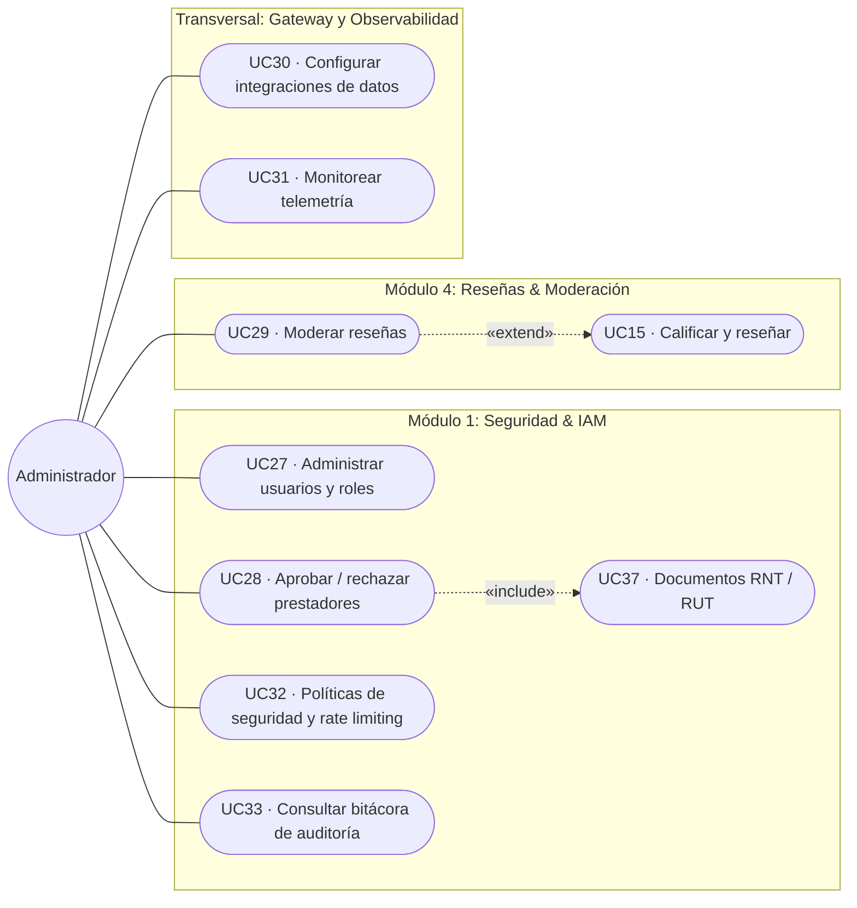
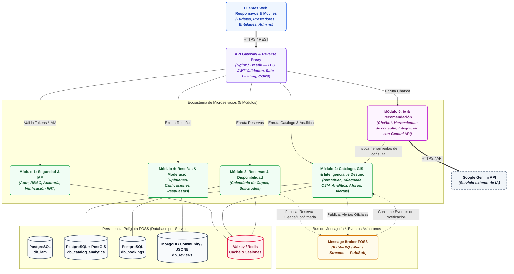
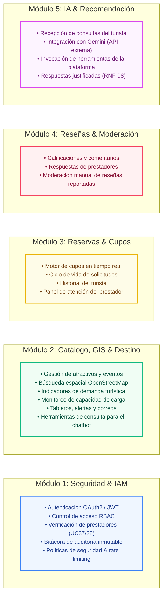
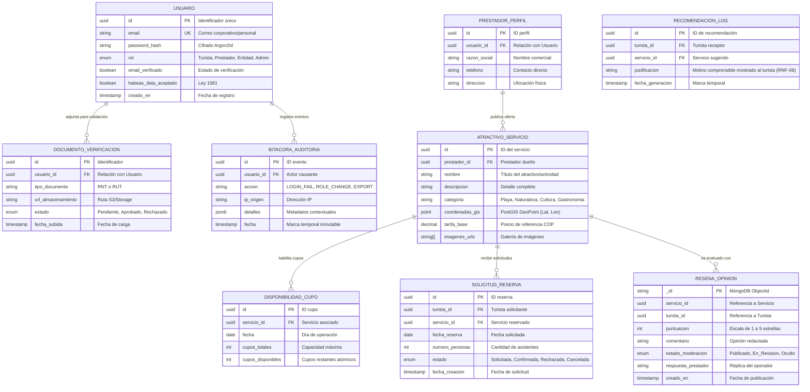

# Especificación de Requerimientos de Software (SRS)
## Conforme al Estándar ISO/IEC/IEEE 29148:2018

**Proyecto:** Plataforma Digital para la Gestión Integrada y Sostenible del Turismo en Santa Marta  
**Curso:** Arquitectura de Software   
**Programa:** Ingeniería de Sistemas — Universidad del Magdalena  
**Versión:** 1.0 (Estructura Estándar ISO/IEC/IEEE 29148:2018)  
**Fecha:** Agosto 2026  

> * INTEGRANTES:
> * **Luis Fernando Barraza Sanchez** 
> * **Alvaro David Ospino Sanchez**
> * **Valentina  Sarait Nieves Hernandez** 
> * **Andres Felipe Gamero Sanchez**
> * **Juan Francisco Gonzalez Pacheco**
>
> *Asignación de responsabilidades del equipo: ver [Apéndice C. Equipo de trabajo y asignación de roles](#apéndice-c-equipo-de-trabajo-y-asignación-de-roles). Plan, cronograma y presupuesto: ver [Apéndice D](#apéndice-d-plan-de-proyecto-cronograma-y-presupuesto).*
---

## Tabla de Contenido

* [1. Introducción](#1-introducción)
  * [1.1 Propósito del documento](#11-propósito-del-documento)
  * [1.2 Alcance del sistema](#12-alcance-del-sistema)
    * [1.2.1 Decisión de alcance: Exclusión de pasarela de pagos en línea](#121-decisión-de-alcance-exclusión-de-pasarela-de-pagos-en-línea)
  * [1.3 Definiciones, acrónimos y abreviaturas](#13-definiciones-acrónimos-y-abreviaturas)
  * [1.4 Referencias](#14-referencias)
* [2. Descripción General](#2-descripción-general)
  * [2.1 Perspectiva del producto](#21-perspectiva-del-producto)
  * [2.2 Funciones del producto](#22-funciones-del-producto)
  * [2.3 Características de los usuarios / Stakeholders](#23-características-de-los-usuarios--stakeholders)
  * [2.4 Restricciones generales](#24-restricciones-generales)
  * [2.5 Supuestos y dependencias](#25-supuestos-y-dependencias)
* [3. Requerimientos Específicos](#3-requerimientos-específicos)
  * [3.1 Requerimientos funcionales](#31-requerimientos-funcionales)
  * [3.2 Casos de uso](#32-casos-de-uso)
  * [3.3 Requerimientos de interfaz](#33-requerimientos-de-interfaz)
  * [3.4 Requerimientos no funcionales / atributos de calidad](#34-requerimientos-no-funcionales--atributos-de-calidad)
  * [3.5 Escenarios de atributos de calidad](#35-escenarios-de-atributos-de-calidad)
  * [3.6 Requerimientos de diseño y restricciones de arquitectura](#36-requerimientos-de-diseño-y-restricciones-de-arquitectura)
  * [3.7 Modelo de datos preliminar](#37-modelo-de-datos-preliminar)
* [4. Verificación](#4-verificación)
  * [4.1 Criterios de verificación por requerimiento](#41-criterios-de-verificación-por-requerimiento)
* [5. Apéndices](#5-apéndices)
  * [Apéndice A. Matriz de trazabilidad global](#apéndice-a-matriz-de-trazabilidad-global)
  * [Apéndice B. Matriz de riesgos del proyecto](#apéndice-b-matriz-de-riesgos-del-proyecto)
  * [Apéndice C. Equipo de trabajo y asignación de roles](#apéndice-c-equipo-de-trabajo-y-asignación-de-roles)
  * [Apéndice D. Plan de proyecto, cronograma y presupuesto](#apéndice-d-plan-de-proyecto-cronograma-y-presupuesto)

---

## 1. Introducción

### 1.1 Propósito del documento

El presente documento constituye la **Especificación de Requerimientos de Software (SRS)** de **alto nivel** para la **Plataforma Digital para la Gestión Integrada y Sostenible del Turismo en Santa Marta**, estructurado bajo los lineamientos y directrices del estándar internacional **ISO/IEC/IEEE 29148:2018** (*Systems and software engineering — Life cycle processes — Requirements engineering*).

El propósito primordial de esta especificación es definir de manera formal, no ambigua, completa, consistente y verificable las necesidades de los interesados, los requerimientos funcionales, los atributos de calidad (requerimientos no funcionales), las restricciones normativas y el modelo conceptual de casos de uso y trazabilidad que rigen el alcance del sistema.

Este documento sirve como acuerdo formal de alto nivel entre el equipo de desarrollo de ingeniería de sistemas, los evaluadores académicos y los actores institucionales y comunitarios del ecosistema turístico de Santa Marta.

> [!NOTE]
> **Documento Complementario de Implementación Técnica:** Los detalles de bajo nivel, la arquitectura hexagonal de cada microservicio, los contratos de mensajería en RabbitMQ, esquemas DDL y orquestación con Kubernetes se desarrollan en el [Plan de Implementación y Funcionamiento Interno](./Plan_de_Implementacion.md).

---

### 1.2 Alcance del sistema

El sistema consiste en el diseño y desarrollo del prototipo funcional de una **Plataforma Digital para la Gestión Integrada y Sostenible del Turismo en Santa Marta**, fundamentada en una **arquitectura de microservicios desacoplada (5 microservicios modulares)** que prioriza el Software Libre y de Código Abierto (FOSS) en sus componentes de soporte y se complementa con servicios externos: la API de Google Gemini para el chatbot de recomendaciones y AWS Lambda para la ejecución de las funciones backend desarrolladas en Python.

El sistema garantiza atributos de calidad esenciales como escalabilidad elástica, alta disponibilidad, interoperabilidad abierta, seguridad integral (conforme a la Ley 1581 de 2012) y mantenibilidad evolutiva.

* **Consolidación de Catálogo y Analítica (Módulo 2):** Para maximizar la cohesión del dominio espacial y optimizar la persistencia, la gestión de atractivos, rutas, cartografía GIS, analítica de demanda, monitoreo de capacidad de carga y avisos institucionales se unifican en un único contexto cohesionado (**Módulo 2: Catálogo, GIS & Inteligencia de Destino**).
* **Desacople del Servicio de Inteligencia Artificial (RF-06):** La inteligencia artificial se incorpora como un chatbot de recomendaciones turísticas, independiente del núcleo transaccional (Módulos 1 a 4). El chatbot consume el modelo de **Google Gemini** mediante su API externa —el equipo no entrena, aloja ni ejecuta un modelo propio— y accede a la información de la plataforma (atractivos, actividades, prestadores y demás datos pertinentes) únicamente a través de **herramientas (*tools*)** controladas que consultan los módulos correspondientes. El desacople se expresa en la integración y en la separación de responsabilidades: la arquitectura se diseña de modo que una indisponibilidad del proveedor de IA no impida consultar el catálogo ni gestionar reservas.
* **Fuentes de Datos Abiertos y Consumo de IA como Servicio Externo:** OpenStreetMap y el portal nacional de Datos Abiertos de Colombia se emplean como fuentes de información geográfica y estadística para el catálogo y los indicadores del Módulo 2; no se utilizan para entrenar ni alimentar a Gemini. El chatbot consulta la información disponible en la plataforma mediante las herramientas integradas y el modelo se consume como un servicio externo, por lo que no se elabora un dataset sintético ni se desarrolla un modelo de recomendación propio.

> [!NOTE]
> **Alcance Delimitado (Exclusiones Justificadas del Prototipo):**
> * **Pasarela de Pagos en Línea (UC34 / UC35):** Fuera de alcance en esta iteración. El prototipo opera bajo un modelo de solicitud y confirmación directa de reserva (ver justificación, alternativas evaluadas y *trade-offs* en la [Sección 1.2.1](#121-decisión-de-alcance-exclusión-de-pasarela-de-pagos-en-línea)).
> * **Registro de Menores de Edad:** Restringido formalmente a mayores de 18 años para resguardar el marco normativo de Habeas Data infantil.
> * **Modelos de IA propios:** No se entrena, ajusta ni aloja un modelo propio de recomendación, ni se construye un dataset sintético. La IA se consume mediante la API de Gemini (ver RF-06).
> * **Repositorio documental en GitHub:** https://github.com/luifdo/tourism-platform/tree/Documents/Documents/Pages

#### 1.2.1 Decisión de Alcance: Exclusión de Pasarela de Pagos en Línea

Para resguardar el carácter de bien público gratuito y cumplir con el horizonte del prototipo (14 semanas, 5 ingenieros), se evaluó y formalizó la exclusión del procesamiento de pagos en línea en el núcleo transaccional:

* **Alternativas evaluadas:**
  * **A. Pasarela comercial integrada:** Cobro automático en línea al emitir la reserva. *Descartada* por contravenir el modelo gratuito sin comisiones, imponer cumplimiento normativo PCI-DSS, requerir gestión compleja de reembolsos y derecho de retracto (Ley 1480 de 2011), y excluir a prestadores comunitarios sin bancarización corporativa.
  * **B. Solicitud y confirmación directa sin pagos *(Seleccionada)*:** La plataforma administra disponibilidad de cupos, emisión de solicitudes y confirmación por parte del prestador; el pago se efectúa de manera directa e independiente entre el turista y el prestador en el destino.
  * **C. Enlace de pago externo del prestador:** El prestador incluye en su ficha de servicio un canal o enlace externo propio de recaudo (billetera digital, pasarela externa propia o enlace bancario), sin que la plataforma procese ni almacene información financiera.

* ***Trade-offs* de la decisión:**
  * **Ventajas obtenidas:** Exclusión total de datos de tarjetas en la infraestructura (cero alcance PCI-DSS y menor superficie de ataque), gratuidad absoluta sin cobro de comisiones para prestadores locales y concentración del esfuerzo del equipo en los 5 microservicios base.
  * **Compromisos asumidos y mitigaciones:** Mayor riesgo de inasistencia (*no-show*) para el prestador al no existir prepago vinculante. Se mitiga mediante confirmación manual obligatoria de solicitudes (UC20), parametrización autónoma de cupos (UC19), publicación visible de políticas de cancelación (UC9, RF-11) y notificaciones automáticas por correo (UC36).

* **Condición de adopción de la Alternativa C:**
  Si la Entidad de Gestión del Destino requiere cobro anticipado para regular atractivos con aforo restringido (p. ej. Parque Tayrona) o los prestadores reportan índices críticos de inasistencia, **se adoptará la Alternativa C (enlace de pago externo del prestador)** como evolución directa de bajo costo, permitiendo al prestador asegurar su reserva sin que la plataforma intermedie pagos ni asuma responsabilidades financieras.

---

### 1.3 Definiciones, acrónimos y abreviaturas

A continuación se definen los términos, abreviaturas y acrónimos empleados a lo largo de este documento:

* **ACID:** *Atomicity, Consistency, Isolation, Durability* (Atomicidad, Consistencia, Aislamiento, Durabilidad), conjunto de propiedades que garantizan que las transacciones en bases de datos se procesen de manera confiable.
* **API:** *Application Programming Interface* (Interfaz de Programación de Aplicaciones), conjunto de definiciones y protocolos que permiten la comunicación entre componentes de software.
* **Argon2id:** Algoritmo criptográfico de derivación de claves y hashing de contraseñas, resistente a ataques de canal lateral y optimizado contra ataques basados en GPU/ASIC.
* **AWS Lambda:** Servicio de cómputo de Amazon Web Services que ejecuta funciones de código en respuesta a solicitudes o eventos, sin administración directa de servidores.
* **Boto3:** SDK oficial de AWS para Python; permite a las funciones backend interactuar con los servicios de AWS. No es un motor de inteligencia artificial.
* **Bounded Context:** Límite conceptual explícito dentro del cual un modelo de dominio particular es aplicable y consistente, propio del Diseño Guiado por el Dominio (DDD).
* **CDN:** *Content Delivery Network* (Red de Entrega de Contenidos), red distribuida geográficamente de servidores proxy para acelerar la entrega de contenido estático.
* **Chatbot:** Asistente conversacional que atiende consultas del usuario en lenguaje natural; en este proyecto, el componente que ofrece recomendaciones turísticas apoyándose en la API de Gemini.
* **CORS:** *Cross-Origin Resource Sharing* (Intercambio de Recursos de Origen Cruzado), mecanismo de seguridad de navegadores web para permitir o restringir peticiones entre diferentes dominios.
* **Cotelco:** Asociación Hotelera y Turística de Colombia (Capítulo Magdalena).
* **FOSS:** *Free and Open Source Software* (Software Libre y de Código Abierto), software que respeta la libertad de los usuarios y desarrolladores para ejecutar, copiar, distribuir, estudiar, cambiar y mejorar el software.
* **Gemini (API de Google Gemini):** Modelo de lenguaje de Google consumido como servicio externo mediante API; el equipo no lo entrena, ajusta ni aloja.
* **GIS:** *Geographic Information System* (Sistema de Información Geográfica), sistema para capturar, almacenar, manipular, analizar y presentar datos georreferenciados.
* **Habeas Data:** Derecho fundamental que otorga a toda persona la facultad de conocer, actualizar y rectificar las informaciones que se hayan recogido sobre ellas en bancos de datos.
* **Herramienta (*tool*):** Función o interfaz controlada, desarrollada por el equipo, que permite al modelo solicitar información específica de la plataforma; el modelo solicita la herramienta y la plataforma la ejecuta.
* **I18n:** Internacionalización (*Internationalization*), proceso de diseñar software para que pueda adaptarse a diferentes idiomas y regiones sin cambios de ingeniería.
* **IAM:** *Identity and Access Management* (Gestión de Identidades y Accesos), marco de procesos y tecnologías que facilita la gestión de identidades electrónicas y permisos.
* **INDETUR:** Instituto Distrital de Turismo de Santa Marta.
* **ISO/IEC/IEEE 29148:2018:** Estándar internacional para la ingeniería de requerimientos en procesos del ciclo de vida del software y sistemas.
* **JWT:** *JSON Web Token* (RFC 7519), estándar abierto que define una forma compacta y autónoma para transmitir información de forma segura entre partes como un objeto JSON.
* **Kubernetes:** Plataforma de código abierto para orquestar el despliegue, el escalado y la operación continua de aplicaciones, manteniendo los servicios activos de forma permanente.
* **MinCIT:** Ministerio de Comercio, Industria y Turismo de Colombia.
* **MongoDB:** Base de datos NoSQL orientada a documentos semiestructurados en formato BSON/JSON.
* **MoSCoW:** Método de priorización de requerimientos categorizados en: *Must have* (Debe tener), *Should have* (Debería tener), *Could have* (Podría tener) y *Won't have* (No tendrá por ahora).
* **ODbL:** *Open Database License*, licencia de datos abiertos utilizada por el proyecto OpenStreetMap.
* **OpenAPI (OAS):** Especificación estándar para la descripción formal y documentación de APIs RESTful independientes del lenguaje de programación.
* **OSM:** *OpenStreetMap*, proyecto colaborativo y abierto para crear mapas editables y libres del mundo.
* **OWASP:** *Open Web Application Security Project*, comunidad abierta dedicada a habilitar a las organizaciones a desarrollar y mantener aplicaciones confiables.
* **PostGIS:** Extensión espacial para el sistema de base de datos objeto-relacional PostgreSQL que añade soporte para objetos geográficos.
* **PostgreSQL:** Sistema de gestión de bases de datos relacional de código abierto potente y compatible con estándares SQL y ACID.
* **Pub/Sub:** *Publish/Subscribe*, patrón de diseño de mensajería asíncrona donde los emisores de mensajes (publicadores) no dirigen mensajes directamente a receptores específicos.
* **RBAC:** *Role-Based Access Control* (Control de Acceso Basado en Roles), método para restringir el acceso al sistema a usuarios autorizados en función de sus roles asignados.
* **REST:** *Representational State Transfer*, estilo de arquitectura de software para sistemas de hipermedios distribuidos.
* **RFC:** *Request for Comments*, publicaciones que describen métodos, comportamientos, investigaciones o innovaciones aplicables al funcionamiento de Internet y sistemas conectados.
* **RNT:** Registro Nacional de Turismo (Colombia), mecanismo de inscripción obligatorio para todos los prestadores de servicios turísticos que efectúen operaciones en Colombia.
* **RPO:** *Recovery Point Objective* (Objetivo de Punto de Recuperación), cantidad máxima aceptable de pérdida de datos medida en tiempo tras un incidente.
* **RTO:** *Recovery Time Objective* (Objetivo de Tiempo de Recuperación), duración máxima de tiempo aceptable para restaurar el servicio tras un desastre o falla técnica.
* **RUT:** Registro Único Tributario (Colombia), mecanismo administrado por la DIAN para identificar, ubicar y clasificar a personas y entidades tributarias.
* **SIC:** Superintendencia de Industria y Comercio de Colombia (autoridad nacional de protección de datos personales).
* **SITUR:** Sistema de Información Turística (SITUR Magdalena).
* **SRS:** *Software Requirements Specification* (Especificación de Requerimientos de Software).
* **SSL / TLS:** *Secure Sockets Layer / Transport Layer Security*, protocolos criptográficos diseñados para proporcionar seguridad en las comunicaciones sobre una red informática.
* **WAF:** *Web Application Firewall*, cortafuegos que monitorea, filtra o bloquea el tráfico HTTP/HTTPS hacia y desde una aplicación web.
* **WCAG:** *Web Content Accessibility Guidelines*, pautas desarrolladas por el W3C para hacer el contenido web más accesible para personas con discapacidad.

---

### 1.4 Referencias

Para la elaboración y validación de esta especificación se han considerado las siguientes normas técnicas, marcos legales y referencias documentales:

1. **ISO/IEC/IEEE 29148:2018:** *Systems and software engineering — Life cycle processes — Requirements engineering*. IEEE Computer Society / ISO / IEC.
2. **Ley Estatutaria 1581 de 2012 (Congreso de la República de Colombia):** *Por la cual se dictan disposiciones generales para la protección de datos personales (Habeas Data)*.
3. **Decreto Reglamentario 1377 de 2013 (República de Colombia):** *Por el cual se reglamenta parcialmente la Ley 1581 de 2012 sobre recolección, almacenamiento y tratamiento de datos personales*.
4. **Ley 300 de 1996 (Congreso de la República de Colombia):** *Ley General de Turismo*.
5. **Ley 2068 de 2020 (Congreso de la República de Colombia):** *Por la cual se modifica la Ley 300 de 1996 y se dictan otras disposiciones en materia de sostenibilidad y reactivación del turismo*.
6. **W3C (World Wide Web Consortium):** *Web Content Accessibility Guidelines (WCAG) 2.1*. W3C Recommendation (Nivel de conformidad AA).
7. **IETF RFC 7519:** *JSON Web Token (JWT)*. Internet Engineering Task Force.
8. **IETF RFC 9110:** *HTTP Semantics / REST Architecture Specifications*.
9. **OpenAPI Initiative:** *OpenAPI Specification v3.0.3 (OAS)*. Linux Foundation.
10. **OpenStreetMap Foundation:** *Open Database License (ODbL) 1.0*. OSM Geo-Data Licensing.
11. **SITUR Magdalena & Cotelco:** *Boletines Estadísticos de Ocupación Hotelera y Flujo Turístico en Santa Marta*. Sistema de Información Turística del Magdalena.

---

## 2. Descripción General

### 2.1 Perspectiva del producto

Santa Marta es uno de los principales destinos turísticos del Caribe colombiano, recibiendo anualmente un alto volumen de visitantes nacionales e internacionales atraídos por sus playas, el Centro Histórico, el Parque Nacional Natural Tayrona, la Sierra Nevada de Santa Marta y su diversa oferta de turismo cultural, gastronómico, ecológico y de aventura.

Este dinamismo turístico representa un motor esencial para el desarrollo socioeconómico regional, pero también introduce desafíos críticos relacionados con la gobernanza, integración de servicios, sostenibilidad ambiental y disponibilidad oportuna de información para la toma de decisiones informadas por parte de turistas, prestadores de servicios y entidades gubernamentales.

<b>Ver especificación de código Mermaid del diagrama</b>

#### Problemáticas Identificadas

1. **Saturación y sobrecarga en zonas sensibles:** Concentración excesiva de turistas en atractivos tradicionales durante temporadas altas, impactando negativamente ecosistemas frágiles (ej. Parque Tayrona, Minca).
2. **Fragmentación y heterogeneidad de la oferta:** Baja integración entre hoteles, restaurantes, operadores y guías, con datos dispersos sobre disponibilidad, horarios, tarifas y normativas.
3. **Brecha digital y visibilidad inequitativa:** Limitada presencia tecnológica de micro, pequeños y medianos prestadores turísticos frente a grandes cadenas.
4. **Ausencia de gestión integrada de reservas y aforos:** Dificultad para consultar disponibilidad centralizada y gestionar solicitudes de reserva de forma anticipada.
5. **Déficit de inteligencia turística y datos para la toma de decisiones:** Carencia de indicadores consolidados de demanda, ocupación y capacidad de carga para la formulación de políticas públicas.
6. **Inestabilidad del servicio en picos de demanda:** Riesgo de degradación de sistemas digitales convencionales ante la concurrencia estacional masiva.

> [!NOTE]
> **Definición de Temporada Alta y Respaldo Cuantitativo:** Se contempla complementar la caracterización del problema con estadísticas oficiales del Sistema de Información Turística (SITUR Magdalena), Cotelco Magdalena y la Secretaría de Desarrollo Económico y Sostenibilidad de Santa Marta antes de la sustentación final.

---

### 2.2 Funciones del producto

La plataforma articula sus capacidades a través de un conjunto integrado de funciones principales que resuelven las problemáticas del ecosistema:

1. **Catálogo Unificado y Búsqueda Geoespacial Multicriterio (RF-01, RF-02):** Centralización de atractivos turísticos, actividades culturales y oferta gastronómica/hotelera con navegación georreferenciada sobre mapas abiertos y filtros por zona, precio y categoría.
2. **Control Atómico de Disponibilidad y Solicitud de Reservas (RF-03, RF-04, RF-05):** Motor transaccional para consulta de cupos en tiempo real, emisión de solicitudes de reserva por parte de turistas y gestión de confirmaciones/cancelaciones por parte de prestadores verificados.
3. **Recomendación Inteligente Justificada y Dispersión Sostenible (RF-06):** Chatbot de recomendaciones, desacoplado del núcleo transaccional, que consume la API de Gemini y consulta la información de la plataforma mediante herramientas para sugerir actividades personalizadas acompañadas de justificaciones comprensibles, con el propósito de contribuir a la redistribución de visitantes hacia destinos emergentes.
4. **Inteligencia de Negocios y Tableros para Gobernanza del Destino (RF-07, RF-13):** Consolidación analítica de métricas de demanda, cálculo estimativo de presión sobre capacidades de carga y exportación de reportes estructurados (CSV/PDF) para autoridades turísticas.
5. **Inclusión Digital de Prestadores Comunitarios (RF-08):** Formularios simplificados y asistidos para que pequeños operadores locales y comunitarios publiquen sus servicios sin barreras técnicas.
6. **Seguridad Integral, IAM y Auditoría Inmutable (RF-09, RF-12):** Gestión perimetral de identidades bajo OAuth2/JWT, control estricto de roles (RBAC), verificación documental (RNT, RUT) y registro auditable de eventos críticos.
7. **Internacionalización y Accesibilidad (RF-10):** Soporte bilingüe completo (Español/Inglés) con estándares de contraste y adaptabilidad WCAG 2.1 AA.
8. **Mensajería Transaccional Asíncrona (RF-11):** Despacho automatizado de notificaciones por correo electrónico ante cambios en el ciclo de vida de las reservas.

---

### 2.3 Características de los usuarios / Stakeholders

Conforme al estándar ISO/IEC/IEEE 29148:2018, los interesados del sistema se clasifican para delimitar el alcance, las responsabilidades operativas y la trazabilidad de requerimientos.

| Tipo | Stakeholder | Rol frente al Sistema | Intereses y Necesidades Principales |
|---|---|---|---|
| **Actor Directo** | **Turista** *(Nacional / Internacional)* | Usuario final que explora, consulta, solicita reservas y califica servicios turísticos. | • Información veraz, consolidada y en tiempo real. • Recomendaciones inteligentes y contextuales. • Proceso de solicitud de reserva ágil e intuitivo. • Interfaz bilingüe (Español/Inglés) y accesible. |
| **Actor Directo** | **Prestador Turístico** *(Hoteles, restaurantes, guías, operadores)* | Proveedor de información que publica ofertas, gestiona disponibilidad y atiende solicitudes. | • Canal de visibilidad digital gratuito y equitativo. • Administración simplificada de cupos y tarifas. • Protección de su información comercial. • Interacción directa con las reseñas de sus clientes. |
| **Actor Directo** | **Entidad de Gestión del Destino** *(Secretaría de Turismo, INDETUR, Corpoteyrona)* | Actor institucional responsable de la gobernanza, sostenibilidad y políticas turísticas. | • Acceso a analítica de demanda, tendencias y aforos. • Herramientas de alerta y comunicación oficial. • Reportes estructurados para toma de decisiones. |
| **Actor Directo** | **Administrador del Sistema** | Gestor técnico y operativo de la plataforma. | • Control de identidades, roles (RBAC) y permisos. • Verificación de legitimidad de prestadores. • Auditoría de seguridad y monitoreo de desempeño. |
| **Actor Indirecto / Normativo** | **Ente Regulador** *(Superintendencia de Industria y Comercio - SIC)* | Autoridad de supervisión de datos personales. | • Cumplimiento riguroso de la Ley Estatutaria 1581 de 2012 y Habeas Data. • Trazabilidad de consentimientos informados. |
| **Actor Indirecto / Externo** | **Servicios de Cartografía Abierta** *(OpenStreetMap / Nominatim)* | Proveedor de infraestructura geoespacial FOSS. | • Geolocalización, cálculo de distancias y visualización de capas de mapas sin costos de licenciamiento comercial. |
| **Actor Indirecto / Externo** | **Servicio de IA Generativa** *(API de Google Gemini)* | Proveedor externo del modelo de lenguaje que utiliza el chatbot de recomendaciones. | • Generación de respuestas en lenguaje natural y solicitud de las herramientas que requiere cada consulta. • Operación dentro de las condiciones de uso, los límites de solicitudes y los costos de consumo del proveedor. |
| **Actor Indirecto / Externo** | **Servicio de Notificaciones** *(SMTP / Postal / SES)* | Proveedor de entrega de correos transaccionales. | • Entrega confiable de correos de confirmación de reserva y avisos de seguridad. |

> [!IMPORTANT]
> **Restricción Normativa de Registro (Habeas Data):** El registro en la plataforma está formalmente restringido a personas **mayores de 18 años**. El tratamiento de datos de menores de edad queda fuera de alcance en esta iteración para simplificar el régimen legal aplicable.

---

### 2.4 Restricciones generales

#### 2.4.1 Restricciones Técnicas
* **Arquitectura de Microservicios:** Implementación de los 5 microservicios desacoplados definidos en la Sección 3.6 (el Módulo 2 consolida Catálogo, GIS e Inteligencia de Destino). La lógica de negocio de las funciones backend se desarrolla en Python, con AWS Lambda y Boto3 para interactuar con los servicios de AWS que correspondan; el despliegue y el entorno de ejecución de la plataforma (módulos, gateway, persistencia, caché y broker) se orquestan con Kubernetes, manteniendo los servicios activos de forma permanente.
* **Consumo de IA mediante API:** El chatbot de recomendaciones (RF-06) utiliza la API de Google Gemini como servicio externo; no se despliega ni se entrena un modelo propio.
* **Persistencia Políglota FOSS:** Uso de motores de datos de código abierto bajo el principio *Database-per-Service* (PostgreSQL + PostGIS, MongoDB/JSONB y Valkey/Redis).
* **Integración Abierta:** Prohibición del uso de APIs privativas de mapas con costos por consumo (ej. Google Maps API); uso estricto del ecosistema OpenStreetMap. Esta restricción aplica a servicios de cartografía y geocodificación; no alcanza al consumo de la API de Gemini para el chatbot.
* **Compatibilidad Multiplataforma:** Interfaz web responsiva compatible con navegadores móviles y de escritorio modernos sin requerir instalación de aplicativos nativos.

#### 2.4.2 Restricciones Económicas y de Recursos
* **Techo Presupuestal:** Límite financiero estricto de **USD 20.000**, con esquemas de ejecución transparente para prototipo académico (USD 6.900) o despliegue institucional piloto (USD 20.000). Desglose en el [Apéndice D](#apéndice-d-plan-de-proyecto-cronograma-y-presupuesto).
* **Talento Humano:** Proyecto ejecutado por un equipo de 5 ingenieros en un marco temporal de 14 semanas lectivas.
* **Modelo Gratuito:** Sin monetización directa ni comisiones sobre transacciones de reserva.

#### 2.4.3 Restricciones Sociales y de Accesibilidad
* **Inclusión de la Economía Popular:** Interfaces intuitivas diseñadas para prestadores turísticos tradicionales con baja alfabetización digital (RF-08).
* **Internacionalización:** Soporte bilingüe completo (Español / Inglés) en catálogo y flujos transaccionales.
* **Límite de Edad:** Registro exclusivo para personas mayores de 18 años para resguardar la privacidad infantil.

#### 2.4.4 Restricciones Ambientales y de Sostenibilidad
* **Protección de Ecosistemas Vulnerables:** Las recomendaciones del chatbot deben procurar orientar la dispersión de flujos turísticos hacia destinos emergentes para mitigar la saturación de áreas protegidas de la Sierra Nevada y el Parque Tayrona.
* **Monitoreo de Capacidad de Carga:** Indicadores analíticos para apoyar las restricciones de ingreso dictadas por autoridades ambientales.

#### 2.4.5 Restricciones Normativas y Legales
* **Ley 1581 de 2012 (Protección de Datos Personales):** Consentimiento informado previo, almacenamiento cifrado de datos sensibles y derecho de actualización/supresión (Habeas Data).
* **Ley General de Turismo (Ley 300 de 1996 / Ley 2068 de 2020):** Exigencia del Registro Nacional de Turismo (RNT) como requisito de verificación para prestadores comerciales.

#### 2.4.6 Restricciones Éticas en Inteligencia Artificial
* **Transparencia Ética (RNF-08):** Toda recomendación turística generada por el chatbot debe acompañarse de una justificación comprensible para el usuario final, basada en la información consultada en la plataforma y en los criterios pertinentes de la respuesta (preferencias expresadas, ubicación, categoría, entre otros). La justificación explica la respuesta entregada; no constituye una garantía de infalibilidad ni una auditoría del modelo de Gemini.
* **Equidad y Neutralidad:** Las recomendaciones del chatbot no deben aplicar criterios discriminatorios ni favorecer comercialmente a ningún operador sobre otro.

---

### 2.5 Supuestos y dependencias

1. **Supuesto de Información Disponible para el Chatbot:** El chatbot de recomendaciones (RF-06) no requiere historiales de transacciones de turistas ni un dataset propio: se asume que construye sus respuestas con la información que obtiene de la plataforma mediante herramientas (atractivos, actividades, prestadores y demás datos pertinentes) y, por tanto, que la calidad de las recomendaciones depende de la completitud y la actualización de esa información.
2. **Dependencia de la Infraestructura de Cartografía Abierta (OSM / Nominatim):** El módulo de Catálogo y GIS depende operativamente de los servidores de teselas (*tiles*) y APIs de geocodificación de OpenStreetMap y Nominatim, asumiendo su disponibilidad bajo las políticas de uso justo del ecosistema FOSS.
3. **Dependencia del Servicio de Transporte de Correo (SMTP):** El despacho de correos electrónicos transaccionales de confirmación de reserva (UC36, RF-11) y restablecimiento de credenciales depende de la conectividad con un servidor de correo saliente SMTP (o servicio FOSS compatible como Postal / AWS SES).
4. **Dependencia de Verificación Administrativa Humana:** La activación pública de las ofertas de prestadores depende del proceso de revisión y validación manual de los documentos de acreditación legal (RNT, RUT) por parte del rol Administrador del Sistema.
5. **Dependencia de Información Oficial de Destino:** La calibración de los límites de aforo y alertas institucionales asume la provisión periódica de lineamientos de capacidad de carga por parte de la Entidad de Gestión (INDETUR, Corpoteyrona, Parques Nacionales Naturales).
6. **Dependencia del Servicio Externo de IA (API de Google Gemini):** El chatbot depende de la disponibilidad de la API de Gemini y se asumen credenciales de acceso vigentes. Se consideran aspectos de diseño, no fallos confirmados: la dependencia de la disponibilidad del proveedor, los límites de solicitudes, los costos de consumo y la latencia de las consultas. El núcleo transaccional se diseña para seguir operando ante una indisponibilidad del servicio de IA.

---

## 3. Requerimientos Específicos

### 3.1 Requerimientos funcionales

A continuación se detalla la especificación completa de los requerimientos funcionales del sistema, priorizados bajo la metodología MoSCoW:

| ID | Requerimiento Funcional | Prioridad | Módulo Asignado | Stakeholder | Criterio de Verificación |
|---|---|---|---|---|---|
| **RF-01** | Consultar catálogo de atractivos, actividades y eventos turísticos. | **Must** | Módulo 2: Catálogo, GIS & Destino | Turista | Visualización completa del catálogo con filtros básicos sin requerir autenticación. |
| **RF-02** | Buscar y filtrar servicios por categoría, ubicación espacial, tarifa y disponibilidad. | **Must** | Módulo 2: Catálogo, GIS & Destino | Turista | Los filtros combinados devuelven resultados exactos en un tiempo inferior a 1.5s. |
| **RF-03** | Consultar la disponibilidad actualizada de cupos de un servicio. | **Must** | Módulo 3: Reservas & Cupos | Turista | El calendario refleja en tiempo real los cupos habilitados por el prestador. |
| **RF-04** | Registrar solicitudes de reserva de actividades o servicios turísticos. | **Must** | Módulo 3: Reservas & Cupos | Turista | Se genera una reserva en estado `Solicitada` visible en el panel del turista y del prestador. |
| **RF-05** | Permitir a los prestadores registrar y actualizar su oferta y cupos. | **Must** | Módulos 2 y 3 | Prestador | Un prestador verificado crea y edita servicios visualizándose inmediatamente en el catálogo. |
| **RF-06** | Ofrecer recomendaciones turísticas personalizadas y justificadas mediante un chatbot que consume la API de Gemini y consulta la información de la plataforma a través de herramientas. | **Should** | Módulo 5: IA & Recomendación | Turista | El usuario recibe sugerencias basadas en su consulta y preferencias, construidas con datos consultados en la plataforma, junto con la justificación (RNF-08). |
| **RF-07** | Generar tableros e indicadores agregados de demanda y aforo para planificación. | **Should** | Módulo 2: Catálogo, GIS & Destino | Entidad | La entidad visualiza gráficos de demanda por zonas y estimación de concentración turística. |
| **RF-08** | Incorporación asistida y sin barreras técnicas para prestadores comunitarios. | **Should** | Módulos 1 y 2 | Prestador | El formulario de registro y carga de servicios no requiere más de 3 pasos sencillos. |
| **RF-09** | Gestión de identidades, control de acceso RBAC y bitácora de auditoría. | **Must** | Módulo 1: Seguridad & IAM | Admin | Intentos de acceso no autorizados devuelven HTTP 403 y quedan registrados en la bitácora. |
| **RF-10** | Disponibilidad de la interfaz en idiomas Español e Inglés (I18n). | **Should** | Transversal | Turista, Entidad | Conmutación instantánea de idioma traduciendo etiquetas, menús y contenidos base. |
| **RF-11** | Enviar notificaciones por correo de confirmación/cancelación de reservas. | **Should** | Módulo 2 / Broker | Turista, Prestador | Tras confirmarse la reserva (UC20), se despacha un correo formateado en menos de 10s. |
| **RF-12** | Permitir a prestadores adjuntar documentos de verificación legal (RNT, RUT). | **Should** | Módulo 1: Seguridad & IAM | Prestador, Admin | El prestador sube archivos PDF/imagen que son auditados por el administrador antes de publicar. |
| **RF-13** | Exportar reportes analíticos e indicadores en formatos estándar (CSV / PDF). | **Could** | Módulo 2: Catálogo, GIS & Destino | Entidad | Descarga funcional de archivos estructurados con métricas del destino. |

---

### 3.2 Casos de uso

#### 3.2.1 Actores del Sistema
* **Turista (`Tur`):** Usuario final autenticado o anónimo que interactúa con el catálogo, solicita reservas y aporta reseñas.
* **Prestador de Servicios Turísticos (`Prest`):** Actor comercial verificado que administra servicios, cupos y atiende reservas.
* **Entidad de Gestión del Destino (`Entidad`):** Actor gubernamental o institucional que analiza métricas y emite avisos oficiales.
* **Administrador (`Admin`):** Custodio técnico de la seguridad, roles, moderación y observabilidad.
* **Sistema / Servicios Externos (`SysExt`):** Motor de colas, proveedor de mapas OSM, pasarela de correo SMTP y proveedor de IA (API de Gemini).

#### 3.2.2 Matriz Detallada de Casos de Uso

| Código | Caso de Uso | Actor Principal | Relaciones / Dependencias | Módulo Asignado |
|---|---|---|---|---|
| **UC1** | Registrarse en la plataforma (18+ años) | Turista, Prestador | `<<include>>` UC6 | Módulo 1: Seguridad & IAM |
| **UC2** | Iniciar sesión y obtener token de acceso | Todos los actores | Control de acceso perimetral | Módulo 1: Seguridad & IAM |
| **UC3** | Recuperar / restablecer contraseña | Turista, Prestador, Entidad | Verificación vía correo | Módulo 1: Seguridad & IAM |
| **UC4** | Gestionar perfil de usuario | Turista, Prestador | - | Módulo 1: Seguridad & IAM |
| **UC5** | Cambiar idioma de la interfaz (ES / EN) | Turista, Entidad | I18n transversal en frontend | Transversal (Frontend) |
| **UC6** | Aceptar política de tratamiento de datos personales | Sistema / Transversal | `<<include>>` en UC1 | Módulo 1: Seguridad & IAM |
| **UC7** | Consultar catálogo de atractivos, actividades y eventos | Turista (anónimo/autenticado) | Base de búsqueda | Módulo 2: Catálogo, GIS & Destino |
| **UC8** | Buscar y filtrar servicios (precio, zona, tipo) | Turista | `<<include>>` UC7 | Módulo 2: Catálogo, GIS & Destino |
| **UC9** | Consultar detalle de atractivo / servicio | Turista | `<<include>>` UC7 | Módulo 2: Catálogo, GIS & Destino |
| **UC10** | Consultar disponibilidad en tiempo real | Turista | `<<include>>` en UC11 | Módulo 3: Reservas & Cupos |
| **UC11** | Solicitar reserva de actividad o servicio | Turista | `<<include>>` UC2, `<<include>>` UC10 | Módulo 3: Reservas & Cupos |
| **UC12** | Cancelar / modificar solicitud de reserva | Turista | `<<include>>` UC13 | Módulo 3: Reservas & Cupos |
| **UC13** | Consultar historial de reservas propias | Turista | - | Módulo 3: Reservas & Cupos |
| **UC14** | Recibir recomendaciones personalizadas justificadas mediante chatbot | Turista | Invoca herramientas de consulta de la plataforma (Módulo 2); consume la API de Gemini | Módulo 5: IA & Recomendación |
| **UC15** | Calificar y redactar reseña de experiencia | Turista | Extendido por UC29 | Módulo 4: Anotaciones & Reseñas |
| **UC16** | Visualizar mapa interactivo de atractivos y zonas | Turista, Entidad | Integración OpenStreetMap | Módulo 2: Catálogo, GIS & Destino |
| **UC17** | Registrar nueva oferta turística | Prestador | `<<include>>` UC2, `<<include>>` UC28 | Módulo 2: Catálogo, GIS & Destino |
| **UC18** | Editar / actualizar información de servicio | Prestador | `<<include>>` UC2 | Módulo 2: Catálogo, GIS & Destino |
| **UC19** | Gestionar calendario de disponibilidad y tarifas | Prestador | `<<include>>` UC2 | Módulo 3: Reservas & Cupos |
| **UC20** | Confirmar / rechazar solicitudes de reserva | Prestador | Dispara evento a UC36 | Módulo 3: Reservas & Cupos |
| **UC21** | Responder públicamente a comentarios de turistas | Prestador | `<<include>>` UC15 | Módulo 4: Anotaciones & Reseñas |
| **UC22** | Consultar métricas de rendimiento de su oferta | Prestador | - | Módulo 2: Catálogo, GIS & Destino |
| **UC23** | Consultar indicadores agregados de demanda turística | Entidad | `<<include>>` en UC25 | Módulo 2: Catálogo, GIS & Destino |
| **UC24** | Monitorear estimación de capacidad de carga | Entidad | `<<include>>` en UC25 | Módulo 2: Catálogo, GIS & Destino |
| **UC25** | Generar tableros de planificación turística | Entidad | `<<include>>` UC23, `<<include>>` UC24 | Módulo 2: Catálogo, GIS & Destino |
| **UC26** | Publicar alertas oficiales y avisos de sostenibilidad | Entidad | - | Módulo 2: Catálogo, GIS & Destino |
| **UC27** | Administrar usuarios, roles y asignación de permisos | Admin | Control RBAC central | Módulo 1: Seguridad & IAM |
| **UC28** | Aprobar / rechazar prestadores de servicios | Admin | `<<include>>` UC37 | Módulo 1: Seguridad & IAM |
| **UC29** | Moderar reseñas y contenido sensible reportado | Admin | `<<extend>>` UC15 | Módulo 4: Anotaciones & Reseñas |
| **UC30** | Configurar integraciones y orígenes de datos abiertos | Admin | - | Transversal (Config / GW) |
| **UC31** | Monitorear telemetría y métricas de salud del sistema | Admin | Prometheus + Grafana | Transversal (Observabilidad) |
| **UC32** | Gestionar políticas de seguridad y rate limiting | Admin | - | Módulo 1: Seguridad & IAM |
| **UC33** | Consultar bitácora de auditoría inmutable | Admin | Trazabilidad RNF-10 | Módulo 1: Seguridad & IAM |
| **UC36** | Despachar notificación de confirmación por correo | Sistema / SysExt | Disparado por UC20 | Módulo 2 / Worker Eventos |
| **UC37** | Cargar documentos de verificación (RNT, RUT) | Prestador | `<<include>>` en UC28 | Módulo 1: Seguridad & IAM |
| **UC38** | Exportar reportes analíticos (CSV / PDF) | Entidad | `<<extend>>` UC25 | Módulo 2: Catálogo, GIS & Destino |

#### 3.2.3 Diagramas de Casos de Uso por Actor

Para garantizar la legibilidad, el modelo de casos de uso se presenta en **cuatro vistas por actor principal**, agrupando los casos de uso según el módulo que los implementa. Convenciones:

* Las líneas continuas asocian al actor con los casos de uso que inicia.
* Las líneas punteadas indican relaciones `«include»`, `«extend»` o disparo de eventos (`«trigger»`), según la Sección 3.2.2.
* Todos los casos de uso que requieren autenticación incluyen UC2 (*Iniciar sesión*); esa relación se omite en los diagramas para no saturarlos.

La vista general con todos los actores se conserva como referencia en [CasosDeUso_PlataformaTurismoSantaMarta.svg](./CasosDeUso_PlataformaTurismoSantaMarta.svg).

##### Vista 1: Turista

##### Vista 2: Prestador de Servicios Turísticos

##### Vista 3: Entidad de Gestión del Destino

##### Vista 4: Administrador del Sistema

---

### 3.3 Requerimientos de interfaz

#### 3.3.1 Interfaces de Usuario (UI)
* **Diseño Web Responsivo:** La interfaz se construirá utilizando estándares HTML5, Vanilla CSS3 y componentes JavaScript/Vue.js, optimizada para resoluciones móviles (desde 360px de ancho) y pantallas de escritorio.
* **Internacionalización Dinámica (I18n):** Mecanismo de alternancia instantánea entre Español (idioma por defecto) e Inglés mediante archivos de recursos JSON sin recarga completa de página.
* **Accesibilidad Web:** Cumplimiento de las directrices WCAG 2.1 Nivel AA, asegurando relaciones de contraste de color mínimas de 4.5:1 para texto estándar, etiquetas descriptivas en controles interactivos (`aria-label`) y soporte de navegación por teclado.

#### 3.3.2 Interfaces de Software / APIs Externas
* **OpenStreetMap / Nominatim (API de Cartografía y Geocodificación):**
  * *Protocolo:* HTTPS / REST.
  * *Formato:* Tiles ráster/vectoriales (XYZ) y respuestas JSON para geocodificación inversa.
  * *Librería Cliente:* Leaflet.js o MapLibre GL.
  * *Finalidad:* Despliegue de capas cartográficas, marcadores interactivos de atractivos y cálculo de distancias aproximadas en el Módulo 2.
* **Servicio de Notificaciones por Correo Electrónico (SMTP / Transportador FOSS):**
  * *Protocolo:* SMTP sobre TLS (puertos 587 / 465).
  * *Formato de Contenido:* Mensajes multiparte MIME con versión HTML enriquecida y texto plano.
  * *Finalidad:* Envío de enlaces de confirmación, restablecimiento de credenciales (Módulo 1) y avisos de confirmación de reserva (Módulo 2).
* **Plataforma de Datos Abiertos de Colombia:**
  * *Protocolo:* HTTPS / REST (Socrata Open Data API - SODA) o ingesta periódica de archivos CSV/JSON.
  * *Finalidad:* Enriquecimiento de indicadores de demanda y calibración de atractivos culturales en el Módulo 2.
* **API de Google Gemini (Servicio de IA Generativa):**
  * *Protocolo:* HTTPS / REST.
  * *Formato:* Mensajes JSON con la consulta del usuario, la declaración de las herramientas disponibles y la respuesta generada.
  * *Finalidad:* Generación de las respuestas del chatbot de recomendaciones (Módulo 5) y solicitud de las herramientas necesarias para consultar información de la plataforma. La ejecución de las herramientas y el acceso a los datos se realizan en la plataforma; el equipo no entrena ni ajusta el modelo con esos datos.

#### 3.3.3 Interfaces de Comunicación e Integración
* **API Gateway Perimetral:**
  * *Protocolo:* HTTPS (TLS 1.3) con intercambio de cargas en JSON (RESTful), documentado bajo OpenAPI 3.0.
  * *Seguridad:* Validación perimetral de cabeceras de autorización (`Authorization: Bearer <JWT>`), Rate Limiting y CORS.
* **Bus de Mensajería Asíncrona (Event Bus):**
  * *Protocolo:* AMQP 0-9-1 (RabbitMQ) o Redis Streams para comunicación orientada a eventos.
  * *Finalidad:* Desacople asíncrono de tareas auxiliares (despacho de correos en Módulo 2 y auditoría en Módulo 1).

---

### 3.4 Requerimientos no funcionales / atributos de calidad

| ID | Atributo | Requerimiento No Funcional | Prioridad | Estándar / Verificación |
|---|---|---|---|---|
| **RNF-01** | **Disponibilidad** | El sistema debe mantener una tasa de disponibilidad operativa $\ge 99.0\%$ durante su ventana de servicio. | **Should** | Monitoreo continuo mediante sondas de salud (Healthchecks en `/health`). |
| **RNF-02** | **Escalabilidad** | La arquitectura de microservicios debe escalar horizontalmente ante incrementos de tráfico en temporada alta. | **Must** | Pruebas de carga simulada con herramientas FOSS (k6 / Locust / JMeter). |
| **RNF-03** | **Interoperabilidad** | La plataforma debe exponer APIs REST documentadas bajo especificación OpenAPI 3.0. | **Must** | Validación con esquemas Swagger/OpenAPI y consumo desacoplado. |
| **RNF-04** | **Seguridad** | Autenticación basada en JWT, cifrado de credenciales con Argon2id y cumplimiento de la Ley 1581 de 2012. | **Must** | Pruebas de vulnerabilidad estática y registro explícito de consentimiento (UC6). |
| **RNF-05** | **Mantenibilidad** | El desacople entre microservicios debe permitir modificar o desplegar módulos (incluido el componente del chatbot) sin alterar el núcleo. | **Should** | Tiempo estimado de incorporación de un nuevo servicio $\le 5$ días-persona. |
| **RNF-06** | **Rendimiento** | El tiempo de respuesta para el 95% de las consultas de catálogo debe ser inferior a 2.0 segundos. | **Must** | Medición de latencia percentil 95 ($p95$) bajo concurrencia controlada. |
| **RNF-07** | **Accesibilidad** | Las interfaces deben satisfacer pautas de diseño accesible (WCAG 2.1 Nivel AA básico: contraste, texto escalable). | **Should** | Evaluación con herramientas de auditoría accesible (Lighthouse / axe-core). |
| **RNF-08** | **Transparencia Ética** | Toda recomendación generada por el chatbot de IA debe ir acompañada de una justificación comprensible, basada en la información consultada en la plataforma y en los criterios pertinentes de la respuesta. | **Should** | Revisión de un conjunto de consultas de prueba: cada recomendación incluye una justificación visible al turista que referencia los datos consultados (p. ej. categoría, ubicación, tarifa) y las preferencias expresadas. |
| **RNF-09** | **Respaldo & Recuperación** | Mecanismos de copia de seguridad periódica de las bases de datos y procedimiento de restauración validado. | **Should** | Ejecución de al menos un simulacro de restauración de datos documentado. |
| **RNF-10** | **Auditoría de Seguridad** | Registro inmutable de eventos administrativos, accesos denegados y modificaciones de estado. | **Must** | Consulta de bitácora disponible en panel administrativo (UC33). |
| **RNF-11** | **Usabilidad** | El flujo de solicitud de reserva debe completarse en un máximo de 4 pasos interactivos. | **Should** | Validación mediante pruebas de usuario guiadas (Buscar $\rightarrow$ Detalle $\rightarrow$ Solicitar $\rightarrow$ Confirmar). |
| **RNF-12** | **Despliegue y Operación Continua** | La plataforma debe desplegarse y operarse sobre Kubernetes, manteniendo sus servicios activos de forma permanente. | **Must** | Despliegue reproducible mediante la configuración declarativa de Kubernetes; los servicios permanecen activos y responden en `/health` (RNF-01). |

---

### 3.5 Escenarios de atributos de calidad

Formato de especificación formal: **Fuente $\rightarrow$ Estímulo $\rightarrow$ Ambiente $\rightarrow$ Artefacto $\rightarrow$ Respuesta $\rightarrow$ Medida de Respuesta**.

| ID | Atributo | Escenario Formal |
|---|---|---|
| **ESC-01** | **Disponibilidad** | *Fuente:* Caída imprevista de un nodo de servicio. *Estímulo:* Falla en el contenedor del Módulo de Reseñas. *Ambiente:* Operación normal. *Artefacto:* API Gateway y clúster. *Respuesta:* El Gateway aísla el microservicio degradado sin interrumpir la navegación en catálogo ni las reservas. *Medida:* Disponibilidad global del sistema $\ge 99.0\%$, tiempo de aislamiento $< 5$ segundos. |
| **ESC-02** | **Rendimiento & Carga** | *Fuente:* Turistas concurrentes en temporada de vacaciones. *Estímulo:* 500 solicitudes concurrentes por segundo en búsqueda de catálogo. *Ambiente:* Pico estacional. *Artefacto:* Módulo 2 (Catálogo) + Caché Redis. *Respuesta:* El sistema atiende las consultas apoyándose en caché en memoria. *Medida:* Tiempo de respuesta $p95 < 2.0$ segundos sin errores HTTP 5xx. |
| **ESC-03** | **Interoperabilidad** | *Fuente:* Desarrollador / Administrador. *Estímulo:* Integración de una nueva fuente de datos abiertos de eventos culturales. *Ambiente:* Mantenimiento evolutivo. *Artefacto:* Módulo 2 (Catálogo). *Respuesta:* Ingesta de datos vía API REST sin modificar la estructura del esquema relacional base. *Medida:* Incorporación funcional completada en $\le 3$ días hábiles. |
| **ESC-04** | **Seguridad & Auditoría** | *Fuente:* Usuario no autorizado / Atacante externo. *Estímulo:* Intento de acceso a endpoints de reportes institucionales sin token o con rol inválido. *Ambiente:* Operación normal. *Artefacto:* Módulo 1 (IAM) y API Gateway. *Respuesta:* Bloqueo inmediato de la petición con HTTP 403 Forbidden y registro detallado del evento (IP, timestamp, usuario) en la bitácora. *Medida:* 100% de los accesos indebidos registrados en la bitácora de auditoría inmutable. |
| **ESC-05** | **Mantenibilidad** | *Fuente:* Equipo de ingeniería. *Estímulo:* Ajuste de la configuración del chatbot (herramientas disponibles, parámetros de consumo o versión del modelo de la API de Gemini). *Ambiente:* Ciclo de desarrollo. *Artefacto:* Módulo 5 (IA). *Respuesta:* Actualización y despliegue del componente del chatbot sin reiniciar ni alterar los microservicios de Reservas o Catálogo. *Medida:* Cero tiempo de inactividad (*zero-downtime*) en el núcleo transaccional. |
| **ESC-06** | **Recuperación ante Fallos** | *Fuente:* Administrador del sistema. *Estímulo:* Simulación de corrupción de la base de datos de reservas. *Ambiente:* Prueba de contingencia. *Artefacto:* Script de respaldo y PostgreSQL. *Respuesta:* Restauración del último volcado (*dump*) programado. *Medida:* Tiempo de recuperación objetivo ($RTO) \le 30$ minutos; pérdida máxima de datos ($RPO) \le 24$ horas. |
| **ESC-07** | **Usabilidad** | *Fuente:* Turista primerizo. *Estímulo:* Búsqueda, selección y envío de solicitud de reserva para un tour ecológico. *Ambiente:* Dispositivo móvil con conexión estándar 4G. *Artefacto:* Interfaz de usuario web. *Respuesta:* Navegación guiada en un flujo de 4 pantallas consecutivas sin bloqueos. *Medida:* Tasa de éxito en la tarea $\ge 90\%$ en pruebas de usabilidad asistidas. |
| **ESC-08** | **Escalabilidad** | *Fuente:* Turistas concurrentes durante temporada alta (vacaciones de fin de año, Semana Santa). *Estímulo:* El tráfico sostenido sobre catálogo y reservas se duplica respecto al escenario ESC-02, pasando de 500 a 1.000 solicitudes por segundo durante al menos 30 minutos. *Ambiente:* Despliegue piloto en temporada alta. *Artefacto:* Módulo 2 (Catálogo & GIS), Módulo 3 (Reservas & Cupos) y orquestador (Kubernetes). *Respuesta:* Se agregan réplicas horizontales únicamente de los servicios presionados, sin reiniciar ni escalar los demás microservicios; al descender la demanda, las réplicas adicionales se retiran. El escalado se ejecuta mediante Kubernetes. *Medida:* Réplicas adicionales operativas en $\le 2$ minutos; la capacidad atendida crece al menos 1,8 veces al duplicar las réplicas; se mantiene $p95 < 2.0$ segundos y tasa de errores HTTP 5xx $< 1\%$ durante todo el pico. |

---

### 3.6 Requerimientos de diseño y restricciones de arquitectura

#### 3.6.1 Estilo Arquitectónico Base y Descomposición Modular

Se adopta una **Arquitectura de Microservicios Desacoplada**, organizada en **5 microservicios funcionales bien delimitados (*Bounded Contexts*)**, un **API Gateway perimetral** y una **Capa Transversal de Mensajería y Observabilidad**, garantizando una separación nítida de responsabilidades y priorizando el Software Libre en sus componentes de soporte, complementado con servicios externos (API de Gemini y AWS Lambda).

> [!NOTE]
> **Justificación de la selección y detalle de implementación:** La comparación entre esta alternativa y un Monolito Modular, con tabla ponderada, decisión justificada y análisis de *trade-offs*, se documenta en [Comparación y Selección de Alternativas Arquitectónicas](./Comparacion_Alternativas_Arquitectonicas.md). El diseño de detalle interno, puertos y adaptadores (arquitectura hexagonal), diagramas de secuencia física y orquestación con Kubernetes se desarrollan en el [Plan de Implementación y Funcionamiento Interno](./Plan_de_Implementacion.md).

<b>Ver especificación de código Mermaid del diagrama de arquitectura (5 Microservicios)</b>

#### Detalle de Responsabilidades por Módulo

<b>Ver especificación de código Mermaid de responsabilidades por módulo (5 Módulos)</b>

##### 1. Módulo 1: Autenticación, Seguridad y Gestión de Identidades (IAM Service)
* **Propósito:** Centralizar el control de acceso, la autenticación perimetral y la trazabilidad de seguridad del ecosistema.
* **Capacidades Principales:**
  * Emisión, firma y validación de tokens de acceso JWT bajo estándares OAuth2 / OpenID Connect.
  * Control de acceso basado en roles (RBAC: `Turista`, `Prestador`, `Entidad`, `Admin`).
  * Almacenamiento seguro de credenciales con hashing criptográfico robusto (Argon2id).
  * Flujo administrativo de verificación de prestadores mediante documentos legales (RNT y RUT).
  * Bitácora inmutable de auditoría para registro de eventos críticos de seguridad (RNF-10).

##### 2. Módulo 2: Catálogo, GIS & Inteligencia de Destino (Catalog, GIS & Destination Analytics Service)
* **Propósito:** Administrar la oferta turística georreferenciada y proveer inteligencia analítica y de gobernanza territorial a la Entidad de Gestión.
* **Capacidades Principales:**
  * Catálogo unificado de atractivos, actividades culturales/ecológicas y fichas de prestadores.
  * Búsqueda espacial y filtros multicriterio integrados con capas abiertas de OpenStreetMap.
  * Agregación analítica de demanda turística y cálculo de índices de presión sobre la capacidad de carga territorial.
  * Consola de planificación con tableros de control y exportación de reportes estructurados (CSV/PDF) para autoridades turísticas.
  * Publicación de alertas oficiales de sostenibilidad y despacho automatizado de notificaciones por correo electrónico (SMTP).
  * Herramientas de consulta para el chatbot: funciones controladas que permiten a Gemini solicitar información específica del catálogo (atractivos, actividades y fichas de prestadores), de acuerdo con las capacidades autorizadas. Las funciones de catálogo y búsqueda que utiliza el turista en la interfaz (RF-01, RF-02) las desarrolla la plataforma; las herramientas solo permiten al chatbot consultar esa información bajo demanda, sin entrenar el modelo ni incorporar los datos a sus parámetros.

##### 3. Módulo 3: Disponibilidad y Gestión de Reservas (Bookings & Availability Service)
* **Propósito:** Gestionar el ciclo de vida de las solicitudes de reserva y el control de cupos en tiempo real.
* **Capacidades Principales:**
  * Consulta atómica y bloqueo transaccional de cupos para evitar sobreventas (*overbooking*).
  * Máquina de estados de reservas (`Solicitada` $\rightarrow$ `Confirmada` $\rightarrow$ `Rechazada` $\rightarrow$ `Cancelada`).
  * Consolas de gestión de solicitudes para prestadores y vista de historial para turistas.

##### 4. Módulo 4: Anotaciones, Reseñas y Moderación (Reviews & Community Service)
* **Propósito:** Fomentar la retroalimentación comunitaria garantizando un entorno confiable y libre de contenido inapropiado.
* **Capacidades Principales:**
  * Registro de calificaciones multidimensionales y reseñas de experiencias de turistas.
  * Canal de respuesta pública para prestadores verificados.
  * Revisión manual, por parte del Administrador, de las reseñas y del contenido sensible reportado (UC29).

##### 5. Módulo 5: Inteligencia Artificial y Recomendación Desacoplada (AI Recommendation Chatbot)
* **Propósito:** Ofrecer recomendaciones personalizadas de atractivos y actividades mediante un chatbot que consume la API de Gemini, sin penalizar el rendimiento del núcleo transaccional.
* **Alcance del componente:** Gemini es un servicio externo consumido mediante API; las herramientas, la lógica de negocio y la integración las desarrolla el equipo. No se entrena, ajusta ni aloja un modelo propio.
* **Capacidades previstas (fase de diseño):**
  * Recepción de la consulta del turista en lenguaje natural.
  * Identificación de la información necesaria para responder.
  * Invocación de las herramientas disponibles para consultar datos de la plataforma (atractivos, actividades, prestadores y demás datos pertinentes).
  * Organización de los resultados obtenidos y generación de una recomendación contextualizada.
  * Presentación de una respuesta comprensible y justificada ante el usuario final (RNF-08).
  * Manejo de errores o de falta de información, informando al usuario sin inventar atractivos, servicios, precios ni disponibilidad.

##### 6. Capa Perimetral y Transversal
* **Propósito:** Enrutamiento perimetral seguro, mediación asíncrona y supervisión continua de la salud operativa.
* **Capacidades Principales:**
  * API Gateway: Terminación TLS, verificación perimetral de JWT, Rate Limiting y políticas de CORS.
  * Bus de Eventos: Broker de mensajería FOSS (RabbitMQ) para desacoplar procesos no bloqueantes.
  * Observabilidad: Monitoreo de telemetría y métricas operacionales con Prometheus y Grafana.

---

#### 3.6.2 Estilo de Comunicación entre Componentes

A nivel arquitectónico se adopta un **patrón híbrido**:

1. **Comunicación Síncrona (RESTful sobre HTTPS / JSON):**
   * Empleada en consultas y operaciones transaccionales directas del usuario (navegación del catálogo, consulta de disponibilidad, autenticación y registro de reservas), así como la interacción con el chatbot de recomendaciones (consulta del turista, invocación de herramientas y consumo de la API de Gemini).
   * Contratos de interfaz documentados formalmente bajo OpenAPI 3.0.
2. **Comunicación Asíncrona Orientada a Eventos (Message Broker FOSS):**
   * Empleada para tareas desacopladas: despacho de correos electrónicos transaccionales y bitácora de auditoría.
   * Evita el bloqueo del usuario final y asegura la resiliencia del sistema ante fallos transitorios.

---

#### 3.6.3 Persistencia de Datos Políglota (100% FOSS)

Cada microservicio gestiona su propio almacén de datos (*Database-per-Service*), garantizando desacople y evitando bloqueos entre esquemas:

* **PostgreSQL + PostGIS (Relacional & Geoespacial):** Utilizado en Módulo 1 (IAM y auditoría), Módulo 2 (Catálogo espacial y analítica agregada) y Módulo 3 (Reservas y cupos con consistencia ACID).
* **MongoDB Community / PostgreSQL JSONB (Documental):** Utilizado en Módulo 4 (Reseñas, calificaciones flexibles y réplicas).
* **Valkey / Redis (Caché en Memoria):** Utilizado para aceleración de consultas de catálogo, control de cuotas (*Rate Limiting*) y listas de revocación de sesiones.

---

#### 3.6.4 Stack Tecnológico de Referencia

La plataforma prioriza el **Software Libre y de Código Abierto (FOSS)**, con licencias permisivas (MIT, Apache 2.0, BSD) y estándares abiertos, en sus componentes de soporte y bibliotecas. Los servicios externos (AWS Lambda y la API de Gemini) se rigen por las condiciones comerciales y de uso de cada proveedor, que se distinguen de las licencias de software de la tabla:

| Capa Arquitectónica | Tecnología de Referencia | Licencia FOSS | Rol en el Sistema |
|---|---|---|---|
| **Perímetro & Gateway** | Nginx / Traefik | BSD / MIT | Reverse proxy, terminación TLS, Rate Limiting y CORS. |
| **Backend Core (M1 a M4)** | Python + AWS Lambda + Boto3 | Python: PSF License; Boto3: Apache 2.0; AWS Lambda: servicio gestionado sujeto a las condiciones comerciales de AWS (no es licencia FOSS) | Funciones backend con la lógica transaccional de los módulos core; Boto3 es el SDK con el que Python interactúa con los servicios de AWS que correspondan. |
| **Backend IA (M5)** | Python + API de Google Gemini (servicio externo) | Python: PSF License; API de Gemini: términos de uso y condiciones comerciales de Google (pendiente de verificación) | Componente del chatbot de recomendaciones: consume la API de Gemini y expone herramientas de consulta de la plataforma. No incluye un modelo propio. |
| **Persistencia Relacional / GIS** | PostgreSQL + PostGIS | PostgreSQL / GPL-2.0 | Almacén transaccional y consultas geoespaciales. |
| **Persistencia Documental** | MongoDB Community / JSONB | SSPL / PostgreSQL | Reseñas y opiniones semiestructuradas. |
| **Caché & Sesiones** | Valkey | BSD-3-Clause | Caché de alta velocidad y control de tasa. |
| **Bus de Mensajería** | RabbitMQ | MPL 2.0 | Broker de eventos asíncronos desacoplados. |
| **Cartografía Abierta** | OpenStreetMap + Leaflet.js | ODbL / BSD-2-Clause | Visualización de mapas interactivos libres. |
| **Frontend Web** | HTML5, CSS3, JavaScript / Vue.js | MIT | Interfaz de usuario responsiva, accesible (WCAG 2.1 AA) e i18n. |
| **Despliegue & Orquestación** | Kubernetes | Apache 2.0 | Orquestación del despliegue y operación continua (servicios siempre activos), con réplicas para el escalado horizontal. |
| **Observabilidad** | Prometheus + Grafana | Apache 2.0 / AGPL-3.0 | Telemetría, métricas de latencia y monitoreo de salud. |

---

### 3.7 Modelo de datos preliminar

A continuación se presenta el modelo conceptual de entidades del dominio organizado por contexto funcional.

<b>Ver especificación de código Mermaid del modelo conceptual de entidades</b>

---

## 4. Verificación

### 4.1 Criterios de verificación por requerimiento

Conforme a las directrices de verificación del estándar ISO/IEC/IEEE 29148:2018, cada requerimiento funcional y no funcional cuenta con un método formal de calificación y un criterio cuantitativo de aceptación asociado:

| ID Requerimiento | Tipo | Método de Verificación | Criterio Formal de Aceptación / Aprobación |
|---|---|---|---|
| **RF-01** | Funcional | **Demostración** | Renderizado del catálogo completo de atractivos y servicios con datos maestros y filtros básicos sin requerir sesión iniciada. |
| **RF-02** | Funcional | **Prueba** | Ejecución de búsquedas combinadas multicriterio (geografía + precio + categoría) devolviendo resultados correctos con latencia $< 1.5$ s. |
| **RF-03** | Funcional | **Demostración** | Actualización atómica en el calendario de cupos reflejando inmediatamente la reserva o modificación de disponibilidad. |
| **RF-04** | Funcional | **Prueba** | Creación exitosa de la entidad `SOLICITUD_RESERVA` en estado `Solicitada`, visible simultáneamente en el panel del turista y en el del prestador. |
| **RF-05** | Funcional | **Demostración** | Formulario de prestador verificado que persiste y actualiza registros en `ATRACTIVO_SERVICIO` e impacta de inmediato el catálogo público. |
| **RF-06** | Funcional | **Prueba / Análisis** | Ante consultas de prueba del turista, el chatbot responde con recomendaciones construidas a partir de datos obtenidos mediante las herramientas de la plataforma, acompañadas de una justificación comprensible (RNF-08); cuando la información no está disponible, informa al usuario sin inventar atractivos, servicios, precios ni disponibilidad. |
| **RF-07** | Funcional | **Demostración** | Renderizado visual de tableros institucionales con agregaciones de demanda por sector y mapas de calor estimativos de capacidad de carga. |
| **RF-08** | Funcional | **Inspección / Demostración** | Flujo de incorporación y publicación de oferta para prestadores comunitarios completable en un máximo de 3 pasos interactivos sin fallos. |
| **RF-09** | Funcional | **Prueba** | Invocación no autenticada o con rol insuficiente a endpoints restringidos retorna HTTP 403 Forbidden y genera un registro en `BITACORA_AUDITORIA`. |
| **RF-10** | Funcional | **Demostración** | Conmutación entre Español e Inglés traduce el 100% de las cadenas estáticas de navegación y etiquetas de interfaz en menos de 100 ms. |
| **RF-11** | Funcional | **Prueba** | Despacho asíncrono y entrega efectiva de correo MIME multipart tras la confirmación de reserva (UC20) en un tiempo $\le 10$ segundos. |
| **RF-12** | Funcional | **Demostración** | Carga de archivos PDF/imagen (RNT y RUT) en almacenamiento seguro y transición de estado en panel administrativo de validación. |
| **RF-13** | Funcional | **Prueba** | Generación y descarga íntegra de archivos estructurados en formato CSV y PDF con métricas analíticas del destino sin errores de serialización. |
| **RNF-01** a **RNF-12** | No Funcional | **Prueba / Análisis** | Verificación empírica contra los escenarios formales de calidad (ESC-01 a ESC-08), pruebas de carga con k6/JMeter ($p95 < 2.0$s), auditorías WCAG 2.1 AA y despliegue reproducible sobre Kubernetes. |

---

## 5. Apéndices

### Apéndice A. Matriz de trazabilidad global

La trazabilidad integral de la plataforma vincula cada necesidad de los interesados con su materialización técnica en casos de uso, requerimientos, módulos de software y pruebas de calidad:

```mermaid
flowchart LR
    classDef stStyle fill:#eff6ff,stroke:#3b82f6,stroke-width:2px,color:#1e40af,font-weight:bold,rx:8px,ry:8px;
    classDef ucStyle fill:#f5f3ff,stroke:#8b5cf6,stroke-width:2px,color:#5b21b6,font-weight:bold,rx:8px,ry:8px;
    classDef reqStyle fill:#f0fdf4,stroke:#10b981,stroke-width:2px,color:#065f46,font-weight:bold,rx:8px,ry:8px;
    classDef modStyle fill:#fffbeb,stroke:#f59e0b,stroke-width:2px,color:#92400e,font-weight:bold,rx:8px,ry:8px;
    classDef escStyle fill:#ecfdf5,stroke:#059669,stroke-width:2px,color:#064e3b,font-weight:bold,rx:8px,ry:8px;

    ST["Stakeholders<br><i>(Turista, Prestador, Entidad, Admin)</i>"]:::stStyle
    UC["Casos de Uso<br><i>(UC1 - UC38)</i>"]:::ucStyle
    RF["Requerimientos<br><i>(RF-01 a 13 / RNF-01 a 12)</i>"]:::reqStyle
    MOD["Microservicios<br><i>(Módulos 1 a 5 + Gateway)</i>"]:::modStyle
    ESC["Escenarios de Calidad<br><i>(ESC-01 a ESC-08)</i>"]:::escStyle

    ST ==>|Originan| UC
    UC ==>|Especifican| RF
    RF ==>|Se implementan en| MOD
    MOD ==>|Se validan con| ESC
```

<b>Ver especificación de código Mermaid de trazabilidad</b>

| Módulo Arquitectónico | Casos de Uso Asignados | Requerimientos Funcionales | Requerimientos No Funcionales | Escenarios de Verificación |
|---|---|---|---|---|
| **Módulo 1: Seguridad & IAM** | UC1, UC2, UC3, UC4, UC6, UC27, UC28, UC32, UC33, UC37 | RF-08, RF-09, RF-12 | RNF-04, RNF-10 | ESC-04, ESC-06 |
| **Módulo 2: Catálogo, GIS & Destino** | UC7, UC8, UC9, UC16, UC17, UC18, UC22, UC23, UC24, UC25, UC26, UC36, UC38 | RF-01, RF-02, RF-05, RF-07, RF-11, RF-13 | RNF-01, RNF-02, RNF-03, RNF-06 | ESC-01, ESC-02, ESC-03, ESC-08 |
| **Módulo 3: Reservas & Cupos** | UC10, UC11, UC12, UC13, UC19, UC20 | RF-03, RF-04, RF-05 | RNF-02, RNF-06, RNF-11 | ESC-02, ESC-07, ESC-08 |
| **Módulo 4: Reseñas & Moderación** | UC15, UC21, UC29 | RF-01, RF-05 | RNF-01, RNF-05 | ESC-01, ESC-05 |
| **Módulo 5: IA & Recomendación** | UC14 | RF-06 | RNF-05, RNF-08 | ESC-05 |
| **API Gateway & Observabilidad** | UC2, UC5, UC30, UC31 | Transversal | RNF-01, RNF-02, RNF-06, RNF-12 | ESC-01, ESC-02, ESC-04, ESC-08 |

---

### Apéndice B. Matriz de riesgos del proyecto

| ID | Categoría | Descripción del Riesgo | Impacto | Probabilidad | Estrategia de Mitigación Propuesta |
|---|---|---|---|---|---|
| **R-01** | **Técnico** | Curva de aprendizaje del equipo en orquestación de microservicios y colas asíncronas. | Alto | Media | Practicar primero en un clúster Kubernetes de pruebas antes de realizar cualquier despliegue definitivo; establecer plantillas base para los microservicios. |
| **R-02** | **Seguridad** | Exposición de endpoints o fuga de datos sensibles de prestadores y turistas. | Crítico | Baja | Aplicación de arquitectura Zero-Trust interna, validación perimetral de JWT en API Gateway, cifrado Argon2id y auditorías automatizadas de código. |
| **R-03** | **Alcance** | Desviación del alcance por complejización innecesaria del módulo de Inteligencia Artificial. | Alto | Media | Congelamiento estricto del alcance en RF-06 (chatbot de recomendaciones que consume la API de Gemini y consulta la plataforma mediante herramientas), descartando el entrenamiento de modelos propios, los datasets sintéticos y la visión artificial. |
| **R-04** | **Técnico (dependencia externa)** | Dependencia de la API de Gemini: disponibilidad del proveedor, límites de solicitudes, costos de consumo y latencia de las consultas. | Medio | Media | Mantener el chatbot desacoplado del núcleo transaccional para que su indisponibilidad no afecte catálogo ni reservas; manejo de errores con mensajes claros al usuario; seguimiento del consumo frente a los límites de uso del proveedor. |
| **R-05** | **Gestión** | Disponibilidad heterogénea de tiempo entre integrantes del equipo durante el semestre. | Alto | Media | Sprints cortos de 2 semanas con entregables modulares e independientes asignados 1:1 por microservicio, visibilizados en GitHub Projects. |

---

### Apéndice C. Equipo de trabajo y asignación de roles

Distribución de responsabilidades acordada por el equipo:

| # | Integrante | Responsabilidad técnica | Rol en el proyecto |
|---|---|---|---|
| 1 | **Juan Francisco Gonzalez Pacheco** | Frontend y API Gateway | Responsable de validación y calidad |
| 2 | **Valentina Sarait Nieves Hernandez** | Seguridad | Analista de requisitos |
| 3 | **Andres Felipe Gamero Sanchez** | Reservas | Diseñador de datos |
| 4 | **Alvaro David Ospino Sanchez** | Inteligencia artificial | Desarrollador principal |
| 5 | **Luis Fernando Barraza Sanchez** | Datos | Arquitecto |

---

### Apéndice D. Plan de proyecto, cronograma y presupuesto

Resumen de la planificación del proyecto. El detalle completo, con diagramas y desglose de rubros.

#### D.1 Proceso de desarrollo

Se adopta **Scrum adaptado** al contexto académico, con **7 sprints de 2 semanas** y tablero Kanban en GitHub Projects. Se seleccionó frente a Cascada, RUP y Kanban porque permite alinear cada fase del cronograma con revisiones de sprint, detectar problemas de integración de microservicios de forma temprana (R-01) y organizar el trabajo en paralelo por módulo (R-05). La comparación completa se presenta en el [Plan de Desarrollo, Sección 3.1](./Plan_de_Desarrollo_de_Software.md#31-selección-y-justificación-del-proceso-de-desarrollo).

#### D.2 Cronograma (14 semanas)

| Fase | Entregables Principales | Semanas | Fechas |
|---|---|---|---|
| **Fase 1: Requerimientos y Dominio** | Especificación de Requerimientos (SRS ISO/IEC/IEEE 29148). | Semanas 1–2 | 24 ago – 6 sep |
| **Fase 2: Comparación Arquitectónica** | [Comparación y Selección de Alternativas Arquitectónicas](./Comparacion_Alternativas_Arquitectonicas.md). | Semanas 3–4 | 7 sep – 20 sep |
| **Fase 3: Diseño Arquitectónico** | Especificación de interfaces y modelo de datos. | Semanas 5–6 | 21 sep – 4 oct |
| **Fase 4: Construcción del Prototipo** | Microservicios, API Gateway, broker y bases de datos desplegados en Kubernetes (meta: $\ge 60\%$ de casos de uso *Must*). | Semanas 7–12 | 5 oct – 15 nov |
| **Fase 5: Validación y Cierre** | Pruebas de carga (ESC-02, ESC-08), verificación de calidad, informe final y sustentación. | Semanas 13–14 | 16 nov – 29 nov |

#### D.3 Presupuesto

Techo presupuestal: **USD 20.000**. Se plantean dos escenarios:

| Rubro | Escenario A: Prototipo Académico (USD) | Escenario B: Piloto Institucional 12 meses (USD) |
|---|---:|---:|
| Infraestructura cloud | 4.500 | 7.200 |
| Servicios de terceros y notificaciones | 1.200 | — |
| Herramientas de desarrollo y colaboración | 300 | — |
| Ciberseguridad, pentesting y cumplimiento Ley 1581 | — | 3.200 |
| Levantamiento de datos, fotografía y cartografía SIG | — | 3.600 |
| Alfabetización digital e inclusión de MiPyMEs | — | 3.200 |
| Observabilidad, dominios y certificados | — | 1.200 |
| Contingencia | 900 (15%) | 1.600 (8%) |
| **Total** | **6.900** | **20.000** |

