# Especificación de Requerimientos de Software (SRS)
## Conforme al Estándar ISO/IEC/IEEE 29148:2018

**Proyecto:** Plataforma Digital para la Gestión Integrada y Sostenible del Turismo en Santa Marta  
**Curso:** Arquitectura de Software   
**Programa:** Ingeniería de Sistemas — Universidad del Magdalena  
**Versión:** 1.1 (Estructura Estándar ISO/IEC/IEEE 29148:2018)  
**Fecha:** Octubre 2026  

> * INTEGRANTES:
> * **Luis Fernando Barraza Sanchez** 
> * **Alvaro David Ospino Sanchez**
> * **Valentina Sarait Nieves Hernandez** 
> * **Andres Felipe Gamero Sanchez**
> * **Juan Francisco Gonzalez Pacheco**
>
> *Asignación de responsabilidades del equipo: ver [Apéndice C. Equipo de trabajo y asignación de roles](#apéndice-c-equipo-de-trabajo-y-asignación-de-roles). Plan, cronograma y presupuesto: ver [Apéndice D](#apéndice-d-plan-de-proyecto-cronograma-y-presupuesto). Decisiones arquitectónicas: ver [Registro de Decisiones Arquitectónicas](./Registro_Decisiones_Arquitectonicas.md).*
---

## Historial de versiones

| Versión | Fecha | Descripción del cambio |
|---|---|---|
| 1.0 | Agosto 2026 | Versión inicial del SRS bajo ISO/IEC/IEEE 29148:2018. |
| 1.0.1 | Octubre 2026 | Atención de la retroalimentación del Grupo 2, exclusión justificada de pagos en línea y redefinición del Módulo 5 como chatbot sobre la API de Gemini. |
| 1.1 | 13 de octubre de 2026 | Revisión de coherencia: despliegue de los 5 microservicios como contenedores en Kubernetes (k3s) con Python y FastAPI; Traefik como API Gateway; RabbitMQ como único broker; persistencia del Módulo 5; auditoría asíncrona; observabilidad; máquina de estados de la reserva; operación con conectividad limitada mediante PWA (RNF-13, ESC-09); reseñas como requerimiento propio (RF-14, UC39); corrección de relaciones UML de casos de uso; diagramas regenerados (despliegue por actor, presupuesto con ambos escenarios); cronograma ajustado a 13 semanas con sustentación del 15 al 17 de noviembre; asignación de componentes por integrante. |

---

## Tabla de Contenido

* [Historial de versiones](#historial-de-versiones)
* [1. Introducción](#1-introducción)
  * [1.1 Propósito del documento](#11-propósito-del-documento)
  * [1.2 Alcance del sistema](#12-alcance-del-sistema)
    * [1.2.1 Decisión de alcance: Exclusión de pasarela de pagos en línea](#121-decisión-de-alcance-exclusión-de-pasarela-de-pagos-en-línea)
  * [1.3 Definiciones, acrónimos y abreviaturas](#13-definiciones-acrónimos-y-abreviaturas)
  * [1.4 Referencias](#14-referencias)
* [2. Descripción General](#2-descripción-general)
  * [2.1 Perspectiva del producto](#21-perspectiva-del-producto)
  * [2.2 Funciones del producto](#22-funciones-del-producto)
  * [2.3 Características de los usuarios / Stakeholders](#23-características-de-los-usuarios--stakeholders)
  * [2.4 Restricciones generales](#24-restricciones-generales)
  * [2.5 Supuestos y dependencias](#25-supuestos-y-dependencias)
* [3. Requerimientos Específicos](#3-requerimientos-específicos)
  * [3.1 Requerimientos funcionales](#31-requerimientos-funcionales)
  * [3.2 Casos de uso](#32-casos-de-uso)
  * [3.3 Requerimientos de interfaz](#33-requerimientos-de-interfaz)
  * [3.4 Requerimientos no funcionales / atributos de calidad](#34-requerimientos-no-funcionales--atributos-de-calidad)
  * [3.5 Escenarios de atributos de calidad](#35-escenarios-de-atributos-de-calidad)
  * [3.6 Requerimientos de diseño y restricciones de arquitectura](#36-requerimientos-de-diseño-y-restricciones-de-arquitectura)
  * [3.7 Modelo de datos preliminar](#37-modelo-de-datos-preliminar)
* [4. Verificación](#4-verificación)
  * [4.1 Criterios de verificación por requerimiento](#41-criterios-de-verificación-por-requerimiento)
* [5. Apéndices](#5-apéndices)
  * [Apéndice A. Matriz de trazabilidad global](#apéndice-a-matriz-de-trazabilidad-global)
  * [Apéndice B. Matriz de riesgos del proyecto](#apéndice-b-matriz-de-riesgos-del-proyecto)
  * [Apéndice C. Equipo de trabajo y asignación de roles](#apéndice-c-equipo-de-trabajo-y-asignación-de-roles)
  * [Apéndice D. Plan de proyecto, cronograma y presupuesto](#apéndice-d-plan-de-proyecto-cronograma-y-presupuesto)

---

## 1. Introducción

### 1.1 Propósito del documento

El presente documento constituye la **Especificación de Requerimientos de Software (SRS)** de **alto nivel** para la **Plataforma Digital para la Gestión Integrada y Sostenible del Turismo en Santa Marta**, estructurado bajo los lineamientos y directrices del estándar internacional **ISO/IEC/IEEE 29148:2018** (*Systems and software engineering — Life cycle processes — Requirements engineering*).

El propósito primordial de esta especificación es definir de manera formal, no ambigua, completa, consistente y verificable las necesidades de los interesados, los requerimientos funcionales, los atributos de calidad (requerimientos no funcionales), las restricciones normativas y el modelo conceptual de casos de uso y trazabilidad que rigen el alcance del sistema.

Este documento sirve como acuerdo formal de alto nivel entre el equipo de desarrollo de ingeniería de sistemas, los evaluadores académicos y los actores institucionales y comunitarios del ecosistema turístico de Santa Marta.

> [!NOTE]
> **Documentos complementarios:**
> * [Plan de Implementación y Funcionamiento Interno](./Plan_de_Implementacion.md): arquitectura hexagonal de cada microservicio, contratos REST y de eventos en RabbitMQ, esquemas DDL, flujos internos y despliegue en Kubernetes (k3s).
> * [Registro de Decisiones Arquitectónicas](./Registro_Decisiones_Arquitectonicas.md): metodología, estilo arquitectónico, tipo de base de datos, estrategia de conectividad, plataforma de despliegue y demás decisiones con sus alternativas y consecuencias.

---

### 1.2 Alcance del sistema

El sistema consiste en el diseño y desarrollo del prototipo funcional de una **Plataforma Digital para la Gestión Integrada y Sostenible del Turismo en Santa Marta**, fundamentada en una **arquitectura de microservicios desacoplada (5 microservicios modulares)**. Los cinco microservicios se desarrollan en **Python con FastAPI**, bajo el paradigma orientado a objetos y una arquitectura hexagonal, se empaquetan como **contenedores** y se despliegan sobre **Kubernetes (k3s)**. La plataforma prioriza el Software Libre y de Código Abierto (FOSS) en todos sus componentes y se complementa con un único servicio externo propietario: la API de Google Gemini para el chatbot de recomendaciones. La interfaz se entrega como una **aplicación web progresiva (PWA)** que conserva el catálogo y los formularios cuando la conexión es intermitente.

El sistema garantiza atributos de calidad esenciales como escalabilidad elástica, alta disponibilidad, interoperabilidad abierta, seguridad integral (conforme a la Ley 1581 de 2012), mantenibilidad evolutiva y operación con conectividad limitada.

* **Consolidación de Catálogo y Analítica (Módulo 2):** Para maximizar la cohesión del dominio espacial y optimizar la persistencia, la gestión de atractivos, rutas, cartografía GIS, analítica de demanda, monitoreo de capacidad de carga y avisos institucionales se unifican en un único contexto cohesionado (**Módulo 2: Catálogo, GIS & Inteligencia de Destino**).
* **Desacople del Servicio de Inteligencia Artificial (RF-06):** La inteligencia artificial se incorpora como un chatbot de recomendaciones turísticas, independiente del núcleo transaccional (Módulos 1 a 4). El chatbot consume el modelo de **Google Gemini** mediante su API externa —el equipo no entrena, aloja ni ejecuta un modelo propio— y accede a la información de la plataforma (atractivos, actividades, prestadores y demás datos pertinentes) únicamente a través de **herramientas (*tools*)** controladas que consultan los módulos correspondientes. El desacople se expresa en la integración y en la separación de responsabilidades: la arquitectura se diseña de modo que una indisponibilidad del proveedor de IA no impida consultar el catálogo ni gestionar reservas.
* **Fuentes de Datos Abiertos y Consumo de IA como Servicio Externo:** OpenStreetMap y el portal nacional de Datos Abiertos de Colombia se emplean como fuentes de información geográfica y estadística para el catálogo y los indicadores del Módulo 2; no se utilizan para entrenar ni alimentar a Gemini. El chatbot consulta la información disponible en la plataforma mediante las herramientas integradas y el modelo se consume como un servicio externo, por lo que no se elabora un dataset sintético para entrenar, ajustar o validar un modelo de recomendación ni se desarrolla un modelo propio.
* **Operación con Conectividad Limitada (RNF-13):** La PWA conserva en el dispositivo el catálogo ya consultado y guarda los formularios de prestadores y turistas hasta que vuelve la conexión, para enviarlos automáticamente una sola vez (ver Sección 3.6.6).

> [!NOTE]
> **Alcance Delimitado (Exclusiones Justificadas del Prototipo):**
> * **Pasarela de Pagos en Línea (UC34 / UC35):** Fuera de alcance en esta iteración. El prototipo opera bajo un modelo de solicitud y confirmación directa de reserva (ver justificación, alternativas evaluadas y *trade-offs* en la [Sección 1.2.1](#121-decisión-de-alcance-exclusión-de-pasarela-de-pagos-en-línea)).
> * **Registro de Menores de Edad:** Restringido formalmente a mayores de 18 años para resguardar el marco normativo de Habeas Data infantil.
> * **Modelos de IA propios:** No se entrena, ajusta ni aloja un modelo propio de recomendación, ni se construye un dataset sintético para entrenar, ajustar o validar un modelo. La IA se consume mediante la API de Gemini (ver RF-06).
> * **Solicitudes de reserva sin conexión:** La solicitud (UC11) y la confirmación de reservas (UC20) requieren conexión, porque dependen de la disponibilidad de cupos en tiempo real (RF-03).
> * **Repositorio documental en GitHub:** https://github.com/luifdo/tourism-platform/tree/Documents/Documents/Pages

#### 1.2.1 Decisión de Alcance: Exclusión de Pasarela de Pagos en Línea

Para resguardar el carácter de bien público gratuito y cumplir con el horizonte del prototipo (13 semanas, 5 ingenieros), se evaluó y formalizó la exclusión del procesamiento de pagos en línea en el núcleo transaccional:

* **Alternativas evaluadas:**
  * **A. Pasarela comercial integrada:** Cobro automático en línea al emitir la reserva. *Descartada* por contravenir el modelo gratuito sin comisiones, imponer cumplimiento normativo PCI-DSS, requerir gestión compleja de reembolsos y derecho de retracto (Ley 1480 de 2011), y excluir a prestadores comunitarios sin bancarización corporativa.
  * **B. Solicitud y confirmación directa sin pagos *(Seleccionada)*:** La plataforma administra disponibilidad de cupos, emisión de solicitudes y confirmación por parte del prestador; el pago se efectúa de manera directa e independiente entre el turista y el prestador en el destino.
  * **C. Enlace de pago externo del prestador:** El prestador incluye en su ficha de servicio un canal o enlace externo propio de recaudo (billetera digital, pasarela externa propia o enlace bancario), sin que la plataforma procese ni almacene información financiera.

* ***Trade-offs* de la decisión:**
  * **Ventajas obtenidas:** Exclusión total de datos de tarjetas en la infraestructura (cero alcance PCI-DSS y menor superficie de ataque), gratuidad absoluta sin cobro de comisiones para prestadores locales y concentración del esfuerzo del equipo en los 5 microservicios base.
  * **Compromisos asumidos y mitigaciones:** Mayor riesgo de inasistencia (*no-show*) para el prestador al no existir prepago vinculante. Se mitiga mediante confirmación manual obligatoria de solicitudes (UC20), parametrización autónoma de cupos (UC19), publicación visible de políticas de cancelación (UC9, RF-11) y notificaciones automáticas por correo (UC36).

* **Condición de adopción de la Alternativa C:**
  Si la Entidad de Gestión del Destino requiere cobro anticipado para regular atractivos con aforo restringido (p. ej. Parque Tayrona) o los prestadores reportan índices críticos de inasistencia, **se adoptará la Alternativa C (enlace de pago externo del prestador)** como evolución directa de bajo costo, permitiendo al prestador asegurar su reserva sin que la plataforma intermedie pagos ni asuma responsabilidades financieras.

---

### 1.3 Definiciones, acrónimos y abreviaturas

A continuación se definen los términos, abreviaturas y acrónimos empleados a lo largo de este documento:

* **ACID:** *Atomicity, Consistency, Isolation, Durability* (Atomicidad, Consistencia, Aislamiento, Durabilidad), conjunto de propiedades que garantizan que las transacciones en bases de datos se procesen de manera confiable.
* **API:** *Application Programming Interface* (Interfaz de Programación de Aplicaciones), conjunto de definiciones y protocolos que permiten la comunicación entre componentes de software.
* **Argon2id:** Algoritmo criptográfico de derivación de claves y hashing de contraseñas, resistente a ataques de canal lateral y optimizado contra ataques basados en GPU/ASIC.
* **Bounded Context:** Límite conceptual explícito dentro del cual un modelo de dominio particular es aplicable y consistente, propio del Diseño Guiado por el Dominio (DDD).
* **CDN:** *Content Delivery Network* (Red de Entrega de Contenidos), red distribuida geográficamente de servidores proxy para acelerar la entrega de contenido estático.
* **Chatbot:** Asistente conversacional que atiende consultas del usuario en lenguaje natural; en este proyecto, el componente que ofrece recomendaciones turísticas apoyándose en la API de Gemini.
* **CloudNativePG:** Operador de código abierto para ejecutar PostgreSQL en Kubernetes con réplicas, respaldos y restauración declarativos.
* **Contenedor:** Unidad estándar de empaquetado que incluye una aplicación y sus dependencias, de modo que se ejecuta igual en cualquier entorno (imagen OCI construida con Docker).
* **CORS:** *Cross-Origin Resource Sharing* (Intercambio de Recursos de Origen Cruzado), mecanismo de seguridad de navegadores web para permitir o restringir peticiones entre diferentes dominios.
* **Cotelco:** Asociación Hotelera y Turística de Colombia (Capítulo Magdalena).
* **FastAPI:** Framework de código abierto (MIT) para construir APIs REST en Python, con validación de datos y generación automática del contrato OpenAPI.
* **FOSS:** *Free and Open Source Software* (Software Libre y de Código Abierto), software que respeta la libertad de los usuarios y desarrolladores para ejecutar, copiar, distribuir, estudiar, cambiar y mejorar el software.
* **ForwardAuth:** Mecanismo de Traefik que, antes de enrutar una petición protegida, consulta a un servicio de autenticación (aquí, el Módulo 1) si el token es válido.
* **Gemini (API de Google Gemini):** Modelo de lenguaje de Google consumido como servicio externo mediante API; el equipo no lo entrena, ajusta ni aloja.
* **GIS:** *Geographic Information System* (Sistema de Información Geográfica), sistema para capturar, almacenar, manipular, analizar y presentar datos georreferenciados.
* **Habeas Data:** Derecho fundamental que otorga a toda persona la facultad de conocer, actualizar y rectificar las informaciones que se hayan recogido sobre ellas en bancos de datos.
* **Herramienta (*tool*):** Función o interfaz controlada, desarrollada por el equipo, que permite al modelo solicitar información específica de la plataforma; el modelo solicita la herramienta y la plataforma la ejecuta.
* **HPA:** *Horizontal Pod Autoscaler*, componente de Kubernetes que ajusta automáticamente el número de réplicas de un servicio según su carga.
* **I18n:** Internacionalización (*Internationalization*), proceso de diseñar software para que pueda adaptarse a diferentes idiomas y regiones sin cambios de ingeniería.
* **IAM:** *Identity and Access Management* (Gestión de Identidades y Accesos), marco de procesos y tecnologías que facilita la gestión de identidades electrónicas y permisos.
* **Idempotencia:** Propiedad de una operación que produce el mismo resultado aunque se ejecute varias veces; se usa para que un formulario reenviado o un evento duplicado no se procesen dos veces.
* **IndexedDB:** Base de datos del navegador donde la PWA guarda los formularios pendientes de envío y los datos del catálogo para uso sin conexión.
* **INDETUR:** Instituto Distrital de Turismo de Santa Marta.
* **ISO/IEC/IEEE 29148:2018:** Estándar internacional para la ingeniería de requerimientos en procesos del ciclo de vida del software y sistemas.
* **JSONB:** Tipo de dato de PostgreSQL que almacena documentos JSON en formato binario indexable; permite el modelo documental sin un motor adicional.
* **JWT:** *JSON Web Token* (RFC 7519), estándar abierto que define una forma compacta y autónoma para transmitir información de forma segura entre partes como un objeto JSON.
* **k3s:** Distribución ligera y certificada de Kubernetes, de código abierto (Apache 2.0), diseñada para clústeres pequeños y de bajo costo.
* **Kubernetes:** Plataforma de código abierto para orquestar el despliegue, el escalado y la operación continua de aplicaciones en contenedores.
* **MinCIT:** Ministerio de Comercio, Industria y Turismo de Colombia.
* **MoSCoW:** Método de priorización de requerimientos categorizados en: *Must have* (Debe tener), *Should have* (Debería tener), *Could have* (Podría tener) y *Won't have* (No tendrá por ahora).
* **ODbL:** *Open Database License*, licencia de datos abiertos utilizada por el proyecto OpenStreetMap.
* **OpenAPI (OAS):** Especificación estándar para la descripción formal y documentación de APIs RESTful independientes del lenguaje de programación.
* **OSM:** *OpenStreetMap*, proyecto colaborativo y abierto para crear mapas editables y libres del mundo.
* **OWASP:** *Open Web Application Security Project*, comunidad abierta dedicada a habilitar a las organizaciones a desarrollar y mantener aplicaciones confiables.
* **PostGIS:** Extensión espacial para el sistema de base de datos objeto-relacional PostgreSQL que añade soporte para objetos geográficos.
* **PostgreSQL:** Sistema de gestión de bases de datos relacional de código abierto potente y compatible con estándares SQL y ACID.
* **Pub/Sub:** *Publish/Subscribe*, patrón de diseño de mensajería asíncrona donde los emisores de mensajes (publicadores) no dirigen mensajes directamente a receptores específicos.
* **PWA:** *Progressive Web App* (Aplicación Web Progresiva), aplicación web instalable que funciona en navegadores móviles y de escritorio y puede operar sin conexión mediante un Service Worker.
* **RabbitMQ:** Broker de mensajería de código abierto (MPL 2.0) basado en AMQP 0-9-1.
* **RBAC:** *Role-Based Access Control* (Control de Acceso Basado en Roles), método para restringir el acceso al sistema a usuarios autorizados en función de sus roles asignados.
* **REST:** *Representational State Transfer*, estilo de arquitectura de software para sistemas de hipermedios distribuidos.
* **RFC:** *Request for Comments*, publicaciones que describen métodos, comportamientos, investigaciones o innovaciones aplicables al funcionamiento de Internet y sistemas conectados.
* **RNT:** Registro Nacional de Turismo (Colombia), mecanismo de inscripción obligatorio para todos los prestadores de servicios turísticos que efectúen operaciones en Colombia.
* **Rolling update:** Estrategia de despliegue de Kubernetes que reemplaza las réplicas de un servicio de forma gradual, sin interrumpir la atención.
* **RPO:** *Recovery Point Objective* (Objetivo de Punto de Recuperación), cantidad máxima aceptable de pérdida de datos medida en tiempo tras un incidente.
* **RTO:** *Recovery Time Objective* (Objetivo de Tiempo de Recuperación), duración máxima de tiempo aceptable para restaurar el servicio tras un desastre o falla técnica.
* **RUT:** Registro Único Tributario (Colombia), mecanismo administrado por la DIAN para identificar, ubicar y clasificar a personas y entidades tributarias.
* **SeaweedFS:** Almacenamiento de objetos de código abierto (Apache 2.0) compatible con la API de S3; guarda los documentos RNT/RUT y los respaldos de la base de datos.
* **Service Worker:** Script que el navegador ejecuta en segundo plano y que permite a la PWA interceptar peticiones, servir contenido desde caché y reintentar envíos al recuperar la conexión.
* **SIC:** Superintendencia de Industria y Comercio de Colombia (autoridad nacional de protección de datos personales).
* **SITUR:** Sistema de Información Turística (SITUR Magdalena).
* **SRS:** *Software Requirements Specification* (Especificación de Requerimientos de Software).
* **SSL / TLS:** *Secure Sockets Layer / Transport Layer Security*, protocolos criptográficos diseñados para proporcionar seguridad en las comunicaciones sobre una red informática.
* **Traefik:** Proxy inverso y controlador de Ingress de código abierto (MIT), incluido por defecto en k3s; actúa como API Gateway de la plataforma.
* **Valkey:** Almacén de datos en memoria de código abierto (BSD-3-Clause), bifurcación comunitaria de Redis.
* **WAF:** *Web Application Firewall*, cortafuegos que monitorea, filtra o bloquea el tráfico HTTP/HTTPS hacia y desde una aplicación web.
* **WCAG:** *Web Content Accessibility Guidelines*, pautas desarrolladas por el W3C para hacer el contenido web más accesible para personas con discapacidad.

---

### 1.4 Referencias

Para la elaboración y validación de esta especificación se han considerado las siguientes normas técnicas, marcos legales y referencias documentales:

1. **ISO/IEC/IEEE 29148:2018:** *Systems and software engineering — Life cycle processes — Requirements engineering*. IEEE Computer Society / ISO / IEC.
2. **Ley Estatutaria 1581 de 2012 (Congreso de la República de Colombia):** *Por la cual se dictan disposiciones generales para la protección de datos personales (Habeas Data)*.
3. **Decreto Reglamentario 1377 de 2013 (República de Colombia):** *Por el cual se reglamenta parcialmente la Ley 1581 de 2012 sobre recolección, almacenamiento y tratamiento de datos personales*.
4. **Ley 300 de 1996 (Congreso de la República de Colombia):** *Ley General de Turismo*.
5. **Ley 2068 de 2020 (Congreso de la República de Colombia):** *Por la cual se modifica la Ley 300 de 1996 y se dictan otras disposiciones en materia de sostenibilidad y reactivación del turismo*.
6. **W3C (World Wide Web Consortium):** *Web Content Accessibility Guidelines (WCAG) 2.1*. W3C Recommendation (Nivel de conformidad AA).
7. **W3C:** *Service Workers* y *Web Application Manifest*. Especificaciones base de las aplicaciones web progresivas.
8. **IETF RFC 7519:** *JSON Web Token (JWT)*. Internet Engineering Task Force.
9. **IETF RFC 9110:** *HTTP Semantics / REST Architecture Specifications*.
10. **OpenAPI Initiative:** *OpenAPI Specification v3.0.3 (OAS)*. Linux Foundation.
11. **OpenStreetMap Foundation:** *Open Database License (ODbL) 1.0* y *Tile Usage Policy*. OSM Geo-Data Licensing.
12. **SITUR Magdalena & Cotelco:** *Boletines Estadísticos de Ocupación Hotelera y Flujo Turístico en Santa Marta*. Sistema de Información Turística del Magdalena.
13. **Universidad del Magdalena:** *Proyecto Experiencia Final de Diseño (Capstone Design) 20602 — Curso Arquitectura de Software*. Enunciado, restricciones y productos esperados.

---

## 2. Descripción General

### 2.1 Perspectiva del producto

Santa Marta es uno de los principales destinos turísticos del Caribe colombiano, recibiendo anualmente un alto volumen de visitantes nacionales e internacionales atraídos por sus playas, el Centro Histórico, el Parque Nacional Natural Tayrona, la Sierra Nevada de Santa Marta y su diversa oferta de turismo cultural, gastronómico, ecológico y de aventura.

Este dinamismo turístico representa un motor esencial para el desarrollo socioeconómico regional, pero también introduce desafíos críticos relacionados con la gobernanza, integración de servicios, sostenibilidad ambiental y disponibilidad oportuna de información para la toma de decisiones informadas por parte de turistas, prestadores de servicios y entidades gubernamentales.

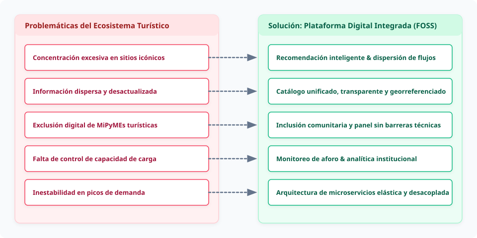

<b>Ver especificación de código Mermaid del diagrama</b>

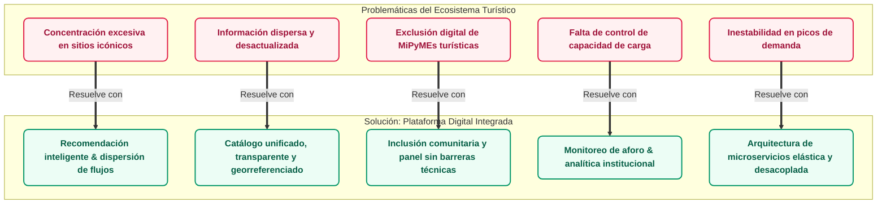

#### Problemáticas Identificadas

1. **Saturación y sobrecarga en zonas sensibles:** Concentración excesiva de turistas en atractivos tradicionales durante temporadas altas, impactando negativamente ecosistemas frágiles (ej. Parque Tayrona, Minca).
2. **Fragmentación y heterogeneidad de la oferta:** Baja integración entre hoteles, restaurantes, operadores y guías, con datos dispersos sobre disponibilidad, horarios, tarifas y normativas.
3. **Brecha digital y visibilidad inequitativa:** Limitada presencia tecnológica de micro, pequeños y medianos prestadores turísticos frente a grandes cadenas, muchos de ellos ubicados en zonas rurales con conectividad intermitente (ej. Minca, Sierra Nevada).
4. **Ausencia de gestión integrada de reservas y aforos:** Dificultad para consultar disponibilidad centralizada y gestionar solicitudes de reserva de forma anticipada.
5. **Déficit de inteligencia turística y datos para la toma de decisiones:** Carencia de indicadores consolidados de demanda, ocupación y capacidad de carga para la formulación de políticas públicas.
6. **Inestabilidad del servicio en picos de demanda:** Riesgo de degradación de sistemas digitales convencionales ante la concurrencia estacional masiva.

> [!NOTE]
> **Definición de Temporada Alta y Respaldo Cuantitativo:** Se contempla complementar la caracterización del problema con estadísticas oficiales del Sistema de Información Turística (SITUR Magdalena), Cotelco Magdalena y la Secretaría de Desarrollo Económico y Sostenibilidad de Santa Marta antes de la sustentación final.

---

### 2.2 Funciones del producto

La plataforma articula sus capacidades a través de un conjunto integrado de funciones principales que resuelven las problemáticas del ecosistema:

1. **Catálogo Unificado y Búsqueda Geoespacial Multicriterio (RF-01, RF-02):** Centralización de atractivos turísticos, actividades culturales y oferta gastronómica/hotelera con navegación georreferenciada sobre mapas abiertos y filtros por zona, precio y categoría.
2. **Control Atómico de Disponibilidad y Solicitud de Reservas (RF-03, RF-04, RF-05):** Motor transaccional para consulta de cupos en tiempo real, emisión de solicitudes de reserva por parte de turistas y gestión de confirmaciones/cancelaciones por parte de prestadores verificados, bajo una máquina de estados explícita (Sección 3.6.1).
3. **Recomendación Inteligente Justificada y Dispersión Sostenible (RF-06):** Chatbot de recomendaciones, desacoplado del núcleo transaccional, que consume la API de Gemini y consulta la información de la plataforma mediante herramientas para sugerir actividades personalizadas acompañadas de justificaciones comprensibles, con el propósito de contribuir a la redistribución de visitantes hacia destinos emergentes.
4. **Inteligencia de Negocios y Tableros para Gobernanza del Destino (RF-07, RF-13):** Consolidación analítica de métricas de demanda, cálculo estimativo de presión sobre capacidades de carga y exportación de reportes estructurados (CSV/PDF) para autoridades turísticas.
5. **Inclusión Digital de Prestadores Comunitarios (RF-08):** Formularios simplificados y asistidos para que pequeños operadores locales y comunitarios publiquen sus servicios sin barreras técnicas, incluso con conectividad intermitente (RNF-13).
6. **Seguridad Integral, IAM y Auditoría Inmutable (RF-09, RF-12):** Gestión perimetral de identidades con JWT, control estricto de roles (RBAC), verificación documental (RNT, RUT) y registro auditable de eventos críticos de todos los módulos.
7. **Internacionalización y Accesibilidad (RF-10):** Soporte bilingüe completo (Español/Inglés) con estándares de contraste y adaptabilidad WCAG 2.1 AA.
8. **Mensajería Transaccional Asíncrona (RF-11):** Despacho automatizado de notificaciones por correo electrónico ante cambios en el ciclo de vida de las reservas.
9. **Reseñas y Retroalimentación Comunitaria (RF-14):** Calificaciones y reseñas de servicios efectivamente utilizados, con respuesta pública del prestador y moderación del contenido reportado.
10. **Operación con Conectividad Limitada (RNF-13):** Consulta del catálogo sin conexión y envío diferido de formularios mediante la PWA.

---

### 2.3 Características de los usuarios / Stakeholders

Conforme al estándar ISO/IEC/IEEE 29148:2018, los interesados del sistema se clasifican para delimitar el alcance, las responsabilidades operativas y la trazabilidad de requerimientos.

| Tipo | Stakeholder | Rol frente al Sistema | Intereses y Necesidades Principales |
|---|---|---|---|
| **Actor Directo** | **Turista** *(Nacional / Internacional)* | Usuario final que explora, consulta, solicita reservas y califica servicios turísticos. | • Información veraz, consolidada y en tiempo real. • Recomendaciones inteligentes y contextuales. • Proceso de solicitud de reserva ágil e intuitivo. • Interfaz bilingüe (Español/Inglés) y accesible. |
| **Actor Directo** | **Prestador Turístico** *(Hoteles, restaurantes, guías, operadores)* | Proveedor de información que publica ofertas, gestiona disponibilidad y atiende solicitudes. | • Canal de visibilidad digital gratuito y equitativo. • Administración simplificada de cupos y tarifas, aun con conexión intermitente. • Protección de su información comercial. • Interacción directa con las reseñas de sus clientes. |
| **Actor Directo** | **Entidad de Gestión del Destino** *(Secretaría de Turismo, INDETUR, Corpoteyrona)* | Actor institucional responsable de la gobernanza, sostenibilidad y políticas turísticas. | • Acceso a analítica de demanda, tendencias y aforos. • Herramientas de alerta y comunicación oficial. • Reportes estructurados para toma de decisiones. |
| **Actor Directo** | **Administrador del Sistema** | Gestor técnico y operativo de la plataforma. | • Control de identidades, roles (RBAC) y permisos. • Verificación de legitimidad de prestadores. • Moderación de reseñas reportadas. • Auditoría de seguridad y monitoreo de desempeño. |
| **Actor Indirecto / Normativo** | **Ente Regulador** *(Superintendencia de Industria y Comercio - SIC)* | Autoridad de supervisión de datos personales. | • Cumplimiento riguroso de la Ley Estatutaria 1581 de 2012 y Habeas Data. • Trazabilidad de consentimientos informados. |
| **Actor Indirecto / Externo** | **Servicios de Cartografía Abierta** *(OpenStreetMap / Nominatim)* | Proveedor de infraestructura geoespacial FOSS. | • Geolocalización, cálculo de distancias y visualización de capas de mapas sin costos de licenciamiento comercial. |
| **Actor Indirecto / Externo** | **Servicio de IA Generativa** *(API de Google Gemini)* | Proveedor externo del modelo de lenguaje que utiliza el chatbot de recomendaciones. | • Generación de respuestas en lenguaje natural y solicitud de las herramientas que requiere cada consulta. • Operación dentro de las condiciones de uso, los límites de solicitudes y los costos de consumo del proveedor. |
| **Actor Indirecto / Externo** | **Servicio de Notificaciones** *(SMTP: Postal o servidor institucional)* | Proveedor de entrega de correos transaccionales. | • Entrega confiable de correos de confirmación de reserva y avisos de seguridad. |

> [!IMPORTANT]
> **Restricción Normativa de Registro (Habeas Data):** El registro en la plataforma está formalmente restringido a personas **mayores de 18 años**. El tratamiento de datos de menores de edad queda fuera de alcance en esta iteración para simplificar el régimen legal aplicable.

---

### 2.4 Restricciones generales

#### 2.4.1 Restricciones Técnicas
* **Arquitectura de Microservicios:** Implementación de los 5 microservicios desacoplados definidos en la Sección 3.6 (el Módulo 2 consolida Catálogo, GIS e Inteligencia de Destino).
* **Lenguaje y Paradigma:** Todos los microservicios se desarrollan en Python con FastAPI, bajo el paradigma orientado a objetos y una arquitectura hexagonal (puertos y adaptadores). Cada servicio es una aplicación HTTP estándar empaquetada como contenedor, sin dependencias de una plataforma de ejecución específica.
* **Plataforma de Despliegue:** Los microservicios, el API Gateway, el broker y los almacenes de datos se despliegan como contenedores sobre Kubernetes (k3s). Docker Compose se utiliza únicamente como entorno de desarrollo local.
* **Consumo de IA mediante API:** El chatbot de recomendaciones (RF-06) utiliza la API de Google Gemini como servicio externo; no se despliega ni se entrena un modelo propio. Por tratarse de un servicio propietario, constituye la única excepción a la prioridad de software libre.
* **Persistencia Políglota FOSS:** Uso de motores de datos de código abierto bajo el principio *Database-per-Service*: PostgreSQL (con PostGIS para datos espaciales y JSONB para documentos), Valkey en memoria y almacenamiento de objetos compatible con S3 (SeaweedFS).
* **Integración Abierta:** Prohibición del uso de APIs privativas de mapas con costos por consumo (ej. Google Maps API); uso estricto del ecosistema OpenStreetMap. Esta restricción aplica a servicios de cartografía y geocodificación; no alcanza al consumo de la API de Gemini para el chatbot.
* **Compatibilidad Multiplataforma:** Interfaz web responsiva (PWA) compatible con navegadores móviles y de escritorio modernos sin requerir instalación de aplicativos nativos.
* **Conectividad Limitada:** La interfaz debe seguir siendo útil con conexión intermitente: catálogo consultable sin conexión y formularios conservados hasta que vuelva la conexión (RNF-13).

#### 2.4.2 Restricciones Económicas y de Recursos
* **Techo Presupuestal:** Límite financiero estricto de **USD 20.000**, con esquemas de ejecución transparente para prototipo académico (USD 6.900) o despliegue institucional piloto (USD 20.000). Desglose en el [Apéndice D](#apéndice-d-plan-de-proyecto-cronograma-y-presupuesto).
* **Talento Humano:** Proyecto ejecutado por un equipo de 5 ingenieros en un marco temporal de 13 semanas lectivas, del 24 de agosto al 17 de noviembre de 2026, con sustentación entre el 15 y el 17 de noviembre (dentro del máximo de 6 meses del enunciado).
* **Modelo Gratuito:** Sin monetización directa ni comisiones sobre transacciones de reserva.

#### 2.4.3 Restricciones Sociales y de Accesibilidad
* **Inclusión de la Economía Popular:** Interfaces intuitivas diseñadas para prestadores turísticos tradicionales con baja alfabetización digital y conectividad limitada (RF-08, RNF-13).
* **Internacionalización:** Soporte bilingüe completo (Español / Inglés) en catálogo y flujos transaccionales.
* **Límite de Edad:** Registro exclusivo para personas mayores de 18 años para resguardar la privacidad infantil.

#### 2.4.4 Restricciones Ambientales y de Sostenibilidad
* **Protección de Ecosistemas Vulnerables:** Las recomendaciones del chatbot deben priorizar destinos con baja presión sobre la capacidad de carga y evitar zonas con alertas oficiales activas, orientando la dispersión de flujos turísticos hacia destinos emergentes para mitigar la saturación de áreas protegidas de la Sierra Nevada y el Parque Tayrona.
* **Monitoreo de Capacidad de Carga:** Indicadores analíticos para apoyar las restricciones de ingreso dictadas por autoridades ambientales.

#### 2.4.5 Restricciones Normativas y Legales
* **Ley 1581 de 2012 (Protección de Datos Personales):** Consentimiento informado previo, almacenamiento cifrado de datos sensibles y derecho de actualización/supresión (Habeas Data).
* **Ley General de Turismo (Ley 300 de 1996 / Ley 2068 de 2020):** Exigencia del Registro Nacional de Turismo (RNT) como requisito de verificación para prestadores comerciales.

#### 2.4.6 Restricciones Éticas en Inteligencia Artificial
* **Transparencia Ética (RNF-08):** Toda recomendación turística generada por el chatbot debe acompañarse de una justificación comprensible para el usuario final, basada en la información consultada en la plataforma y en los criterios pertinentes de la respuesta (preferencias expresadas, ubicación, categoría, entre otros). La justificación explica la respuesta entregada; no constituye una garantía de infalibilidad ni una auditoría del modelo de Gemini.
* **Equidad y Neutralidad:** Las recomendaciones del chatbot no deben aplicar criterios discriminatorios ni favorecer comercialmente a ningún operador sobre otro.

---

### 2.5 Supuestos y dependencias

1. **Supuesto de Información Disponible para el Chatbot:** El chatbot de recomendaciones (RF-06) no requiere historiales de transacciones de turistas ni un dataset propio: se asume que construye sus respuestas con la información que obtiene de la plataforma mediante herramientas (atractivos, actividades, prestadores y demás datos pertinentes) y, por tanto, que la calidad de las recomendaciones depende de la completitud y la actualización de esa información.
2. **Dependencia de la Infraestructura de Cartografía Abierta (OSM / Nominatim):** El módulo de Catálogo y GIS depende operativamente de los servidores de teselas (*tiles*) y APIs de geocodificación de OpenStreetMap y Nominatim, asumiendo su disponibilidad bajo las políticas de uso justo del ecosistema FOSS. Por esas políticas, la PWA solo conserva en caché las teselas que el usuario ya visualizó; no descarga mapas de forma masiva.
3. **Dependencia del Servicio de Transporte de Correo (SMTP):** El despacho de correos electrónicos transaccionales de confirmación de reserva (UC36, RF-11) y restablecimiento de credenciales depende de la conectividad con un servidor de correo saliente SMTP (Postal, servidor FOSS, o el servidor institucional).
4. **Dependencia de Verificación Administrativa Humana:** La activación pública de las ofertas de prestadores depende del proceso de revisión y validación manual de los documentos de acreditación legal (RNT, RUT) por parte del rol Administrador del Sistema.
5. **Dependencia de Información Oficial de Destino:** La calibración de los límites de aforo y alertas institucionales asume la provisión periódica de lineamientos de capacidad de carga por parte de la Entidad de Gestión (INDETUR, Corpoteyrona, Parques Nacionales Naturales).
6. **Dependencia del Servicio Externo de IA (API de Google Gemini):** El chatbot depende de la disponibilidad de la API de Gemini y se asumen credenciales de acceso vigentes. Se consideran aspectos de diseño, no fallos confirmados: la dependencia de la disponibilidad del proveedor, los límites de solicitudes, los costos de consumo y la latencia de las consultas. El núcleo transaccional se diseña para seguir operando ante una indisponibilidad del servicio de IA. Dado que la conversación y los resultados de las herramientas viajan a un servicio externo, al modelo se le envía el mínimo de información necesaria (nunca el nombre, el correo ni el documento del turista) y, antes de enviar información de turistas reales, se deben revisar las condiciones de uso de datos del plan de Gemini utilizado (Ley 1581 de 2012).
7. **Dependencia de la Infraestructura de Cómputo:** El prototipo asume la disponibilidad de al menos una máquina virtual Linux de bajo costo (Escenario A) para el clúster k3s, y de tres nodos en el piloto institucional (Escenario B). La capacidad de escalado horizontal está limitada por los recursos de esos nodos.
8. **Dependencia de Capacidades del Navegador:** La operación sin conexión (RNF-13) asume navegadores con soporte de Service Worker e IndexedDB. Donde no exista la API *Background Sync*, la PWA reintenta el envío al detectar la reconexión o al volver a abrir la aplicación.

---

## 3. Requerimientos Específicos

### 3.1 Requerimientos funcionales

A continuación se detalla la especificación completa de los requerimientos funcionales del sistema, priorizados bajo la metodología MoSCoW:

| ID | Requerimiento Funcional | Prioridad | Módulo Asignado | Stakeholder | Criterio de Verificación |
|---|---|---|---|---|---|
| **RF-01** | Consultar catálogo de atractivos, actividades y eventos turísticos. | **Must** | Módulo 2: Catálogo, GIS & Destino | Turista | Visualización completa del catálogo con filtros básicos sin requerir autenticación. |
| **RF-02** | Buscar y filtrar servicios por categoría, ubicación espacial, tarifa y disponibilidad. | **Must** | Módulo 2: Catálogo, GIS & Destino | Turista | Los filtros combinados devuelven resultados exactos en un tiempo inferior a 1.5s. |
| **RF-03** | Consultar la disponibilidad actualizada de cupos de un servicio. | **Must** | Módulo 3: Reservas & Cupos | Turista | El calendario refleja en tiempo real los cupos habilitados por el prestador. |
| **RF-04** | Registrar solicitudes de reserva de actividades o servicios turísticos y gestionar su ciclo de vida según la máquina de estados de la Sección 3.6.1. | **Must** | Módulo 3: Reservas & Cupos | Turista, Prestador | Se genera una reserva en estado `Solicitada` visible en el panel del turista y del prestador; solo se permiten las transiciones definidas. |
| **RF-05** | Permitir a los prestadores registrar y actualizar su oferta y cupos. | **Must** | Módulos 2 y 3 | Prestador | Un prestador verificado crea y edita servicios visualizándose inmediatamente en el catálogo. |
| **RF-06** | Ofrecer recomendaciones turísticas personalizadas y justificadas mediante un chatbot que consume la API de Gemini y consulta la información de la plataforma a través de herramientas. | **Should** | Módulo 5: IA & Recomendación | Turista | El usuario recibe sugerencias basadas en su consulta y preferencias, construidas con datos consultados en la plataforma, junto con la justificación (RNF-08). |
| **RF-07** | Generar tableros e indicadores agregados de demanda y aforo para planificación. | **Should** | Módulo 2: Catálogo, GIS & Destino | Entidad | La entidad visualiza gráficos de demanda por zonas y estimación de concentración turística. |
| **RF-08** | Incorporación asistida y sin barreras técnicas para prestadores comunitarios. | **Should** | Módulos 1 y 2 | Prestador | El formulario de registro y carga de servicios no requiere más de 3 pasos sencillos. |
| **RF-09** | Gestión de identidades, control de acceso RBAC y bitácora de auditoría. | **Must** | Módulo 1: Seguridad & IAM | Admin | Intentos de acceso no autorizados devuelven HTTP 403 y quedan registrados en la bitácora. |
| **RF-10** | Disponibilidad de la interfaz en idiomas Español e Inglés (I18n). | **Should** | Transversal (Frontend PWA) | Turista, Entidad | Conmutación instantánea de idioma traduciendo etiquetas, menús y contenidos base. |
| **RF-11** | Enviar notificaciones por correo de confirmación/cancelación de reservas. | **Should** | Módulo 2 (consume eventos de reservas) | Turista, Prestador | Tras confirmarse la reserva (UC20), se despacha un correo formateado en menos de 10s. |
| **RF-12** | Permitir a prestadores adjuntar documentos de verificación legal (RNT, RUT). | **Should** | Módulo 1: Seguridad & IAM | Prestador, Admin | El prestador sube archivos PDF/imagen que son auditados por el administrador antes de publicar. |
| **RF-13** | Exportar reportes analíticos e indicadores en formatos estándar (CSV / PDF). | **Could** | Módulo 2: Catálogo, GIS & Destino | Entidad | Descarga funcional de archivos estructurados con métricas del destino. |
| **RF-14** | Calificar y reseñar servicios utilizados, con respuesta pública del prestador y moderación del contenido reportado. | **Should** | Módulo 4: Reseñas & Moderación | Turista, Prestador, Admin | Solo un turista con una reserva `Finalizada` del servicio puede reseñarlo; una reseña reportada pasa a `En_Revision` hasta la decisión del Administrador. |

---

### 3.2 Casos de uso

#### 3.2.1 Actores del Sistema
* **Turista (`Tur`):** Usuario final autenticado o anónimo que interactúa con el catálogo, solicita reservas y aporta reseñas.
* **Prestador de Servicios Turísticos (`Prest`):** Actor comercial verificado que administra servicios, cupos y atiende reservas.
* **Entidad de Gestión del Destino (`Entidad`):** Actor gubernamental o institucional que analiza métricas y emite avisos oficiales.
* **Administrador (`Admin`):** Custodio técnico de la seguridad, roles, moderación y observabilidad.
* **Sistema / Servicios Externos (`SysExt`):** Proveedor de mapas OSM, servidor de correo SMTP y proveedor de IA (API de Gemini).

#### 3.2.2 Matriz Detallada de Casos de Uso

Las relaciones siguen la semántica UML: `«include»` indica que el caso base **siempre** ejecuta el incluido como parte de su flujo y `«extend»` que el caso extensor agrega comportamiento opcional al caso base. Cuando un caso de uso depende de otro que ejecuta un actor distinto o en otro momento, la dependencia se expresa como **precondición** y no como `«include»`.

| Código | Caso de Uso | Actor Principal | Relaciones / Dependencias | Módulo Asignado |
|---|---|---|---|---|
| **UC1** | Registrarse en la plataforma (18+ años) | Turista, Prestador | `<<include>>` UC6 | Módulo 1: Seguridad & IAM |
| **UC2** | Iniciar sesión y obtener token de acceso | Todos los actores | Control de acceso perimetral | Módulo 1: Seguridad & IAM |
| **UC3** | Recuperar / restablecer contraseña | Turista, Prestador, Entidad | Verificación vía correo | Módulo 1: Seguridad & IAM |
| **UC4** | Gestionar perfil de usuario | Turista, Prestador | - | Módulo 1: Seguridad & IAM |
| **UC5** | Cambiar idioma de la interfaz (ES / EN) | Turista, Entidad | I18n transversal en frontend | Transversal (Frontend) |
| **UC6** | Aceptar política de tratamiento de datos personales | Sistema / Transversal | `<<include>>` en UC1 | Módulo 1: Seguridad & IAM |
| **UC7** | Consultar catálogo de atractivos, actividades y eventos | Turista (anónimo/autenticado) | Base de búsqueda; disponible sin conexión con los datos ya consultados (RNF-13) | Módulo 2: Catálogo, GIS & Destino |
| **UC8** | Buscar y filtrar servicios (precio, zona, tipo) | Turista | `<<include>>` UC7 | Módulo 2: Catálogo, GIS & Destino |
| **UC9** | Consultar detalle de atractivo / servicio | Turista | `<<include>>` UC7 | Módulo 2: Catálogo, GIS & Destino |
| **UC10** | Consultar disponibilidad en tiempo real | Turista | `<<include>>` en UC11 | Módulo 3: Reservas & Cupos |
| **UC11** | Solicitar reserva de actividad o servicio | Turista | `<<include>>` UC2, `<<include>>` UC10; requiere conexión | Módulo 3: Reservas & Cupos |
| **UC12** | Cancelar / modificar solicitud de reserva | Turista | `<<include>>` UC13; modificar solo en estado `Solicitada` | Módulo 3: Reservas & Cupos |
| **UC13** | Consultar historial de reservas propias | Turista | - | Módulo 3: Reservas & Cupos |
| **UC14** | Recibir recomendaciones personalizadas justificadas mediante chatbot | Turista | Invoca herramientas de solo lectura sobre UC8, UC9, UC10, UC13, UC15, UC24 y UC26; consume la API de Gemini | Módulo 5: IA & Recomendación |
| **UC15** | Calificar y redactar reseña de experiencia | Turista | Precondición: reserva `Finalizada` del servicio; puede ser reportada (UC39) | Módulo 4: Reseñas & Moderación |
| **UC16** | Visualizar mapa interactivo de atractivos y zonas | Turista, Entidad | Integración OpenStreetMap | Módulo 2: Catálogo, GIS & Destino |
| **UC17** | Registrar nueva oferta turística | Prestador | `<<include>>` UC2; precondición: prestador aprobado (UC28) | Módulo 2: Catálogo, GIS & Destino |
| **UC18** | Editar / actualizar información de servicio | Prestador | `<<include>>` UC2 | Módulo 2: Catálogo, GIS & Destino |
| **UC19** | Gestionar calendario de disponibilidad y tarifas | Prestador | `<<include>>` UC2 | Módulo 3: Reservas & Cupos |
| **UC20** | Confirmar / rechazar solicitudes de reserva | Prestador | Dispara el evento `reserva.confirmada` o `reserva.rechazada` hacia UC36; requiere conexión | Módulo 3: Reservas & Cupos |
| **UC21** | Responder públicamente a comentarios de turistas | Prestador | Precondición: existe una reseña publicada (UC15) | Módulo 4: Reseñas & Moderación |
| **UC22** | Consultar métricas de rendimiento de su oferta | Prestador | - | Módulo 2: Catálogo, GIS & Destino |
| **UC23** | Consultar indicadores agregados de demanda turística | Entidad | `<<include>>` en UC25 | Módulo 2: Catálogo, GIS & Destino |
| **UC24** | Monitorear estimación de capacidad de carga | Entidad | `<<include>>` en UC25 | Módulo 2: Catálogo, GIS & Destino |
| **UC25** | Generar tableros de planificación turística | Entidad | `<<include>>` UC23, `<<include>>` UC24 | Módulo 2: Catálogo, GIS & Destino |
| **UC26** | Publicar alertas oficiales y avisos de sostenibilidad | Entidad | - | Módulo 2: Catálogo, GIS & Destino |
| **UC27** | Administrar usuarios, roles y asignación de permisos | Admin | Control RBAC central | Módulo 1: Seguridad & IAM |
| **UC28** | Aprobar / rechazar prestadores de servicios | Admin | Precondición: documentos cargados (UC37); publica el evento `prestador.aprobado` | Módulo 1: Seguridad & IAM |
| **UC29** | Moderar reseñas y contenido sensible reportado | Admin | Atiende las reseñas reportadas (UC39) | Módulo 4: Reseñas & Moderación |
| **UC30** | Configurar integraciones y orígenes de datos abiertos | Admin | - | Transversal (Config / GW) |
| **UC31** | Monitorear telemetría y métricas de salud del sistema | Admin | Prometheus, Grafana y Loki | Transversal (Observabilidad) |
| **UC32** | Gestionar políticas de seguridad y rate limiting | Admin | Políticas aplicadas en Traefik | Módulo 1: Seguridad & IAM |
| **UC33** | Consultar bitácora de auditoría inmutable | Admin | Trazabilidad RNF-10 | Módulo 1: Seguridad & IAM |
| **UC36** | Despachar notificación de confirmación por correo | Sistema / SysExt | Disparado por UC20 (evento `reserva.confirmada`) | Módulo 2: Catálogo, GIS & Destino |
| **UC37** | Cargar documentos de verificación (RNT, RUT) | Prestador | Precondición de UC28 | Módulo 1: Seguridad & IAM |
| **UC38** | Exportar reportes analíticos (CSV / PDF) | Entidad | `<<extend>>` UC25 | Módulo 2: Catálogo, GIS & Destino |
| **UC39** | Reportar reseña inapropiada | Turista, Prestador | Activa la revisión de UC29; la reseña pasa a `En_Revision` | Módulo 4: Reseñas & Moderación |

> [!NOTE]
> Los códigos UC34 y UC35 (pagos en línea) quedan reservados y fuera de alcance por la decisión de la Sección 1.2.1.

#### 3.2.3 Diagramas de Casos de Uso por Actor

El modelo de casos de uso se presenta en **cuatro vistas por actor principal**, agrupando los casos de uso según el módulo que los implementa. Convenciones:

* Las líneas continuas asocian al actor con los casos de uso que inicia.
* Las líneas punteadas con estereotipo indican relaciones `«include»`, `«extend»` o disparo de eventos (`«trigger»`), según la Sección 3.2.2.
* Los casos de uso en gris pertenecen a otro actor y se muestran solo para conservar las precondiciones; las notas explican la dependencia.
* Todos los casos de uso que requieren autenticación incluyen UC2 (*Iniciar sesión*); esa relación se omite en los diagramas para no saturarlos.

La vista general con todos los actores se conserva como referencia en [CasosDeUso_PlataformaTurismoSantaMarta.svg](./CasosDeUso_PlataformaTurismoSantaMarta.svg). Las fuentes PlantUML de todas las vistas están en [`fuentes/`](./fuentes/).

##### Vista 1: Turista

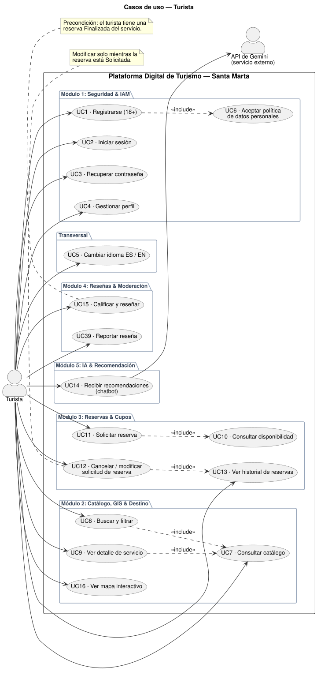

##### Vista 2: Prestador de Servicios Turísticos

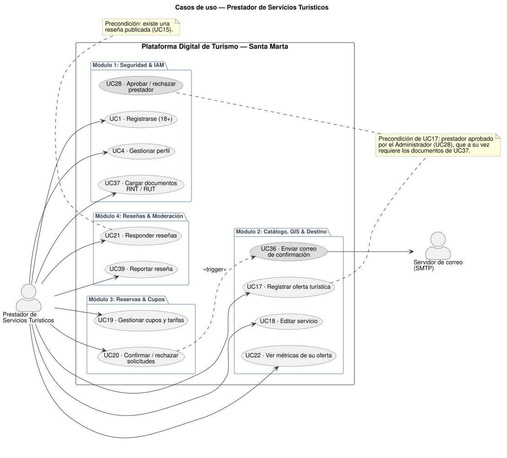

##### Vista 3: Entidad de Gestión del Destino

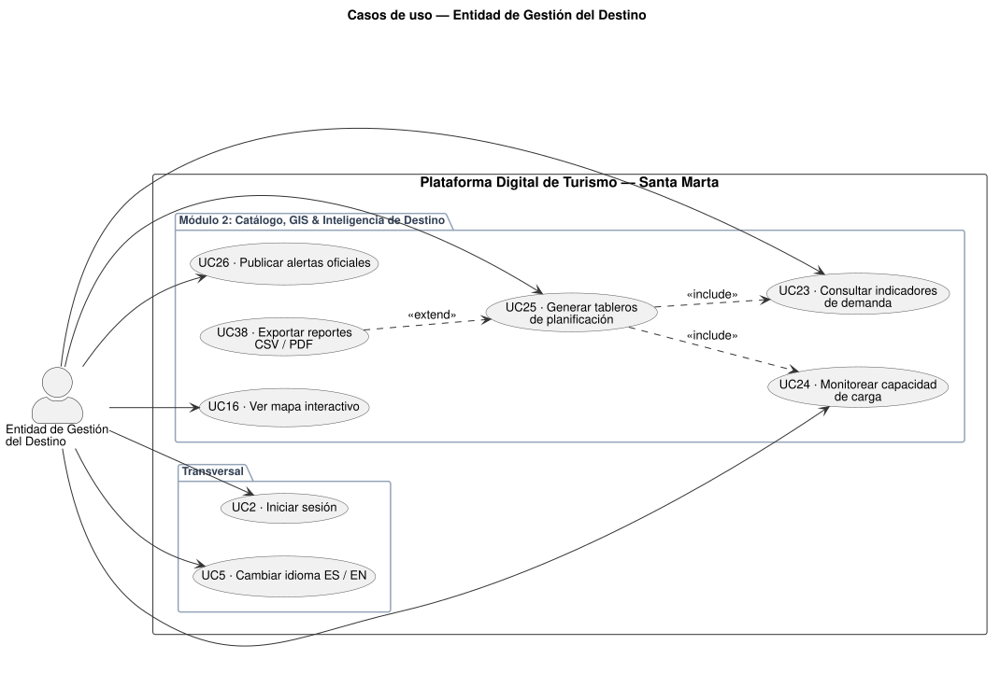

##### Vista 4: Administrador del Sistema

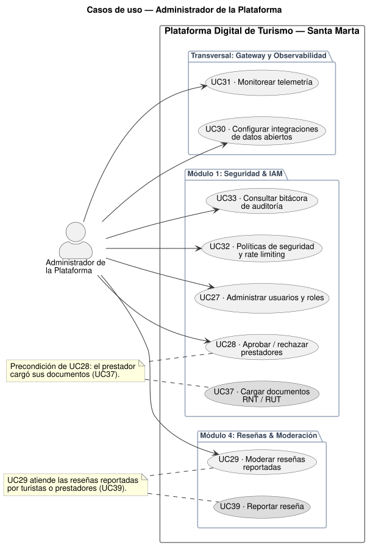

---

### 3.3 Requerimientos de interfaz

#### 3.3.1 Interfaces de Usuario (UI)
* **Aplicación Web Progresiva (PWA):** La interfaz se construye con HTML5, CSS3 y Vue.js 3, y se entrega como PWA instalable desde el navegador, optimizada para resoluciones móviles (desde 360px de ancho) y pantallas de escritorio.
* **Operación sin Conexión (RNF-13):** Un Service Worker conserva la aplicación y el catálogo ya consultado; los formularios se guardan en IndexedDB con el estado visible "Pendiente de envío" y se envían automáticamente al recuperar la conexión. La interfaz indica siempre si el usuario está sin conexión y la fecha de la última actualización del catálogo.
* **Internacionalización Dinámica (I18n):** Mecanismo de alternancia instantánea entre Español (idioma por defecto) e Inglés mediante archivos de recursos JSON sin recarga completa de página.
* **Accesibilidad Web:** Cumplimiento de las directrices WCAG 2.1 Nivel AA, asegurando relaciones de contraste de color mínimas de 4.5:1 para texto estándar, etiquetas descriptivas en controles interactivos (`aria-label`) y soporte de navegación por teclado.

#### 3.3.2 Interfaces de Software / APIs Externas
* **OpenStreetMap / Nominatim (API de Cartografía y Geocodificación):**
  * *Protocolo:* HTTPS / REST.
  * *Formato:* Tiles ráster/vectoriales (XYZ) y respuestas JSON para geocodificación inversa.
  * *Librería Cliente:* Leaflet.js.
  * *Finalidad:* Despliegue de capas cartográficas, marcadores interactivos de atractivos y cálculo de distancias aproximadas en el Módulo 2.
* **Servicio de Notificaciones por Correo Electrónico (SMTP):**
  * *Protocolo:* SMTP sobre TLS (puertos 587 / 465).
  * *Formato de Contenido:* Mensajes multiparte MIME con versión HTML enriquecida y texto plano.
  * *Finalidad:* Envío de enlaces de confirmación, restablecimiento de credenciales (Módulo 1) y avisos sobre el estado de las reservas (Módulo 2).
* **Plataforma de Datos Abiertos de Colombia:**
  * *Protocolo:* HTTPS / REST (Socrata Open Data API - SODA) o ingesta periódica de archivos CSV/JSON.
  * *Finalidad:* Enriquecimiento de indicadores de demanda y calibración de atractivos culturales en el Módulo 2.
* **API de Google Gemini (Servicio de IA Generativa):**
  * *Protocolo:* HTTPS / REST.
  * *Formato:* Mensajes JSON con la consulta del usuario, la declaración de las herramientas disponibles y la respuesta generada.
  * *Finalidad:* Generación de las respuestas del chatbot de recomendaciones (Módulo 5) y solicitud de las herramientas necesarias para consultar información de la plataforma. La ejecución de las herramientas y el acceso a los datos se realizan en la plataforma; el equipo no entrena ni ajusta el modelo con esos datos. Al modelo solo se le envía el mínimo de información necesaria, nunca el nombre, el correo ni el documento del turista.

#### 3.3.3 Interfaces de Comunicación e Integración
* **API Gateway Perimetral (Traefik):**
  * *Protocolo:* HTTPS (TLS 1.3) con intercambio de cargas en JSON (RESTful), documentado bajo OpenAPI 3.0.
  * *Enrutamiento:* Por prefijo de ruta hacia cada microservicio: `/api/iam`, `/api/catalog`, `/api/bookings`, `/api/reviews` y `/api/recommendations`.
  * *Seguridad:* Validación del encabezado `Authorization: Bearer <JWT>` en las rutas protegidas mediante ForwardAuth contra el Módulo 1, Rate Limiting y CORS. Las rutas públicas del catálogo (RF-01) no requieren token.
* **Bus de Mensajería Asíncrona (Event Bus):**
  * *Protocolo:* AMQP 0-9-1 sobre RabbitMQ, exchange `turismo.eventos` de tipo *topic*.
  * *Contratos:* Esquemas JSON versionados con un sobre común (`event_id`, `event_type`, `occurred_at`, `correlation_id`), definidos en la carpeta `contracts/events/` del repositorio.
  * *Finalidad:* Desacople asíncrono de tareas auxiliares: correos y métricas en el Módulo 2, habilitación de reseñas en el Módulo 4 y bitácora de auditoría en el Módulo 1 (ver Sección 3.6.2).

---

### 3.4 Requerimientos no funcionales / atributos de calidad

| ID | Atributo | Requerimiento No Funcional | Prioridad | Estándar / Verificación |
|---|---|---|---|---|
| **RNF-01** | **Disponibilidad** | El sistema debe mantener una tasa de disponibilidad operativa $\ge 99.0\%$ durante su ventana de servicio. | **Should** | Monitoreo continuo mediante sondas de salud (`/health`) consultadas por Prometheus. |
| **RNF-02** | **Escalabilidad** | La arquitectura de microservicios debe escalar horizontalmente ante incrementos de tráfico en temporada alta. | **Must** | Pruebas de carga simulada con herramientas FOSS (k6 / Locust) y escalado automático con HPA. |
| **RNF-03** | **Interoperabilidad** | La plataforma debe exponer APIs REST documentadas bajo especificación OpenAPI 3.0. | **Must** | Validación con esquemas Swagger/OpenAPI y consumo desacoplado. |
| **RNF-04** | **Seguridad** | Autenticación basada en JWT, cifrado de credenciales con Argon2id y cumplimiento de la Ley 1581 de 2012. | **Must** | Pruebas de vulnerabilidad estática y registro explícito de consentimiento (UC6). |
| **RNF-05** | **Mantenibilidad** | El desacople entre microservicios debe permitir modificar o desplegar módulos (incluido el componente del chatbot) sin alterar el núcleo. | **Should** | Tiempo estimado de incorporación de un nuevo servicio $\le 5$ días-persona a partir de la plantilla base. |
| **RNF-06** | **Rendimiento** | El tiempo de respuesta para el 95% de las consultas de catálogo debe ser inferior a 2.0 segundos. | **Must** | Medición de latencia percentil 95 ($p95$) bajo concurrencia controlada. |
| **RNF-07** | **Accesibilidad** | Las interfaces deben satisfacer pautas de diseño accesible (WCAG 2.1 Nivel AA básico: contraste, texto escalable). | **Should** | Evaluación con herramientas de auditoría accesible (Lighthouse / axe-core). |
| **RNF-08** | **Transparencia Ética** | Toda recomendación generada por el chatbot de IA debe ir acompañada de una justificación comprensible, basada en la información consultada en la plataforma y en los criterios pertinentes de la respuesta. | **Should** | Revisión de un conjunto de consultas de prueba: cada recomendación incluye una justificación visible al turista que referencia los datos consultados (p. ej. categoría, ubicación, tarifa) y las preferencias expresadas. |
| **RNF-09** | **Respaldo & Recuperación** | Mecanismos de copia de seguridad periódica de las bases de datos y procedimiento de restauración validado. | **Should** | Ejecución de al menos un simulacro de restauración de datos documentado (CloudNativePG). |
| **RNF-10** | **Auditoría de Seguridad** | Registro inmutable de eventos administrativos, accesos denegados y modificaciones de estado de todos los módulos. | **Must** | Consulta de bitácora disponible en panel administrativo (UC33); la tabla de bitácora solo admite inserciones. |
| **RNF-11** | **Usabilidad** | El flujo de solicitud de reserva debe completarse en un máximo de 4 pasos interactivos. | **Should** | Validación mediante pruebas de usuario guiadas (Buscar $\rightarrow$ Detalle $\rightarrow$ Solicitar $\rightarrow$ Confirmar). |
| **RNF-12** | **Despliegue y Operación Continua** | Los 5 microservicios, el API Gateway, el broker y los almacenes de datos deben desplegarse como contenedores en Kubernetes (k3s) a partir de configuración declarativa versionada; las actualizaciones se aplican con *rolling update* y cada servicio expone `/health` y `/metrics`. El Módulo 5 mantiene siempre al menos una réplica activa. | **Must** | Despliegue reproducible desde los manifiestos del repositorio; una actualización de cualquier servicio se completa sin errores HTTP 5xx durante el cambio. |
| **RNF-13** | **Operación con Conectividad Limitada** | La PWA debe mostrar sin conexión el catálogo ya consultado y conservar los formularios de registro y edición de oferta (UC17, UC18), cupos y tarifas (UC19), reseñas (UC15) y perfil (UC4) hasta recuperar la conexión, enviándolos automáticamente una sola vez. | **Should** | Prueba en modo sin conexión del navegador (ESC-09): sincronización del 100% de los formularios pendientes sin duplicados. |

---

### 3.5 Escenarios de atributos de calidad

Formato de especificación formal: **Fuente $\rightarrow$ Estímulo $\rightarrow$ Ambiente $\rightarrow$ Artefacto $\rightarrow$ Respuesta $\rightarrow$ Medida de Respuesta**.

| ID | Atributo | Escenario Formal |
|---|---|---|
| **ESC-01** | **Disponibilidad** | *Fuente:* Caída imprevista de un nodo de servicio. *Estímulo:* Falla en el Módulo de Reseñas. *Ambiente:* Operación normal. *Artefacto:* API Gateway (Traefik), sondas de Kubernetes y módulos del backend. *Respuesta:* Kubernetes retira del enrutamiento las réplicas que no superan la sonda de disponibilidad y las reinicia, sin interrumpir la navegación en catálogo ni las reservas. *Medida:* Disponibilidad global del sistema $\ge 99.0\%$, tiempo de aislamiento $< 5$ segundos. |
| **ESC-02** | **Rendimiento & Carga** | *Fuente:* Turistas concurrentes en temporada de vacaciones. *Estímulo:* 500 solicitudes concurrentes por segundo en búsqueda de catálogo. *Ambiente:* Pico estacional. *Artefacto:* Módulo 2 (Catálogo) + caché Valkey. *Respuesta:* El sistema atiende las consultas apoyándose en caché en memoria. *Medida:* Tiempo de respuesta $p95 < 2.0$ segundos sin errores HTTP 5xx. |
| **ESC-03** | **Interoperabilidad** | *Fuente:* Desarrollador / Administrador. *Estímulo:* Integración de una nueva fuente de datos abiertos de eventos culturales. *Ambiente:* Mantenimiento evolutivo. *Artefacto:* Módulo 2 (Catálogo). *Respuesta:* Ingesta de datos vía API REST sin modificar la estructura del esquema relacional base. *Medida:* Incorporación funcional completada en $\le 3$ días hábiles. |
| **ESC-04** | **Seguridad & Auditoría** | *Fuente:* Usuario no autorizado / Atacante externo. *Estímulo:* Intento de acceso a endpoints de reportes institucionales sin token o con rol inválido. *Ambiente:* Operación normal. *Artefacto:* Módulo 1 (IAM), API Gateway y módulo que recibe la petición. *Respuesta:* Bloqueo inmediato de la petición (HTTP 401 sin token válido, HTTP 403 con rol insuficiente) y registro del evento (IP, timestamp, usuario) en la bitácora: el Módulo 1 lo escribe directamente si el rechazo ocurre en la validación del token, y el módulo afectado publica `auditoria.registrada` si el rechazo es por rol. *Medida:* 100% de los accesos indebidos registrados en la bitácora de auditoría inmutable. |
| **ESC-05** | **Mantenibilidad** | *Fuente:* Equipo de ingeniería. *Estímulo:* Ajuste de la configuración del chatbot (herramientas disponibles, parámetros de consumo o versión del modelo de la API de Gemini). *Ambiente:* Ciclo de desarrollo. *Artefacto:* Módulo 5 (IA). *Respuesta:* Actualización y despliegue del componente del chatbot mediante *rolling update*, sin reiniciar ni alterar los microservicios de Reservas o Catálogo. *Medida:* Cero tiempo de inactividad (*zero-downtime*) en el núcleo transaccional. |
| **ESC-06** | **Recuperación ante Fallos** | *Fuente:* Administrador del sistema. *Estímulo:* Simulación de corrupción de la base de datos de reservas. *Ambiente:* Prueba de contingencia. *Artefacto:* Respaldos de CloudNativePG en SeaweedFS y PostgreSQL (`booking_db`). *Respuesta:* Restauración del último respaldo programado. *Medida:* Tiempo de recuperación objetivo ($RTO) \le 30$ minutos; pérdida máxima de datos ($RPO) \le 24$ horas. |
| **ESC-07** | **Usabilidad** | *Fuente:* Turista primerizo. *Estímulo:* Búsqueda, selección y envío de solicitud de reserva para un tour ecológico. *Ambiente:* Dispositivo móvil con conexión estándar 4G. *Artefacto:* Interfaz de usuario web (PWA). *Respuesta:* Navegación guiada en un flujo de 4 pantallas consecutivas sin bloqueos. *Medida:* Tasa de éxito en la tarea $\ge 90\%$ en pruebas de usabilidad asistidas. |
| **ESC-08** | **Escalabilidad** | *Fuente:* Turistas concurrentes durante temporada alta (vacaciones de fin de año, Semana Santa). *Estímulo:* El tráfico sostenido sobre catálogo y reservas se duplica respecto al escenario ESC-02, pasando de 500 a 1.000 solicitudes por segundo durante al menos 30 minutos. *Ambiente:* Despliegue piloto en temporada alta, con capacidad de nodos aprovisionada para el pico. *Artefacto:* Módulo 2 (Catálogo & GIS) y Módulo 3 (Reservas & Cupos), desplegados en k3s con HPA. *Respuesta:* El HPA incrementa las réplicas únicamente de los servicios presionados, sin reiniciar ni escalar los demás microservicios; al descender la demanda, las réplicas adicionales se liberan. *Medida:* Réplicas adicionales listas en $\le 2$ minutos; la capacidad atendida crece al menos 1,8 veces al duplicar las réplicas; se mantiene $p95 < 2.0$ segundos y tasa de errores HTTP 5xx $< 1\%$ durante todo el pico. |
| **ESC-09** | **Conectividad Limitada** | *Fuente:* Prestador comunitario en zona rural (p. ej. Minca) con conexión intermitente. *Estímulo:* Edita su oferta (UC18) y actualiza cupos (UC19) mientras no tiene conexión. *Ambiente:* Sin conectividad durante 30 minutos; luego la conexión se restablece. *Artefacto:* PWA (Service Worker e IndexedDB) y Módulos 2 y 3. *Respuesta:* Los formularios quedan guardados con estado "Pendiente de envío" y se envían automáticamente al volver la conexión, con una clave de idempotencia que evita duplicados; si la oferta cambió en el servidor, el prestador ve el conflicto para resolverlo. Durante la desconexión, el catálogo ya consultado sigue visible. *Medida:* 100% de los formularios pendientes sincronizados en $\le 60$ segundos tras recuperar la conexión, 0 registros duplicados y catálogo consultado previamente visible sin conexión en $\le 3$ segundos. |

---

### 3.6 Requerimientos de diseño y restricciones de arquitectura

#### 3.6.1 Estilo Arquitectónico Base y Descomposición Modular

Se adopta una **Arquitectura de Microservicios Desacoplada**, organizada en **5 microservicios funcionales bien delimitados (*Bounded Contexts*)**, un **API Gateway perimetral (Traefik)** y una **Capa Transversal de Mensajería, Observabilidad y Presentación (PWA)**. Todos los componentes se ejecutan como contenedores sobre **Kubernetes (k3s)** y priorizan el Software Libre; la única dependencia propietaria es la API de Gemini.

> [!NOTE]
> **Justificación de la selección y detalle de implementación:** La comparación entre esta alternativa y un Monolito Modular, con tabla ponderada, decisión justificada y análisis de *trade-offs*, se documenta en [Comparación y Selección de Alternativas Arquitectónicas](./Comparacion_Alternativas_Arquitectonicas.md). Las decisiones de plataforma, lenguaje, gateway, broker, persistencia y conectividad están en el [Registro de Decisiones Arquitectónicas](./Registro_Decisiones_Arquitectonicas.md). El diseño interno (arquitectura hexagonal), los contratos, los flujos y el despliegue en k3s se desarrollan en el [Plan de Implementación y Funcionamiento Interno](./Plan_de_Implementacion.md).

*Fuente del diagrama: [`fuentes/generar_svg_arquitectura.py`](./fuentes/generar_svg_arquitectura.py).*

#### Detalle de Responsabilidades por Módulo

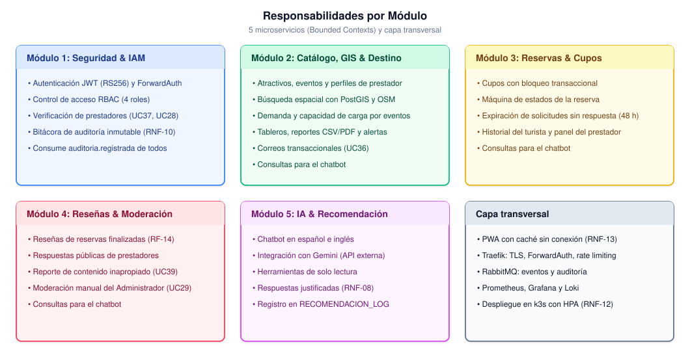

##### 1. Módulo 1: Autenticación, Seguridad y Gestión de Identidades (IAM Service)
* **Propósito:** Centralizar el control de acceso, la autenticación perimetral y la trazabilidad de seguridad del ecosistema.
* **Capacidades Principales:**
  * Emisión y firma de tokens de acceso JWT (RS256) y verificación de tokens para el API Gateway (ForwardAuth).
  * Control de acceso basado en roles (RBAC: `Turista`, `Prestador`, `Entidad`, `Admin`).
  * Almacenamiento seguro de credenciales con hashing criptográfico robusto (Argon2id).
  * Flujo administrativo de verificación de prestadores mediante documentos legales (RNT y RUT), almacenados en SeaweedFS; al aprobar un prestador publica el evento `prestador.aprobado`.
  * Bitácora inmutable de auditoría (RNF-10): registra directamente sus propios eventos y consume el evento `auditoria.registrada` que publican los demás módulos.

##### 2. Módulo 2: Catálogo, GIS & Inteligencia de Destino (Catalog, GIS & Destination Analytics Service)
* **Propósito:** Administrar la oferta turística georreferenciada y proveer inteligencia analítica y de gobernanza territorial a la Entidad de Gestión.
* **Capacidades Principales:**
  * Catálogo unificado de atractivos, actividades culturales/ecológicas y perfiles de prestadores (creados al consumir `prestador.aprobado`).
  * Búsqueda espacial y filtros multicriterio integrados con capas abiertas de OpenStreetMap y PostGIS.
  * Agregación analítica de demanda turística y cálculo de índices de presión sobre la capacidad de carga territorial, a partir de los eventos de reservas (`reserva.*`) que consume; el módulo no consulta la base de datos de reservas.
  * Consola de planificación con tableros de control y exportación de reportes estructurados (CSV/PDF) para autoridades turísticas.
  * Publicación de alertas oficiales de sostenibilidad y despacho de correos transaccionales (SMTP) ante los eventos de reservas.
  * Consultas para el chatbot: los contratos del módulo exponen la información de catálogo (UC8, UC9), de presión sobre la capacidad de carga (UC24) y de alertas oficiales (UC26) que el chatbot consulta mediante sus herramientas de solo lectura (ver Módulo 5), sin entrenar el modelo ni incorporar los datos a sus parámetros. Las funciones de catálogo y búsqueda que utiliza el turista en la interfaz (RF-01, RF-02) las desarrolla la plataforma.

##### 3. Módulo 3: Disponibilidad y Gestión de Reservas (Bookings & Availability Service)
* **Propósito:** Gestionar el ciclo de vida de las solicitudes de reserva y el control de cupos en tiempo real.
* **Capacidades Principales:**
  * Consulta atómica y bloqueo transaccional de cupos para evitar sobreventas (*overbooking*).
  * Máquina de estados de la reserva (ver diagrama) con expiración automática de las solicitudes que el prestador no responde en 48 horas y finalización automática después de la fecha de la reserva.
  * Consolas de gestión de solicitudes para prestadores y vista de historial para turistas.
  * Publicación de un evento por cada transición: `reserva.solicitada`, `reserva.confirmada`, `reserva.rechazada`, `reserva.cancelada` y `reserva.finalizada`.
  * Consultas para el chatbot: disponibilidad de cupos (UC10) e historial de reservas del turista autenticado (UC13).

**Máquina de estados de la reserva:**

<b>Ver especificación de código Mermaid de la máquina de estados</b>

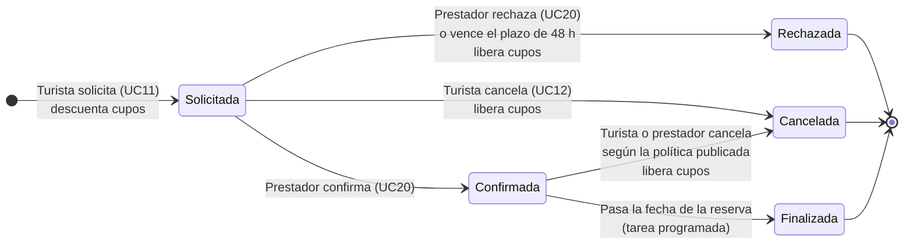

| Estado | Significado | Efecto sobre los cupos | Evento publicado al entrar |
|---|---|---|---|
| `Solicitada` | El turista envió la solicitud; espera respuesta del prestador durante 48 h. Solo en este estado se puede modificar (UC12). | Descuenta los cupos solicitados. | `reserva.solicitada` |
| `Confirmada` | El prestador aceptó la solicitud. | Sin cambio. | `reserva.confirmada` (dispara UC36) |
| `Rechazada` | El prestador la rechazó o venció el plazo de respuesta. Estado final. | Libera los cupos. | `reserva.rechazada` |
| `Cancelada` | El turista o el prestador la canceló según la política de cancelación publicada. Estado final. | Libera los cupos. | `reserva.cancelada` |
| `Finalizada` | Pasó la fecha de la reserva confirmada. Habilita la reseña del turista (RF-14). Estado final. | Sin cambio. | `reserva.finalizada` |

##### 4. Módulo 4: Anotaciones, Reseñas y Moderación (Reviews & Community Service)
* **Propósito:** Fomentar la retroalimentación comunitaria garantizando un entorno confiable y libre de contenido inapropiado.
* **Capacidades Principales:**
  * Registro de calificaciones multidimensionales y reseñas de experiencias, solo para turistas con una reserva `Finalizada` del servicio (el módulo conoce esa condición al consumir `reserva.finalizada`).
  * Canal de respuesta pública para prestadores verificados.
  * Reporte de reseñas inapropiadas por turistas y prestadores (UC39) y revisión manual, por parte del Administrador, del contenido reportado (UC29).
  * Publicación de `resena.publicada` para las métricas del prestador (UC22).
  * Consultas para el chatbot: reseñas y calificación de un servicio (UC15).

##### 5. Módulo 5: Inteligencia Artificial y Recomendación Desacoplada (AI Recommendation Chatbot)
* **Propósito:** Ofrecer recomendaciones personalizadas de atractivos y actividades mediante un chatbot que consume la API de Gemini, sin penalizar el rendimiento del núcleo transaccional.
* **Alcance del componente:** Gemini es un servicio externo consumido mediante API; las herramientas, la lógica de negocio y la integración las desarrolla el equipo. No se entrena, ajusta ni aloja un modelo propio. El chatbot es de solo lectura: no crea, modifica ni cancela reservas ni publica contenido, y orienta al turista hacia las pantallas de la plataforma para hacerlo. Sus respuestas se limitan al turismo en Santa Marta y a la plataforma, en español e inglés.
* **Persistencia:** El contexto de la conversación (últimos mensajes) se guarda en Valkey con expiración de 24 horas; las recomendaciones entregadas se registran de forma permanente en `RECOMENDACION_LOG`, en su propia base `recommendation_db` (PostgreSQL). No se almacena el texto completo de las conversaciones.
* **Capacidades previstas (fase de diseño):**
  * Recepción de la consulta del turista en lenguaje natural, con memoria de la conversación dentro de la sesión.
  * Identificación, por parte del modelo, de si necesita información de la plataforma para responder.
  * Invocación de herramientas de solo lectura que consultan datos de la plataforma:
    * búsqueda y detalle de servicios (Módulo 2; UC8, UC9);
    * disponibilidad e historial del turista (Módulo 3; UC10, UC13);
    * reseñas de un servicio (Módulo 4; UC15);
    * presión sobre la capacidad de carga y alertas oficiales (Módulo 2; UC24, UC26).
  * Organización de los resultados obtenidos y generación de una recomendación contextualizada, priorizando destinos con menor presión de capacidad de carga y evitando zonas con alertas oficiales activas (sección 2.4.4).
  * Presentación de una respuesta comprensible y justificada ante el usuario final (RNF-08).
  * Validación de la salida: solo se recomiendan servicios obtenidos mediante las herramientas y toda recomendación incluye su justificación; las recomendaciones entregadas se registran en `RECOMENDACION_LOG`.
  * Manejo de errores o de falta de información, informando al usuario sin inventar atractivos, servicios, precios ni disponibilidad.
* **Controles:** La identidad del turista se obtiene del token JWT validado por el gateway y nunca la define el modelo; los mensajes del turista y los resultados de las herramientas se tratan como datos, no como instrucciones del sistema.

##### 6. Capa Perimetral y Transversal
* **Propósito:** Presentación al usuario, enrutamiento perimetral seguro, mediación asíncrona y supervisión continua de la salud operativa.
* **Capacidades Principales:**
  * Frontend PWA: interfaz bilingüe y accesible con operación sin conexión (Sección 3.6.6).
  * API Gateway (Traefik): terminación TLS, ForwardAuth contra el Módulo 1, Rate Limiting y políticas de CORS.
  * Bus de eventos (RabbitMQ): exchange `turismo.eventos` para desacoplar procesos no bloqueantes (Sección 3.6.2).
  * Observabilidad: métricas con Prometheus, tableros con Grafana y registros centralizados con Loki; sondas de `/health` para RNF-01.

---

#### 3.6.2 Estilo de Comunicación entre Componentes

A nivel arquitectónico se adopta un **patrón híbrido**:

1. **Comunicación Síncrona (RESTful sobre HTTPS / JSON):**
   * Empleada en consultas y operaciones transaccionales directas del usuario (navegación del catálogo, consulta de disponibilidad, autenticación y registro de reservas), así como la interacción con el chatbot de recomendaciones (consulta del turista, invocación de herramientas y consumo de la API de Gemini).
   * Contratos de interfaz documentados formalmente bajo OpenAPI 3.0.
2. **Comunicación Asíncrona Orientada a Eventos (RabbitMQ):**
   * Empleada para tareas desacopladas que no deben bloquear al usuario: correos transaccionales, métricas de demanda, habilitación de reseñas y bitácora de auditoría.
   * Cada consumidor tiene su propia cola, descarta los eventos duplicados por `event_id` y envía a una cola de mensajes fallidos (DLQ) los que no logra procesar tras 3 intentos.

| Evento | Productor | Consumidor(es) | Efecto |
|---|---|---|---|
| `reserva.solicitada` | Módulo 3 | Módulo 2 | Aviso al prestador y métricas de demanda. |
| `reserva.confirmada` | Módulo 3 | Módulo 2 | Correo de confirmación al turista (UC36) y métricas. |
| `reserva.rechazada` | Módulo 3 | Módulo 2 | Correo al turista y métricas. |
| `reserva.cancelada` | Módulo 3 | Módulo 2 | Correo a la otra parte y métricas. |
| `reserva.finalizada` | Módulo 3 | Módulo 4, Módulo 2 | Habilita la reseña del turista; métricas de ocupación. |
| `resena.publicada` | Módulo 4 | Módulo 2 | Calificación promedio y métricas del prestador (UC22). |
| `prestador.aprobado` | Módulo 1 | Módulo 2 | Crea el perfil del prestador y habilita la publicación de ofertas (UC17). |
| `auditoria.registrada` | Módulos 2, 3 y 4 | Módulo 1 | Inserción en la bitácora inmutable (RNF-10). |

> [!NOTE]
> **Auditoría asíncrona:** El Módulo 1 escribe sus propios eventos de auditoría en la misma transacción que la acción auditada, de modo que no pueden perderse. Los demás módulos publican `auditoria.registrada` con confirmación del broker; si se requiere garantía total de entrega se adoptará el patrón *outbox* (ver [Registro de Decisiones Arquitectónicas](./Registro_Decisiones_Arquitectonicas.md), ADR-008). El Módulo 5 no participa en el bus: obtiene los datos bajo demanda mediante sus herramientas.

---

#### 3.6.3 Persistencia de Datos Políglota (100% FOSS)

Cada microservicio gestiona su propio almacén de datos (*Database-per-Service*) y ningún servicio accede a la base de datos de otro; los datos ajenos se obtienen por REST o por eventos. Se adopta una **persistencia políglota consolidada**: varios modelos de datos sobre pocos motores, para equilibrar el ajuste a cada tipo de dato con el costo y la complejidad de operación (ver ADR-003):

| Modelo de datos | Motor | Uso |
|---|---|---|
| Relacional (ACID) | PostgreSQL 16 | Módulo 1 (`iam_db`: usuarios, documentos y auditoría), Módulo 3 (`booking_db`: cupos y reservas) y Módulo 5 (`recommendation_db`: `RECOMENDACION_LOG`). |
| Geoespacial | PostgreSQL + PostGIS | Módulo 2 (`catalog_db`: catálogo espacial, perfiles de prestador, alertas y analítica agregada). |
| Documental | PostgreSQL JSONB | Módulo 4 (`review_db`: reseñas con calificaciones multidimensionales y réplicas anidadas). |
| Clave-valor en memoria | Valkey | Caché de catálogo, sesiones del chatbot (TTL de 24 h), lista de tokens revocados e idempotencia de eventos y formularios. |
| Objetos | SeaweedFS (API S3) | Documentos RNT/RUT del Módulo 1 y respaldos de PostgreSQL. |

En el prototipo, las cinco bases son bases lógicas separadas dentro de un mismo clúster PostgreSQL administrado por CloudNativePG, con un usuario por servicio que solo tiene permisos sobre su propia base.

---

#### 3.6.4 Stack Tecnológico de Referencia

La plataforma prioriza el **Software Libre y de Código Abierto (FOSS)**, con licencias permisivas (MIT, Apache 2.0, BSD) y estándares abiertos. La API de Gemini es el único servicio externo propietario y se rige por las condiciones comerciales y de uso de Google:

| Capa Arquitectónica | Tecnología de Referencia | Licencia | Rol en el Sistema |
|---|---|---|---|
| **Perímetro & Gateway** | Traefik (Ingress de k3s) | MIT | Reverse proxy, terminación TLS, ForwardAuth, Rate Limiting y CORS. |
| **Backend (M1 a M5)** | Python 3.12 + FastAPI, SQLAlchemy, Pydantic, aio-pika | PSF / MIT | Microservicios orientados a objetos con arquitectura hexagonal, empaquetados como contenedores. |
| **Integración de IA (M5)** | API de Google Gemini (servicio externo) | Términos comerciales de Google (no FOSS) | Modelo de lenguaje del chatbot; el servicio expone las herramientas de consulta de la plataforma. No incluye un modelo propio. |
| **Persistencia Relacional / GIS / Documental** | PostgreSQL 16 + PostGIS 3.4 (JSONB), CloudNativePG | PostgreSQL / GPL-2.0 / Apache 2.0 | Almacén transaccional, consultas geoespaciales, documentos de reseñas y respaldos. |
| **Caché & Sesiones** | Valkey | BSD-3-Clause | Caché de alta velocidad, sesiones del chatbot e idempotencia. |
| **Almacenamiento de Objetos** | SeaweedFS | Apache 2.0 | Documentos de verificación y respaldos (API S3). |
| **Bus de Mensajería** | RabbitMQ | MPL 2.0 | Broker de eventos asíncronos desacoplados. |
| **Cartografía Abierta** | OpenStreetMap + Leaflet.js | ODbL / BSD-2-Clause | Visualización de mapas interactivos libres. |
| **Frontend Web** | Vue.js 3 + Workbox (PWA), HTML5, CSS3 | MIT | Interfaz responsiva, accesible (WCAG 2.1 AA), bilingüe y con operación sin conexión. |
| **Orquestación y Despliegue** | k3s (Kubernetes), Docker para construir imágenes | Apache 2.0 | Despliegue declarativo, escalado con HPA, *rolling updates* y autorreparación. Docker Compose solo en desarrollo local. |
| **Observabilidad** | Prometheus + Grafana + Loki | Apache 2.0 / AGPL-3.0 | Telemetría, métricas de latencia, registros y monitoreo de salud. |

---

#### 3.6.5 Despliegue y Operación

La plataforma se despliega en un clúster **k3s**: un nodo en el prototipo (Escenario A) y tres nodos en el piloto institucional (Escenario B). Cada microservicio corre como un *Deployment* con sondas de `/health`, límites de recursos y un HPA; los almacenes de datos y el broker se ejecutan en un espacio de nombres separado, y las políticas de red solo permiten el tráfico previsto (Traefik hacia los servicios, cada servicio hacia su base de datos, el Módulo 5 hacia los Módulos 2, 3 y 4). El detalle de réplicas y respaldos está en el [Plan de Implementación](./Plan_de_Implementacion.md), sección 7.

Para facilitar su lectura, el despliegue se presenta en una vista de infraestructura y una vista por actor, con solo los nodos y servicios que cada actor utiliza. Las fuentes PlantUML están en [`fuentes/`](./fuentes/).

##### Vista de infraestructura

##### Vista del Turista

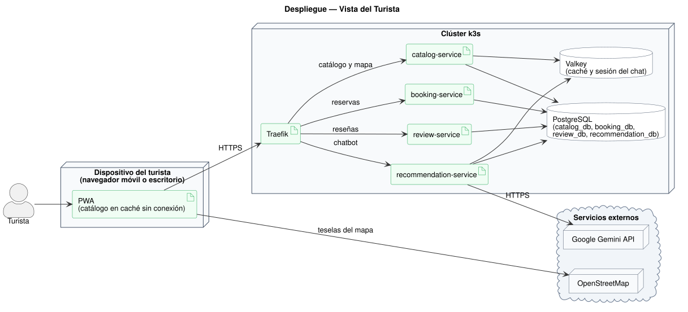

##### Vista del Prestador de Servicios Turísticos

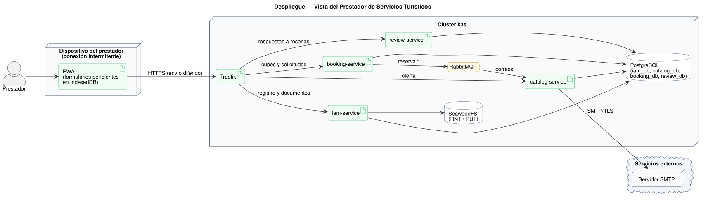

##### Vista de la Entidad de Gestión del Destino

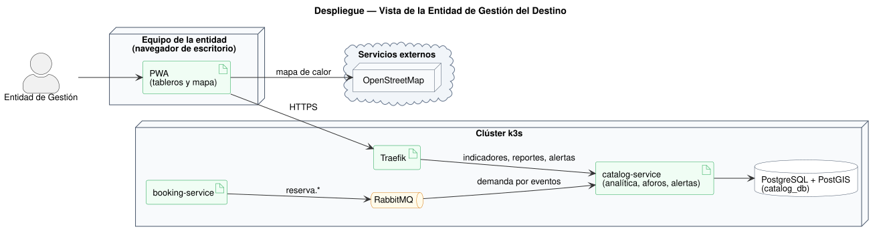

##### Vista del Administrador de la Plataforma

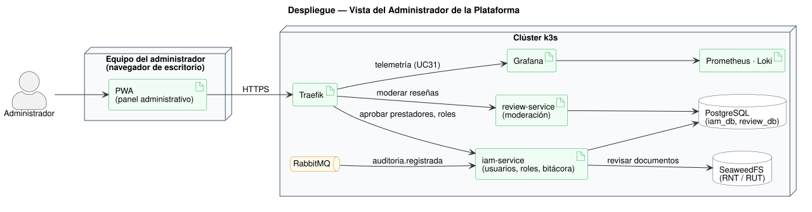

---

#### 3.6.6 Estrategia de Operación con Conectividad Limitada

Para incluir a prestadores y turistas con conexión intermitente (problemática 3, restricción social 2.4.3), la interfaz se entrega como **PWA** (ver ADR-004):

* **Catálogo sin conexión:** El Service Worker guarda la aplicación (*cache first*) y las respuestas del catálogo (*stale-while-revalidate*); sin conexión se muestran los datos ya consultados con la fecha de la última actualización. Del mapa solo se conservan las teselas ya visualizadas, conforme a la política de uso de OpenStreetMap.
* **Formularios diferidos:** Los formularios de UC4, UC15, UC17, UC18 y UC19 se guardan en IndexedDB con el estado "Pendiente de envío" y se envían al recuperar la conexión. Cada envío lleva una clave de idempotencia (`Idempotency-Key`) para que el servidor no lo procese dos veces, y las ediciones llevan la versión del registro para detectar conflictos (respuesta HTTP 409 que el usuario resuelve).
* **Operaciones que requieren conexión:** Solicitar (UC11) y confirmar o rechazar reservas (UC20), porque dependen de la disponibilidad en tiempo real; la interfaz las deshabilita sin conexión y lo explica.
* **Sesión y privacidad:** Si el token expiró durante la desconexión, la PWA pide iniciar sesión antes de enviar los pendientes. Los datos guardados en el dispositivo se borran al cerrar sesión.

---

### 3.7 Modelo de datos preliminar

A continuación se presenta el modelo conceptual de entidades del dominio. El comentario de cada clave primaria indica el módulo y la base de datos que son dueños de la entidad.

> [!NOTE]
> **Referencias entre servicios:** Las relaciones entre entidades de módulos distintos son conceptuales. Por el principio *Database-per-Service*, físicamente se implementan como **referencias lógicas** (identificadores sin llave foránea), marcadas como `REF a ...`; solo las relaciones dentro de una misma base usan llaves foráneas (`FK`). La consistencia entre servicios se mantiene mediante eventos (Sección 3.6.2).


<b>Ver especificación de código Mermaid del modelo conceptual de entidades</b>

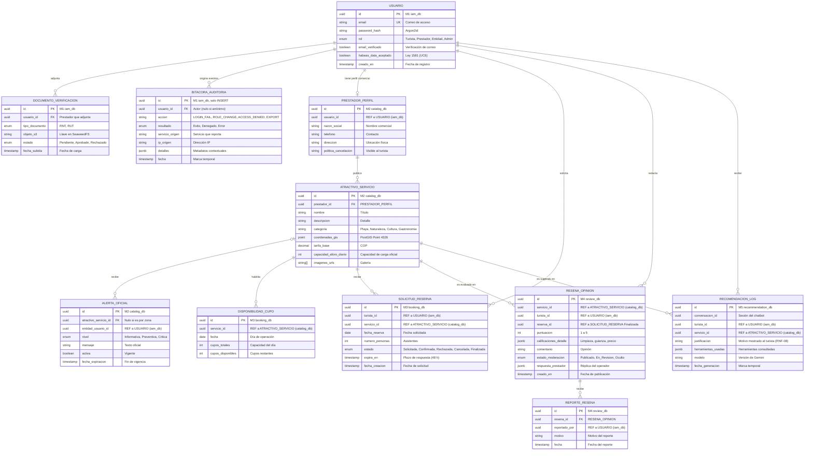

---

## 4. Verificación

### 4.1 Criterios de verificación por requerimiento

Conforme a las directrices de verificación del estándar ISO/IEC/IEEE 29148:2018, cada requerimiento funcional y no funcional cuenta con un método formal de calificación y un criterio cuantitativo de aceptación asociado:

| ID Requerimiento | Tipo | Método de Verificación | Criterio Formal de Aceptación / Aprobación |
|---|---|---|---|
| **RF-01** | Funcional | **Demostración** | Renderizado del catálogo completo de atractivos y servicios con datos maestros y filtros básicos sin requerir sesión iniciada. |
| **RF-02** | Funcional | **Prueba** | Ejecución de búsquedas combinadas multicriterio (geografía + precio + categoría) devolviendo resultados correctos con latencia $< 1.5$ s. |
| **RF-03** | Funcional | **Demostración** | Actualización atómica en el calendario de cupos reflejando inmediatamente la reserva o modificación de disponibilidad. |
| **RF-04** | Funcional | **Prueba** | Creación exitosa de la entidad `SOLICITUD_RESERVA` en estado `Solicitada`, visible simultáneamente en el panel del turista y en el del prestador; las transiciones no permitidas por la máquina de estados se rechazan con HTTP 409. |
| **RF-05** | Funcional | **Demostración** | Formulario de prestador verificado que persiste y actualiza registros en `ATRACTIVO_SERVICIO` e impacta de inmediato el catálogo público. |
| **RF-06** | Funcional | **Prueba / Análisis** | Ante consultas de prueba del turista, el chatbot responde con recomendaciones construidas a partir de datos obtenidos mediante las herramientas de la plataforma, acompañadas de una justificación comprensible (RNF-08) registrada en `RECOMENDACION_LOG`; solo se presentan servicios obtenidos mediante las herramientas y, cuando la información no está disponible, se informa al usuario sin inventar atractivos, servicios, precios ni disponibilidad. |
| **RF-07** | Funcional | **Demostración** | Renderizado visual de tableros institucionales con agregaciones de demanda por sector y mapas de calor estimativos de capacidad de carga. |
| **RF-08** | Funcional | **Inspección / Demostración** | Flujo de incorporación y publicación de oferta para prestadores comunitarios completable en un máximo de 3 pasos interactivos sin fallos. |
| **RF-09** | Funcional | **Prueba** | Invocación no autenticada o con rol insuficiente a endpoints restringidos retorna HTTP 401 o 403 y genera un registro en `BITACORA_AUDITORIA`. |
| **RF-10** | Funcional | **Demostración** | Conmutación entre Español e Inglés traduce el 100% de las cadenas estáticas de navegación y etiquetas de interfaz en menos de 100 ms. |
| **RF-11** | Funcional | **Prueba** | Despacho asíncrono y entrega efectiva de correo MIME multipart tras la confirmación de reserva (UC20) en un tiempo $\le 10$ segundos. |
| **RF-12** | Funcional | **Demostración** | Carga de archivos PDF/imagen (RNT y RUT) en almacenamiento seguro y transición de estado en panel administrativo de validación. |
| **RF-13** | Funcional | **Prueba** | Generación y descarga íntegra de archivos estructurados en formato CSV y PDF con métricas analíticas del destino sin errores de serialización. |
| **RF-14** | Funcional | **Prueba** | Un turista sin reserva `Finalizada` del servicio recibe HTTP 403 al intentar reseñarlo; con reserva finalizada la reseña queda `Publicado`; una reseña reportada (UC39) pasa a `En_Revision` y solo el Administrador la publica u oculta. |
| **RNF-01** a **RNF-13** | No Funcional | **Prueba / Análisis** | Verificación empírica contra los escenarios formales de calidad (ESC-01 a ESC-09), pruebas de carga con k6 ($p95 < 2.0$s), auditorías WCAG 2.1 AA, despliegue reproducible en k3s y pruebas de la PWA en modo sin conexión. |

---

## 5. Apéndices

### Apéndice A. Matriz de trazabilidad global

La trazabilidad integral de la plataforma vincula cada necesidad de los interesados con su materialización técnica en casos de uso, requerimientos, módulos de software y pruebas de calidad:

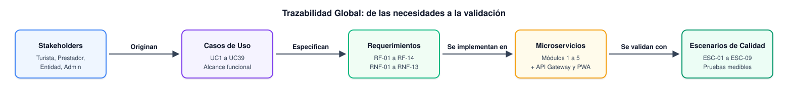

<b>Ver especificación de código Mermaid de trazabilidad</b>

```mermaid
flowchart LR
    classDef stStyle fill:#eff6ff,stroke:#3b82f6,stroke-width:2px,color:#1e40af,font-weight:bold,rx:8px,ry:8px;
    classDef ucStyle fill:#f5f3ff,stroke:#8b5cf6,stroke-width:2px,color:#5b21b6,font-weight:bold,rx:8px,ry:8px;
    classDef reqStyle fill:#f0fdf4,stroke:#10b981,stroke-width:2px,color:#065f46,font-weight:bold,rx:8px,ry:8px;
    classDef modStyle fill:#fffbeb,stroke:#f59e0b,stroke-width:2px,color:#92400e,font-weight:bold,rx:8px,ry:8px;
    classDef escStyle fill:#ecfdf5,stroke:#059669,stroke-width:2px,color:#064e3b,font-weight:bold,rx:8px,ry:8px;

    ST["Stakeholders<br><i>(Turista, Prestador, Entidad, Admin)</i>"]:::stStyle
    UC["Casos de Uso<br><i>(UC1 - UC39)</i>"]:::ucStyle
    RF["Requerimientos<br><i>(RF-01 a 14 / RNF-01 a 13)</i>"]:::reqStyle
    MOD["Microservicios<br><i>(Módulos 1 a 5 + Gateway)</i>"]:::modStyle
    ESC["Escenarios de Calidad<br><i>(ESC-01 a ESC-09)</i>"]:::escStyle

    ST ==>|Originan| UC
    UC ==>|Especifican| RF
    RF ==>|Se implementan en| MOD
    MOD ==>|Se validan con| ESC
```

| Módulo Arquitectónico | Casos de Uso Asignados | Requerimientos Funcionales | Requerimientos No Funcionales | Escenarios de Verificación |
|---|---|---|---|---|
| **Módulo 1: Seguridad & IAM** | UC1, UC2, UC3, UC4, UC6, UC27, UC28, UC32, UC33, UC37 | RF-08, RF-09, RF-12 | RNF-04, RNF-10 | ESC-04 |
| **Módulo 2: Catálogo, GIS & Destino** | UC7, UC8, UC9, UC16, UC17, UC18, UC22, UC23, UC24, UC25, UC26, UC36, UC38 | RF-01, RF-02, RF-05, RF-07, RF-08, RF-11, RF-13 | RNF-01, RNF-02, RNF-03, RNF-06, RNF-13 | ESC-02, ESC-03, ESC-08, ESC-09 |
| **Módulo 3: Reservas & Cupos** | UC10, UC11, UC12, UC13, UC19, UC20 | RF-03, RF-04, RF-05 | RNF-02, RNF-06, RNF-09, RNF-11, RNF-13 | ESC-02, ESC-06, ESC-07, ESC-08, ESC-09 |
| **Módulo 4: Reseñas & Moderación** | UC15, UC21, UC29, UC39 | RF-14 | RNF-01, RNF-10 | ESC-01 |
| **Módulo 5: IA & Recomendación** | UC14 | RF-06 | RNF-05, RNF-08, RNF-12 | ESC-05 |
| **Transversal: Frontend PWA, API Gateway, Observabilidad y Plataforma k3s** | UC5, UC30, UC31 | RF-10 | RNF-01, RNF-02, RNF-06, RNF-07, RNF-12, RNF-13 | ESC-01, ESC-02, ESC-04, ESC-07, ESC-08, ESC-09 |

---

### Apéndice B. Matriz de riesgos del proyecto

| ID | Categoría | Descripción del Riesgo | Impacto | Probabilidad | Estrategia de Mitigación Propuesta |
|---|---|---|---|---|---|
| **R-01** | **Técnico** | Curva de aprendizaje del equipo en orquestación de microservicios, Kubernetes y colas asíncronas. | Alto | Media | Un solo lenguaje y framework para los 5 servicios (Python + FastAPI); plantilla base común en `templates/`; práctica en un clúster local (k3d) y en Docker Compose antes del despliegue en k3s. |
| **R-02** | **Seguridad** | Exposición de endpoints o fuga de datos sensibles de prestadores y turistas. | Crítico | Baja | Aplicación de arquitectura Zero-Trust interna (políticas de red de Kubernetes), validación perimetral de JWT en el API Gateway, cifrado Argon2id y auditorías automatizadas de código. |
| **R-03** | **Alcance** | Desviación del alcance por complejización innecesaria del módulo de Inteligencia Artificial. | Alto | Media | Congelamiento estricto del alcance en RF-06 (chatbot de recomendaciones que consume la API de Gemini y consulta la plataforma mediante herramientas), descartando el entrenamiento de modelos propios, los datasets sintéticos de entrenamiento y la visión artificial. |
| **R-04** | **Técnico (dependencia externa)** | Dependencia de la API de Gemini: disponibilidad del proveedor, límites de solicitudes, costos de consumo y latencia de las consultas. | Medio | Media | Mantener el chatbot desacoplado del núcleo transaccional para que su indisponibilidad no afecte catálogo ni reservas; manejo de errores con mensajes claros al usuario; seguimiento del consumo frente a los límites de uso del proveedor. |
| **R-05** | **Gestión** | Disponibilidad heterogénea de tiempo entre integrantes del equipo durante el semestre. | Alto | Media | Sprints cortos de 2 semanas con entregables modulares e independientes asignados por componente (Apéndice C), visibilizados en GitHub Projects. |
| **R-06** | **Técnico** | Pérdida, duplicación o conflicto de formularios enviados sin conexión desde la PWA. | Medio | Media | Clave de idempotencia por envío, versión del registro en las ediciones (HTTP 409 ante conflicto), estado "Pendiente de envío" visible y prueba dedicada (ESC-09). |
| **R-07** | **Técnico (capacidad)** | La capacidad fija de los nodos del clúster limita el escalado horizontal en picos. | Medio | Media | Dimensionar los nodos con holgura para el pico de ESC-08, fijar máximos en el HPA, priorizar Módulos 2 y 3 y ejecutar la prueba de carga antes de la temporada alta. |

---

### Apéndice C. Equipo de trabajo y asignación de roles

Distribución de responsabilidades acordada por el equipo. La columna de componentes indica las carpetas del monorepo de las que cada integrante es responsable y revisor (archivo `CODEOWNERS`):

| # | Integrante | Responsabilidad técnica | Componentes a cargo (monorepo) | Rol en el proyecto |
|---|---|---|---|---|
| 1 | **Juan Francisco Gonzalez Pacheco** | Frontend y API Gateway | `frontend/` (PWA), `gateway/`, `infra/observabilidad/` | Responsable de validación y calidad |
| 2 | **Valentina Sarait Nieves Hernandez** | Seguridad | `services/iam-service/` (Módulo 1) | Analista de requisitos |
| 3 | **Andres Felipe Gamero Sanchez** | Reservas | `services/booking-service/` (Módulo 3) | Diseñador de datos |
| 4 | **Alvaro David Ospino Sanchez** | Inteligencia artificial | `services/recommendation-service/` (Módulo 5), `templates/` | Desarrollador principal |
| 5 | **Luis Fernando Barraza Sanchez** | Datos | `services/catalog-service/` (Módulo 2), `services/review-service/` (Módulo 4), `contracts/`, `infra/` | Arquitecto |

> [!NOTE]
> La responsabilidad del Módulo 4 (Reseñas) no estaba asignada explícitamente; se ubica en el área de Datos y se confirmará en la próxima revisión de sprint.

---

### Apéndice D. Plan de proyecto, cronograma y presupuesto

Resumen de la planificación del proyecto, con su proceso, cronograma y presupuesto.

#### D.1 Proceso de desarrollo

Se adopta **Scrum adaptado** al contexto académico, con **6 sprints de 2 semanas** seguidos de la sustentación, y tablero Kanban en GitHub Projects. Se seleccionó frente a Cascada, RUP y Kanban porque permite alinear cada fase del cronograma con revisiones de sprint, detectar problemas de integración de microservicios de forma temprana (R-01) y organizar el trabajo en paralelo por módulo (R-05). La justificación completa está en el [Registro de Decisiones Arquitectónicas](./Registro_Decisiones_Arquitectonicas.md) (ADR-001).

#### D.2 Cronograma (13 semanas)

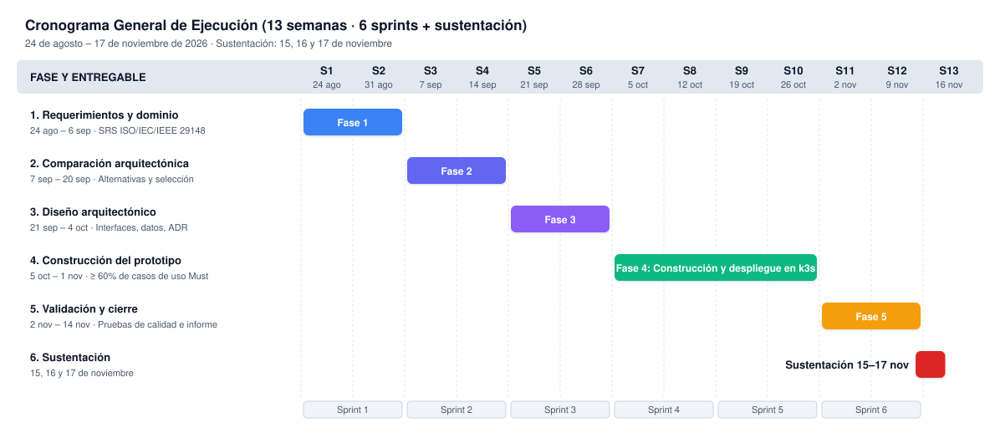

| Fase | Entregables Principales | Semanas | Fechas |
|---|---|---|---|
| **Fase 1: Requerimientos y Dominio** | Especificación de Requerimientos (SRS ISO/IEC/IEEE 29148). | Semanas 1–2 | 24 ago – 6 sep |
| **Fase 2: Comparación Arquitectónica** | [Comparación y Selección de Alternativas Arquitectónicas](./Comparacion_Alternativas_Arquitectonicas.md). | Semanas 3–4 | 7 sep – 20 sep |
| **Fase 3: Diseño Arquitectónico** | Especificación de interfaces, modelo de datos, diagramas de paquetes y despliegue, y [Registro de Decisiones Arquitectónicas](./Registro_Decisiones_Arquitectonicas.md). | Semanas 5–6 | 21 sep – 4 oct |
| **Fase 4: Construcción del Prototipo** | 5 microservicios en Python + FastAPI desplegados en k3s, API Gateway Traefik, RabbitMQ, PostgreSQL, Valkey y PWA (meta: $\ge 60\%$ de casos de uso *Must*). | Semanas 7–10 | 5 oct – 1 nov |
| **Fase 5: Validación y Cierre** | Pruebas de carga (ESC-02, ESC-08), prueba sin conexión (ESC-09), verificación de calidad e informe final. | Semanas 11–12 | 2 nov – 14 nov |
| **Sustentación** | Presentación y defensa del proyecto. | Semanas 12–13 | 15, 16 y 17 nov |

#### D.3 Presupuesto

Techo presupuestal: **USD 20.000**. Se plantean dos escenarios: el **Escenario A** financia el prototipo académico durante las 13 semanas del proyecto y el **Escenario B** el piloto institucional durante 12 meses.

| Rubro | Escenario A: Prototipo Académico (USD) | Escenario B: Piloto Institucional 12 meses (USD) |
|---|---:|---:|
| Infraestructura cloud | 4.500 | 7.200 |
| Servicios de terceros y notificaciones | 1.200 | — |
| Herramientas de desarrollo y colaboración | 300 | — |
| Ciberseguridad, pentesting y cumplimiento Ley 1581 | — | 3.200 |
| Levantamiento de datos, fotografía y cartografía SIG | — | 3.600 |
| Alfabetización digital e inclusión de MiPyMEs | — | 3.200 |
| Observabilidad, dominios y certificados | — | 1.200 |
| Contingencia | 900 (15%) | 1.600 (8%) |
| **Total** | **6.900** | **20.000** |

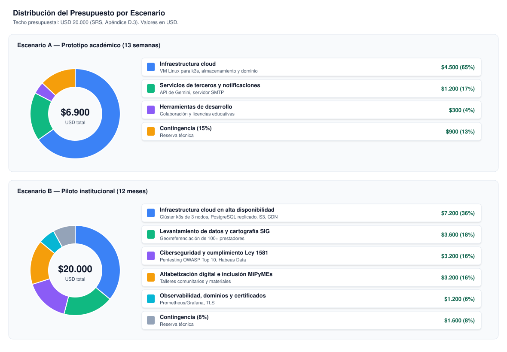
